# Senior Node.js Engineer Interview Guide (7+ Years)
### Top 25 Most Frequently Asked Topics — FAANG, Product Companies & High-Growth Startups

> **How to use this guide:** Each topic follows a 13-part structure — question, concise answer, deep technical explanation, production examples, architecture diagrams, code, follow-ups, edge cases, performance/scalability, best practices, trade-offs, interview tips, and a summary. Read top to bottom for depth, or skim the "Concise Answer" + "Summary" boxes for quick revision.

---

## 📑 Table of Contents

| # | Topic |
|---|-------|
| 1 | Event Loop & Concurrency Model |
| 2 | Streams (Readable/Writable/Transform/Duplex) |
| 3 | Cluster Module & Multi-Core Scaling |
| 4 | Worker Threads vs Child Processes |
| 5 | Memory Management & Garbage Collection |
| 6 | Backpressure Handling |
| 7 | Error Handling Strategies |
| 8 | Microservices Communication (REST vs gRPC vs MQ) |
| 9 | Caching Strategies |
| 10 | Database Connection Pooling |
| 11 | Authentication & Authorization (JWT/OAuth2/Sessions) |
| 12 | Rate Limiting & Throttling |
| 13 | RESTful API Design & Versioning |
| 14 | GraphQL vs REST |
| 15 | Message Queues (Kafka/RabbitMQ/SQS) |
| 16 | Node.js Security Best Practices (OWASP) |
| 17 | Logging, Monitoring & Observability |
| 18 | Testing Strategies (Unit/Integration/E2E) |
| 19 | CI/CD Pipelines for Node.js |
| 20 | Containerization & Orchestration (Docker/K8s) |
| 21 | Scaling Node.js Applications |
| 22 | Database Design & ORM vs Query Builder |
| 23 | File Uploads & Large Payload Handling |
| 24 | WebSockets & Real-Time Communication |
| 25 | Design Patterns in Node.js |

---

## 1. Event Loop & Concurrency Model

### 1.1 Interview Question
> "Explain the Node.js event loop in depth. How does Node achieve non-blocking I/O with a single thread?"

### 1.2 Concise Answer
> 💡 **TL;DR:** Node.js runs JavaScript on a single main thread, but delegates I/O, timers, and some crypto/zlib work to **libuv**, which uses an OS-level event notification mechanism (epoll/kqueue/IOCP) and a thread pool. The event loop repeatedly cycles through six phases, pulling completed callbacks off queues and executing them on the main thread — giving the *illusion* of concurrency without multi-threading application code.

### 1.3 Deep Technical Explanation
The event loop has six phases per tick, run by **libuv**:

1. **Timers** — executes `setTimeout`/`setInterval` callbacks whose threshold has elapsed.
2. **Pending callbacks** — executes I/O callbacks deferred from the previous cycle (e.g., some TCP errors).
3. **Idle, prepare** — internal use only.
4. **Poll** — retrieves new I/O events; executes I/O-related callbacks. Node will block here if nothing else is scheduled.
5. **Check** — executes `setImmediate` callbacks.
6. **Close callbacks** — e.g., `socket.on('close', ...)`.

Between **every** phase transition (and between each callback), Node drains two microtask queues **fully**:
- `process.nextTick()` queue (highest priority, Node-specific)
- Promise microtask queue (`.then`/`async-await` continuations)

This is why `process.nextTick` can starve I/O if called recursively — it always runs before the event loop is allowed to proceed.

CPU-bound JS on the main thread blocks the loop entirely — no I/O, no timers, no other requests get serviced until it returns.

### 1.4 Real-World Production Examples
- **Netflix** relies on the event loop's non-blocking I/O to serve high-throughput API gateways (falcor/BFF layers) with a small number of Node processes rather than thousands of OS threads.
- **PayPal** rewrote a Java page-rendering service in Node and reported significant latency and throughput improvements for I/O-heavy, low-CPU workloads.
- A common **production incident pattern**: a synchronous `JSON.parse` or regex on a large payload (a "ReDoS"-prone regex) blocks the loop for hundreds of ms, causing cascading latency spikes across all concurrent requests on that process.

### 1.5 Architecture Diagram


### 1.6 Optimized Code Snippet
```javascript
// Demonstrates ordering: nextTick > Promise > setTimeout > setImmediate
console.log('start');

setTimeout(() => console.log('timeout'), 0);
setImmediate(() => console.log('immediate'));

Promise.resolve().then(() => console.log('promise'));
process.nextTick(() => console.log('nextTick'));

console.log('end');

// Output: start, end, nextTick, promise, timeout, immediate
// (timeout vs immediate order is non-deterministic outside I/O cycles,
// but immediate always fires before timeout INSIDE an I/O callback)
```

```javascript
// Offloading CPU-bound work off the main thread to avoid blocking the loop
const { Worker } = require('worker_threads');

function runHeavyTask(data) {
  return new Promise((resolve, reject) => {
    const worker = new Worker('./heavy-task.js', { workerData: data });
    worker.once('message', resolve);
    worker.once('error', reject);
  });
}
```

### 1.7 Common Follow-Up Questions
- What's the difference between `process.nextTick()` and `setImmediate()`?
- Why can `process.nextTick` cause I/O starvation?
- How does libuv's thread pool size (`UV_THREADPOOL_SIZE`) affect `fs`/`dns`/`crypto` operations?
- How would you detect and profile event loop lag in production?

### 1.8 Edge Cases & Pitfalls
- Recursive `process.nextTick()` calls starve the event loop indefinitely ("nextTick starvation").
- Synchronous file system calls (`fs.readFileSync`) in a hot request path block all concurrent requests.
- Large `JSON.stringify`/`parse` or unbounded regex (catastrophic backtracking) causing multi-second stalls.
- Default `UV_THREADPOOL_SIZE` is 4 — DNS lookups, some crypto, and file I/O can bottleneck under load.

### 1.9 Performance & Scalability Considerations
- Monitor **event loop lag** (e.g., via `perf_hooks.monitorEventLoopDelay()` or the `event-loop-lag` npm pattern) as a first-class SLO metric.
- Use clustering or worker threads to utilize multiple cores since one process = one main thread.
- Increase `UV_THREADPOOL_SIZE` for I/O-heavy workloads bound by libuv's pool.

### 1.10 Best Practices
- Never perform CPU-heavy synchronous work in request handlers; delegate to worker threads or separate services.
- Use asynchronous APIs (`fs.promises`, streaming parsers) over synchronous variants in server code.
- Instrument event loop delay and alert on p95/p99 thresholds.

### 1.11 Trade-offs
| Approach | Pros | Cons |
|---|---|---|
| Single-threaded event loop | Simple concurrency model, no locks/race conditions in JS | CPU-bound work blocks everything |
| Worker threads for CPU work | True parallelism, shared memory possible | Serialization overhead, added complexity |
| Clustering | Uses all cores, isolates crashes per worker | No shared memory, higher per-process overhead |

### 1.12 Interview Tips
> 🎯 Draw the six phases from memory and explicitly call out **where microtasks drain** — this is the detail that separates mid-level from senior answers. Bring up a real production event-loop-blocking incident if you have one; interviewers at FAANG-level companies weight practical debugging experience heavily.

### 1.13 Summary
> ✅ Node's single-threaded event loop achieves concurrency via libuv delegating I/O to the OS/thread pool, cycling through six phases, and fully draining `nextTick`/Promise microtask queues between phases. The senior-level insight is recognizing when the model breaks down — CPU-bound synchronous work — and knowing the tools (worker threads, clustering, monitoring) to mitigate it.

---
## 2. Streams (Readable / Writable / Transform / Duplex)

### 2.1 Interview Question
> "How do Node.js streams work internally, and why would you use them over loading data fully into memory?"

### 2.2 Concise Answer
> 💡 Streams process data in **chunks** rather than loading entire payloads into memory, enabling constant memory usage for arbitrarily large data (files, HTTP bodies, sockets). Node has four stream types: **Readable**, **Writable**, **Duplex** (both), and **Transform** (Duplex that modifies data in-flight).

### 2.3 Deep Technical Explanation
Streams are built on `EventEmitter` and implement flow control via **internal buffers** with a `highWaterMark`. Readable streams operate in two modes:
- **Paused mode** (default): consumer calls `.read()` explicitly.
- **Flowing mode**: data is pushed via `'data'` events as soon as available.

`stream.pipe()` connects a Readable to a Writable and automatically manages backpressure (see Topic 6) by pausing the source when the destination's internal buffer is full, and resuming once drained. `pipeline()` (from `stream/promises`) is the modern, production-recommended replacement for `.pipe()` because it properly propagates errors and cleans up resources on failure — `.pipe()` alone does not destroy all streams on error, causing memory/fd leaks.

### 2.4 Real-World Production Examples
- **Video streaming platforms** use Readable streams over Range-request-based HTTP handlers to serve partial content without buffering entire video files.
- **AWS S3 SDK's** `GetObject` and **Node's** `http` request/response objects are streams — enabling reverse proxies to stream large payloads through without buffering.
- **CSV/log ingestion pipelines** commonly chain `fs.createReadStream → parse Transform → transform/enrich Transform → Writable (DB batch insert)` to process multi-GB files with flat memory usage.

### 2.5 Architecture Diagram


### 2.6 Optimized Code Snippet
```javascript
const { pipeline } = require('stream/promises');
const fs = require('fs');
const zlib = require('zlib');

async function compressLargeFile(input, output) {
  await pipeline(
    fs.createReadStream(input),
    zlib.createGzip(),
    fs.createWriteStream(output)
  );
  // pipeline() auto-destroys all streams and propagates errors correctly
}

// Custom Transform stream example
const { Transform } = require('stream');

class RedactPII extends Transform {
  _transform(chunk, encoding, callback) {
    const redacted = chunk.toString().replace(/\d{3}-\d{2}-\d{4}/g, '[REDACTED-SSN]');
    callback(null, redacted);
  }
}
```

### 2.7 Common Follow-Up Questions
- Difference between `.pipe()` and `pipeline()`? Why does `pipeline()` matter for production?
- How does `highWaterMark` affect memory usage and throughput?
- How would you implement backpressure in a custom Transform stream?
- Object mode streams — when and why?

### 2.8 Edge Cases & Pitfalls
- Forgetting error handlers on each stream in a manual `.pipe()` chain leaves dangling file descriptors on failure.
- Mixing `'data'` event listeners with `.read()` calls causes data loss (mode confusion).
- Not respecting the boolean return of `.write()` leads to unbounded memory growth (ignoring backpressure).

### 2.9 Performance & Scalability Considerations
- Tune `highWaterMark` based on payload size/latency trade-offs (larger = higher throughput, more memory per stream).
- Use object-mode streams sparingly — they lose the byte-level backpressure semantics.
- For very high-throughput pipelines, consider parallelizing with worker threads per shard rather than a single stream chain.

### 2.10 Best Practices
- Always prefer `pipeline()`/`finished()` over raw `.pipe()` in production code.
- Handle `'error'` events on every stream in a chain.
- Use streaming JSON parsers (e.g., `stream-json`) for huge JSON payloads instead of `JSON.parse`.

### 2.11 Trade-offs
| Approach | Pros | Cons |
|---|---|---|
| Buffer entire payload in memory | Simple code | OOM risk on large inputs |
| Streams | Constant memory, composable | More complex error handling, harder to debug |

### 2.12 Interview Tips
> 🎯 Mention `pipeline()` unprompted — many candidates only know `.pipe()`, and knowing the error-handling gap signals production battle scars.

### 2.13 Summary
> ✅ Streams enable constant-memory processing of large or infinite data via chunked I/O and automatic backpressure. Senior engineers should know `pipeline()` over `.pipe()`, the four stream types, and how to build custom Transform streams for real pipelines.

---

## 3. Cluster Module & Multi-Core Scaling

### 3.1 Interview Question
> "Node.js is single-threaded — how do you utilize all CPU cores on a server?"

### 3.2 Concise Answer
> 💡 The built-in `cluster` module forks multiple worker **processes** (not threads) that share the same server port via the OS/master process, each running its own event loop and V8 instance. This achieves horizontal scaling within a single machine.

### 3.3 Deep Technical Explanation
`cluster.fork()` spawns child processes via `child_process.fork()` under the hood. The master process listens on the port and distributes incoming connections to workers using one of two strategies:
- **Round-robin** (default on Linux/macOS, `SCHED_RR`): master accepts and hands off connections to workers in rotation.
- **None** (`SCHED_NONE`, default on Windows): the OS kernel itself distributes connections, and workers compete via `accept()`.

Workers are fully isolated processes — no shared memory, no shared V8 heap. Communication happens via IPC (`process.send()`/`.on('message')`) or external shared state (Redis, DB). Crashed workers can be automatically respawned by listening to the `'exit'` event on the master, providing resilience.

### 3.4 Real-World Production Examples
- **PM2** (process manager) wraps `cluster` to provide zero-downtime reloads, auto-restart on crash, and load-balanced multi-core deployment — widely used at startups and mid-size companies.
- **Kubernetes-based deployments** often prefer **one Node process per pod + horizontal pod autoscaling** over in-process clustering, since K8s already handles process-level scaling/restarts — using `cluster` inside a container can complicate health checks and resource limits.

### 3.5 Architecture Diagram
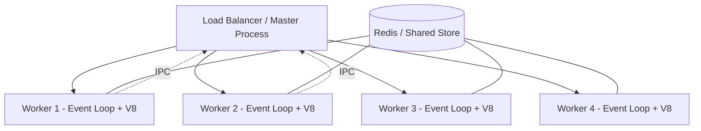

### 3.6 Optimized Code Snippet
```javascript
const cluster = require('cluster');
const os = require('os');
const http = require('http');

if (cluster.isPrimary) {
  const numCPUs = os.cpus().length;
  for (let i = 0; i < numCPUs; i++) cluster.fork();

  cluster.on('exit', (worker, code, signal) => {
    console.error(`Worker ${worker.process.pid} died. Restarting...`);
    cluster.fork(); // resilience: auto-respawn
  });
} else {
  http.createServer((req, res) => {
    res.writeHead(200);
    res.end(`Handled by worker ${process.pid}`);
  }).listen(3000);
}
```

### 3.7 Common Follow-Up Questions
- How does `cluster` differ from running multiple containers/pods behind a load balancer?
- How do you share state (e.g., in-memory cache) across cluster workers?
- What happens to in-flight requests during a graceful worker restart?
- Round-robin vs OS scheduling — when does each apply?

### 3.8 Edge Cases & Pitfalls
- In-memory caches/session stores are **per-worker**, not shared — causing inconsistent behavior (e.g., sticky-session-dependent auth) unless externalized to Redis.
- WebSocket connections need **sticky sessions** at the load balancer level, or a pub/sub backplane (e.g., Redis adapter for `socket.io`) since a client's reconnect may hit a different worker.
- Blindly forking `os.cpus().length` workers in a containerized environment may over-provision if the container's CPU quota is less than the host's core count.

### 3.9 Performance & Scalability Considerations
- In Kubernetes, prefer **one process per pod + HPA** over in-process clustering for simpler health checks, observability, and resource isolation; use `cluster` primarily for bare-metal/VM deployments.
- Graceful shutdown: listen for `SIGTERM`, stop accepting new connections, drain in-flight requests, then exit.

### 3.10 Best Practices
- Use PM2 or a process supervisor for auto-restart, log aggregation, and zero-downtime reload in non-K8s environments.
- Externalize all shared state (sessions, cache, rate-limit counters) to Redis/Memcached.
- Implement graceful shutdown handlers for `SIGTERM`/`SIGINT`.

### 3.11 Trade-offs
| Approach | Pros | Cons |
|---|---|---|
| `cluster` module | Simple, no extra infra | No shared memory, manual orchestration |
| K8s horizontal pod scaling | Declarative, integrates with autoscaling/health checks | Requires container orchestration knowledge/infra |

### 3.12 Interview Tips
> 🎯 Be ready to discuss **why** you'd choose K8s-level scaling over `cluster` in modern architectures — this shows platform maturity beyond textbook knowledge.

### 3.13 Summary
> ✅ `cluster` forks OS processes to use multiple cores, distributing connections round-robin with no shared memory. Production systems often prefer container-orchestration-level scaling, but understanding `cluster` internals remains a core scaling fundamental interviewers expect at senior level.

---

## 4. Worker Threads vs Child Processes

### 4.1 Interview Question
> "When would you use `worker_threads` instead of `child_process`, and how do they differ from `cluster`?"

### 4.2 Concise Answer
> 💡 **Worker threads** run in the same process with isolated V8 instances but can share memory via `SharedArrayBuffer`, ideal for CPU-bound tasks. **Child processes** are fully separate OS processes (different memory, possibly different executables), better for isolating untrusted code or running non-Node programs.

### 4.3 Deep Technical Explanation
- `worker_threads`: each worker has its own event loop, V8 isolate, and Node.js instance, but they live inside the same OS process, so spawn cost is lower than `child_process`. Data is passed via structured clone (`postMessage`) by default, or **zero-copy** via `SharedArrayBuffer`/`ArrayBuffer` transfer list.
- `child_process` (`fork`, `spawn`, `exec`): spawns a fully independent OS process with its own memory space; communication is strictly via IPC/stdio serialization (no shared memory). Useful for running non-JS binaries, isolating crashes completely, or running untrusted code with OS-level sandboxing.
- `cluster` is built on top of `child_process.fork()` specifically for the network-server-scaling use case.

### 4.4 Real-World Production Examples
- **Image/video processing services** (e.g., resizing pipelines) use worker threads to run CPU-heavy `sharp`/`ffmpeg`-bound JS logic without blocking the API event loop.
- **Sandboxed code execution platforms** (like coding-judge systems, e.g., similar to HackerRank/LeetCode backends) use `child_process` with resource limits (`ulimit`, cgroups) to execute untrusted user code safely, since a crash or infinite loop in a worker thread would still share the process's fate in some failure modes.
- **ESLint/Webpack/Jest** use worker pools (via `child_process` or `worker_threads`) to parallelize file processing across cores.

### 4.5 Architecture Diagram
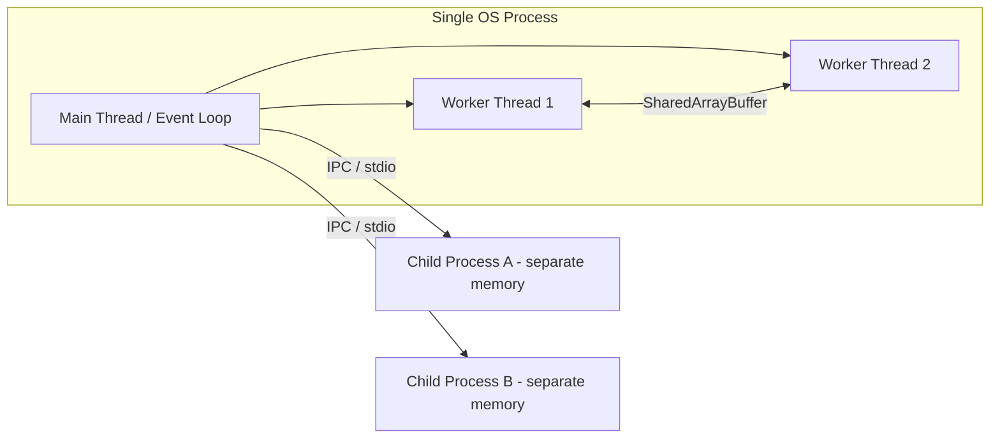

### 4.6 Optimized Code Snippet
```javascript
// worker_threads with a reusable worker pool (simplified)
const { Worker } = require('worker_threads');
const os = require('os');

class WorkerPool {
  constructor(file, size = os.cpus().length) {
    this.queue = [];
    this.workers = Array.from({ length: size }, () => {
      const w = new Worker(file);
      w.available = true;
      return w;
    });
  }

  run(data) {
    return new Promise((resolve, reject) => {
      const worker = this.workers.find(w => w.available);
      if (!worker) return this.queue.push({ data, resolve, reject });
      this._exec(worker, data, resolve, reject);
    });
  }

  _exec(worker, data, resolve, reject) {
    worker.available = false;
    worker.once('message', (result) => {
      worker.available = true;
      resolve(result);
      if (this.queue.length) {
        const next = this.queue.shift();
        this._exec(worker, next.data, next.resolve, next.reject);
      }
    });
    worker.once('error', reject);
    worker.postMessage(data);
  }
}
```

### 4.7 Common Follow-Up Questions
- How does `SharedArrayBuffer` avoid serialization overhead compared to `postMessage`?
- When would you choose `child_process.spawn` over `fork`?
- How do you handle a crashed worker thread gracefully in a pool?
- What are the security implications of running untrusted code in each model?

### 4.8 Edge Cases & Pitfalls
- Overusing worker threads for small tasks introduces overhead (thread spawn/message passing) that can exceed the task's cost.
- `SharedArrayBuffer` requires manual synchronization (`Atomics`) — easy to introduce race conditions.
- Child processes leaking (not killed properly) accumulate as zombie processes under load.

### 4.9 Performance & Scalability Considerations
- Maintain a **worker pool** (reuse threads) rather than spawning per-request — thread creation has non-trivial overhead (~ms scale).
- Benchmark: worker threads are cheaper to spawn than child processes but heavier than async I/O; use only for genuinely CPU-bound work.

### 4.10 Best Practices
- Use libraries like `piscina` for production-grade worker pools instead of hand-rolling.
- Always set timeouts and kill hung workers/child processes.
- Isolate untrusted or unstable third-party code in child processes, not threads.

### 4.11 Trade-offs
| Model | Isolation | Shared Memory | Spawn Cost | Best For |
|---|---|---|---|---|
| Worker Threads | Partial (same process) | Yes (`SharedArrayBuffer`) | Low-Medium | CPU-bound JS tasks |
| Child Process | Full (separate process) | No | Higher | Untrusted code, non-Node binaries |
| Cluster | Full (separate process) | No | Higher | Scaling network servers across cores |

### 4.12 Interview Tips
> 🎯 Interviewers often probe whether you'd default to worker threads for *everything* CPU-heavy — the nuanced answer is "only if the task is substantial enough to amortize spawn/message overhead," which demonstrates practical judgment.

### 4.13 Summary
> ✅ Worker threads share a process and support zero-copy memory sharing, ideal for CPU-bound parallelism; child processes offer full isolation at higher cost, ideal for untrusted code or non-JS workloads. `cluster` is a specialized child-process pattern for network server scaling.

---

## 5. Memory Management & Garbage Collection

### 5.1 Interview Question
> "How does memory management work in Node.js, and how would you debug a memory leak in production?"

### 5.2 Concise Answer
> 💡 Node uses V8's generational garbage collector: a small, fast **Scavenger** for the **Young Generation** (short-lived objects) and a slower **Mark-Sweep-Compact** collector for the **Old Generation** (long-lived objects). Memory leaks typically stem from unintended references (global caches, closures, event listeners) preventing garbage collection.

### 5.3 Deep Technical Explanation
V8's heap is divided into:
- **New Space (Young Generation)**: small, split into two semi-spaces; uses a copying **Scavenge** algorithm — fast because most objects die young.
- **Old Space (Old Generation)**: objects surviving 2+ scavenges are "promoted" here; collected via **Mark-Sweep-Compact**, which is slower and can cause noticeable pauses ("stop-the-world" GC, mitigated by incremental/concurrent marking in modern V8).
- **Large Object Space**: objects too big for normal pages.

Common leak sources: growing arrays/maps used as ad-hoc caches with no eviction, closures unintentionally retaining large scope references, un-removed `EventEmitter` listeners (each `.on()` without `.off()` accumulates), and detached DOM-like references in server contexts (e.g., retained `req`/`res` objects in long-lived closures/timers).

Debugging: `--inspect` + Chrome DevTools heap snapshots, `heapdump`/`clinic.js` for production diagnostics, comparing snapshots over time to find growing retainer paths.

### 5.4 Real-World Production Examples
- **Uber's** engineering blog has documented Node.js memory leak investigations using heap snapshots to trace listener accumulation.
- A very common startup incident: an Express app storing per-request data in a **module-level array** (`const requestLogs = []`) for "debugging," never trimmed — RSS grows until OOM-kill by the container orchestrator.
- **`clinic.js`** (by NearForm) is widely used in production post-mortems to visualize GC pauses and flame graphs correlating with latency spikes.

### 5.5 Architecture Diagram
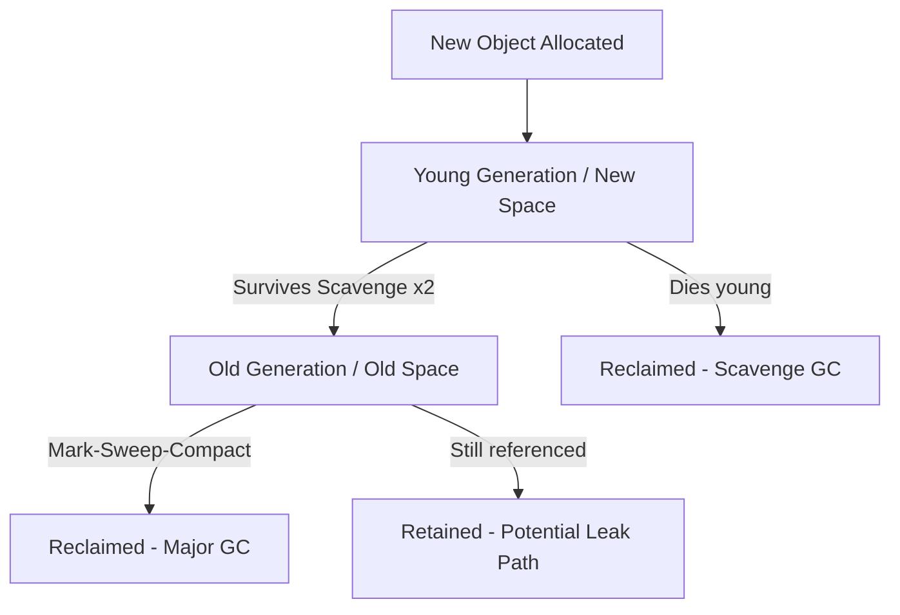

### 5.6 Optimized Code Snippet
```javascript
// Programmatic heap snapshot for production diagnostics
const v8 = require('v8');
const fs = require('fs');

function takeHeapSnapshot() {
  const snapshotStream = v8.getHeapSnapshot();
  const file = fs.createWriteStream(`/tmp/heap-${Date.now()}.heapsnapshot`);
  snapshotStream.pipe(file);
}

// Common leak pattern: unbounded Map used as cache
class LRUCache {
  constructor(maxSize = 1000) {
    this.maxSize = maxSize;
    this.cache = new Map();
  }
  set(key, value) {
    if (this.cache.size >= this.maxSize) {
      this.cache.delete(this.cache.keys().next().value); // evict oldest
    }
    this.cache.set(key, value);
  }
}
```

### 5.7 Common Follow-Up Questions
- Difference between Scavenge GC and Mark-Sweep-Compact?
- How would you diagnose a memory leak with only production metrics (no local repro)?
- What's the impact of closures on garbage collection?
- How does `--max-old-space-size` affect application behavior, and what happens when it's exceeded?

### 5.8 Edge Cases & Pitfalls
- Unbounded in-memory caches/maps growing without eviction policy.
- Forgotten `clearInterval`/`clearTimeout` retaining closures indefinitely.
- Accumulating `EventEmitter` listeners without removal (Node warns at 10+ by default — `MaxListenersExceededWarning`).
- Large Buffers held in closures (e.g., in retry queues) surviving far longer than intended.

### 5.9 Performance & Scalability Considerations
- Monitor RSS, heap used/total, and GC pause duration as core production metrics (via `process.memoryUsage()` + APM).
- Tune `--max-old-space-size` to match container memory limits to avoid OOM-killer vs V8 heap-limit mismatches.
- Prefer streaming over buffering for large payloads to reduce Old Generation pressure.

### 5.10 Best Practices
- Use bounded caches (LRU) with TTL/eviction, never raw unbounded objects/maps for caching.
- Always pair `.on()` with `.off()`/`.removeListener()` in long-lived objects.
- Set up heap snapshot capture on high-memory alerts, not just post-mortem.

### 5.11 Trade-offs
| Approach | Pros | Cons |
|---|---|---|
| In-process caching | Fast, no network hop | Memory pressure, leak risk, not shared across instances |
| External cache (Redis) | Bounded, shared, evictable | Network latency, extra infra |

### 5.12 Interview Tips
> 🎯 Walk through an actual heap-snapshot diffing methodology if you've done it — "I took two snapshots 10 minutes apart under load and diffed retained size by constructor" is a strong senior-level signal.

### 5.13 Summary
> ✅ V8's generational GC handles most memory efficiently, but leaks arise from unintended long-lived references — unbounded caches, listeners, and closures. Senior engineers should be fluent in heap snapshot analysis and defensive patterns like bounded caches and listener cleanup.

---
## 6. Backpressure Handling

### 6.1 Interview Question
> "What is backpressure in Node.js streams, and how do you handle it correctly?"

### 6.2 Concise Answer
> 💡 Backpressure occurs when a Readable source produces data **faster** than a Writable destination can consume it. Unhandled, this causes unbounded memory growth as data buffers up. Node signals backpressure via the boolean return value of `writable.write()` and the `'drain'` event.

### 6.3 Deep Technical Explanation
Every Writable stream has an internal buffer bounded by `highWaterMark`. When `.write(chunk)` is called:
- If the internal buffer is below `highWaterMark`, it returns `true` — safe to keep writing.
- If it returns `false`, the buffer is full; the producer **must** pause writing until a `'drain'` event fires, indicating the buffer has been flushed below the threshold.

`.pipe()` and `pipeline()` handle this automatically by pausing/resuming the source Readable. Manual implementations that ignore the `false` return value defeat the purpose of streams entirely — effectively re-introducing unbounded buffering.

### 6.4 Real-World Production Examples
- **Log shippers** (e.g., custom Filebeat-like agents in Node) reading from high-volume log files and writing to a slower network sink (e.g., Elasticsearch) must respect backpressure or risk OOM under load spikes.
- **File upload proxies** streaming from client → S3: if S3 upload throughput dips below incoming rate, unmanaged backpressure causes the proxy service to balloon in memory and eventually crash.

### 6.5 Architecture Diagram
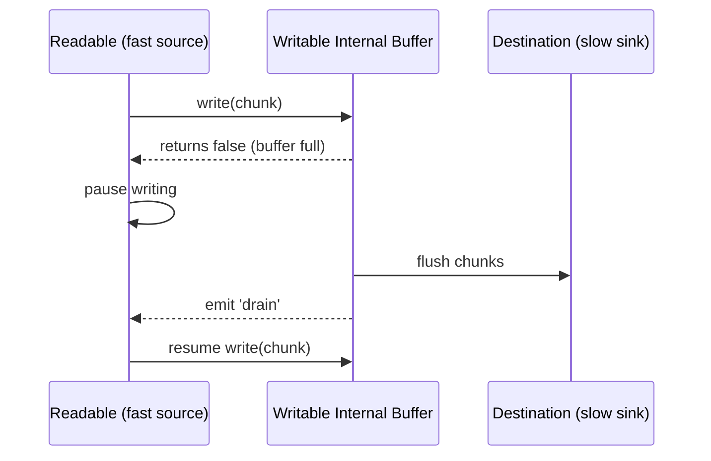

### 6.6 Optimized Code Snippet
```javascript
// Manual backpressure-aware write loop
async function writeWithBackpressure(writable, chunks) {
  for (const chunk of chunks) {
    const canContinue = writable.write(chunk);
    if (!canContinue) {
      await new Promise(resolve => writable.once('drain', resolve));
    }
  }
  writable.end();
}

// Preferred: let pipeline() handle it automatically
const { pipeline } = require('stream/promises');
await pipeline(readable, transform, writable);
```

### 6.7 Common Follow-Up Questions
- What happens if you ignore the return value of `.write()`?
- How does backpressure propagate through multiple chained Transform streams?
- How would you apply backpressure concepts to a message queue consumer (not just streams)?

### 6.8 Edge Cases & Pitfalls
- Calling `.write()` in a tight loop without checking the return value or awaiting `'drain'`.
- Backpressure not propagating correctly through custom Transform streams that buffer internally without honoring `callback()` timing.

### 6.9 Performance & Scalability Considerations
- Backpressure is a memory-vs-throughput trade-off; tune `highWaterMark` for your latency/memory budget.
- Applies beyond streams — the same principle governs consumer-side flow control in Kafka/RabbitMQ consumers (prefetch limits).

### 6.10 Best Practices
- Always use `pipeline()` for chained streams instead of manual write loops.
- Apply the same conceptual pattern (pause/resume, ack-based flow control) to queue consumers.

### 6.11 Trade-offs
| Approach | Pros | Cons |
|---|---|---|
| Ignore backpressure | Simpler code | OOM risk under load |
| Respect backpressure | Bounded memory, resilient | Slightly more complex control flow |

### 6.12 Interview Tips
> 🎯 Connect backpressure to queue consumer prefetch counts (Topic 15) — showing you see the pattern beyond just streams is a strong senior signal.

### 6.13 Summary
> ✅ Backpressure prevents unbounded memory growth when producers outpace consumers. `write()`'s boolean return and the `'drain'` event are the core primitives; `pipeline()` automates correct handling, and the same pattern generalizes to queue-based systems.

---

## 7. Error Handling Strategies

### 7.1 Interview Question
> "How do you design a robust error-handling strategy for a large Node.js/Express application?"

### 7.2 Concise Answer
> 💡 Separate **operational errors** (expected failures: bad input, network timeout) from **programmer errors** (bugs: undefined is not a function). Use centralized Express error-handling middleware, `async` wrapper utilities to avoid unhandled promise rejections, and process-level guards (`unhandledRejection`, `uncaughtException`) as a last-resort safety net — not a primary strategy.

### 7.3 Deep Technical Explanation
- **Operational errors**: anticipated (validation failures, DB connection drops, 3rd-party API timeouts). Should be handled gracefully, logged, and returned as proper HTTP responses.
- **Programmer errors**: bugs. The correct response is often to **crash and restart** the process (fail fast) rather than continue in a corrupted state — supervised by PM2/Kubernetes.
- Express doesn't natively catch errors thrown inside `async` route handlers pre-Express-5 — a rejected promise without `.catch()` becomes an unhandled rejection unless wrapped.
- `process.on('unhandledRejection')` and `process.on('uncaughtException')` are safety nets to log and gracefully shut down — **not** a substitute for proper try/catch or `.catch()` chains, since process state may already be corrupted.
- Custom error classes with an `isOperational` flag let a centralized handler distinguish "safe to respond and continue" vs "must crash."

### 7.4 Real-World Production Examples
- **Netflix/Node.js best practices** (well-documented in the community) recommend crashing on programmer errors and letting an orchestrator (K8s liveness probe) restart the pod, rather than attempting in-process recovery.
- Many **fintech/payments backends** implement a custom `AppError` hierarchy (`ValidationError`, `PaymentGatewayError`, `NotFoundError`) mapped to specific HTTP status codes in one centralized Express error middleware.

### 7.5 Architecture Diagram
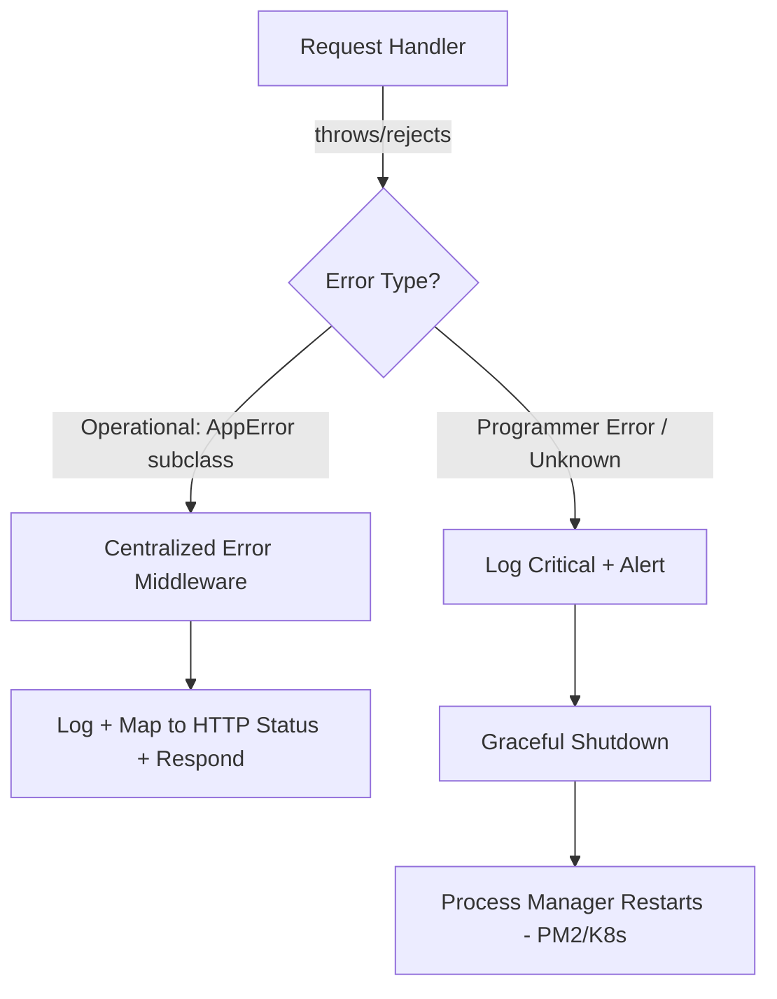

### 7.6 Optimized Code Snippet
```javascript
// Base operational error class
class AppError extends Error {
  constructor(message, statusCode, isOperational = true) {
    super(message);
    this.statusCode = statusCode;
    this.isOperational = isOperational;
    Error.captureStackTrace(this, this.constructor);
  }
}

// Async handler wrapper to avoid unhandled rejections
const catchAsync = (fn) => (req, res, next) => fn(req, res, next).catch(next);

app.get('/orders/:id', catchAsync(async (req, res) => {
  const order = await OrderService.findById(req.params.id);
  if (!order) throw new AppError('Order not found', 404);
  res.json(order);
}));

// Centralized error middleware (must be last, 4 args)
app.use((err, req, res, next) => {
  const statusCode = err.statusCode || 500;
  if (!err.isOperational) {
    logger.error('CRITICAL: non-operational error', err);
  }
  res.status(statusCode).json({ message: err.isOperational ? err.message : 'Internal Server Error' });
});

// Process-level safety net (last resort, not primary strategy)
process.on('unhandledRejection', (reason) => {
  logger.error('Unhandled Rejection', reason);
  process.exit(1); // fail fast; let orchestrator restart
});
```

### 7.7 Common Follow-Up Questions
- Difference between operational and programmer errors, and why does it matter for recovery strategy?
- Why shouldn't you rely solely on `uncaughtException` to keep the process alive?
- How do you handle errors in event emitters or streams differently from promise chains?
- How does Express 5 change async error handling versus Express 4?

### 7.8 Edge Cases & Pitfalls
- Swallowing errors silently (`catch(() => {})`) hides real production issues.
- Relying on `uncaughtException` to "catch and continue" — process state is often already corrupted, leading to subtler bugs later.
- Errors thrown inside `EventEmitter` callbacks that have no `'error'` listener crash the process (unlike promises).

### 7.9 Performance & Scalability Considerations
- Centralized error handling adds negligible overhead but vastly improves observability at scale.
- Structured error logging (with error codes/types) enables better alerting and reduces on-call triage time.

### 7.10 Best Practices
- Define a clear `AppError` hierarchy with `isOperational` flags.
- Wrap every async route handler (or upgrade to Express 5 which handles this natively).
- Treat `uncaughtException`/`unhandledRejection` handlers as **log-and-crash**, not recovery mechanisms.

### 7.11 Trade-offs
| Strategy | Pros | Cons |
|---|---|---|
| Fail-fast on programmer errors | Prevents corrupted state propagation | Brief downtime per pod during restart (mitigated by replicas) |
| Try to "recover" in-process | No restart cost | Risk of running in an inconsistent, hard-to-debug state |

### 7.12 Interview Tips
> 🎯 Explicitly state the operational-vs-programmer error distinction early — it's the single most senior-signaling concept in this topic.

### 7.13 Summary
> ✅ Robust error handling separates operational errors (handle gracefully) from programmer errors (fail fast, restart). Centralized Express middleware, async wrappers, and custom error classes form the core pattern; process-level handlers are a safety net, not the primary defense.

---

## 8. Microservices Communication (REST vs gRPC vs Message Queues)

### 8.1 Interview Question
> "How would you design communication between microservices in a Node.js-based system, and how do you choose between REST, gRPC, and async messaging?"

### 8.2 Concise Answer
> 💡 Use **synchronous REST/gRPC** for request-response interactions needing an immediate answer, and **asynchronous messaging** (Kafka/RabbitMQ/SQS) for decoupled, eventual-consistency workflows. gRPC wins on performance/type-safety for internal service-to-service calls; REST wins on simplicity/interoperability; messaging wins on resilience and decoupling.

### 8.3 Deep Technical Explanation
- **REST/HTTP+JSON**: human-readable, cacheable, universally supported, but higher overhead (text serialization, HTTP/1.1 head-of-line blocking unless HTTP/2).
- **gRPC**: uses HTTP/2 + Protocol Buffers (binary, schema-enforced), supports streaming (unary, server-streaming, client-streaming, bidirectional), significantly lower latency/payload size — ideal for internal, high-throughput service-to-service calls where both ends are trusted and schema evolution is managed.
- **Message Queues** (Kafka, RabbitMQ, SQS): decouple producer and consumer in time and topology — the producer doesn't need the consumer to be available. Enables buffering during traffic spikes, retry/backoff semantics, and fan-out to multiple consumers. Trades immediate consistency for resilience and scalability.

Architecturally, most FAANG-scale systems use a **hybrid**: synchronous gRPC/REST for user-facing request paths requiring immediate responses, and async messaging for side effects (notifications, analytics events, order fulfillment steps).

### 8.4 Real-World Production Examples
- **Uber** uses gRPC extensively for internal service-to-service calls for its low latency and strong typing across thousands of microservices.
- **Amazon** order processing: the checkout API responds synchronously (REST/gRPC) confirming order acceptance, while downstream steps (inventory reservation, shipping label generation, email confirmation) are triggered asynchronously via SQS/EventBridge.
- **Netflix** uses a mix of gRPC (via internal frameworks) for service mesh calls and Kafka for its data/event pipeline.

### 8.5 Architecture Diagram
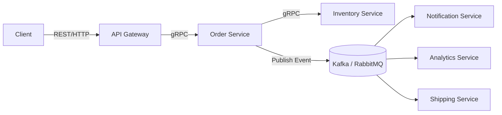

### 8.6 Optimized Code Snippet
```javascript
// gRPC service call example (Node.js client)
const grpc = require('@grpc/grpc-js');
const protoLoader = require('@grpc/proto-loader');

const packageDef = protoLoader.loadSync('inventory.proto');
const inventoryProto = grpc.loadPackageDefinition(packageDef).inventory;

const client = new inventoryProto.InventoryService(
  'inventory-service:50051',
  grpc.credentials.createInsecure()
);

function reserveStock(sku, qty) {
  return new Promise((resolve, reject) => {
    client.ReserveStock({ sku, qty }, (err, response) => {
      if (err) return reject(err);
      resolve(response);
    });
  });
}

// Publishing an async event after a sync order is accepted
async function placeOrder(orderData) {
  const order = await OrderService.create(orderData); // sync, must succeed
  await kafkaProducer.send({
    topic: 'order-created',
    messages: [{ value: JSON.stringify({ orderId: order.id }) }],
  }); // async, fire-and-forget with retry/DLQ handling
  return order;
}
```

### 8.7 Common Follow-Up Questions
- How do you handle partial failures across a chain of synchronous service calls?
- What's the Saga pattern, and when would you use it over 2PC (two-phase commit)?
- How does gRPC handle versioning/backward compatibility via Protobuf?
- How do you implement retries/circuit breakers for inter-service calls?

### 8.8 Edge Cases & Pitfalls
- Synchronous call chains (A→B→C→D) create tight coupling and cascading latency/failure — a single slow downstream service degrades the entire chain.
- Missing idempotency keys in async consumers causes duplicate processing on redelivery (at-least-once delivery is the norm in most MQs).
- Protobuf schema changes without careful field numbering/reserved fields break wire compatibility.

### 8.9 Performance & Scalability Considerations
- gRPC's binary framing + HTTP/2 multiplexing significantly reduces latency/bandwidth versus REST/JSON at high QPS.
- Message queues absorb traffic spikes (buffer) that would otherwise overwhelm synchronous downstream services.
- Use circuit breakers (e.g., `opossum`) and bulkheads to prevent cascading failures in synchronous call graphs.

### 8.10 Best Practices
- Keep the **synchronous critical path** as short as possible; push everything else to async events.
- Design consumers to be **idempotent** to safely handle at-least-once delivery.
- Use schema registries (for Kafka/Avro or Protobuf) to manage contract evolution across teams.

### 8.11 Trade-offs
| Style | Latency | Coupling | Consistency | Best For |
|---|---|---|---|---|
| REST | Medium | Tight | Strong (immediate) | Public APIs, simple CRUD |
| gRPC | Low | Tight | Strong (immediate) | Internal high-throughput service calls |
| Message Queue | N/A (async) | Loose | Eventual | Decoupled workflows, resilience, fan-out |

### 8.12 Interview Tips
> 🎯 When asked "how would you design service X," proactively map out which calls are synchronous-critical vs. can be async — this shows systems-design maturity expected at Staff/Senior level.

### 8.13 Summary
> ✅ Choose REST for simplicity/interoperability, gRPC for low-latency internal service calls, and message queues for decoupled, resilient async workflows. The senior-level skill is architecting hybrid systems that minimize the synchronous critical path.

---

## 9. Caching Strategies

### 9.1 Interview Question
> "How would you design a multi-layer caching strategy for a high-traffic Node.js API, and how do you handle cache invalidation?"

### 9.2 Concise Answer
> 💡 Layer caching from closest-to-client to furthest: **CDN/edge cache** → **application-level in-memory cache** → **distributed cache (Redis)** → **database**. The hardest problem is invalidation — common strategies are TTL-based expiry, write-through/write-behind, and event-driven invalidation (pub/sub on writes).

### 9.3 Deep Technical Explanation
- **CDN caching**: for static assets and cacheable GET responses (via `Cache-Control`/`ETag` headers) — reduces origin load entirely for repeat requests.
- **In-process memory cache** (e.g., `lru-cache` or `node-cache`): fastest (no network hop) but not shared across instances — fine for rarely-changing, small reference data (feature flags, config).
- **Distributed cache (Redis/Memcached)**: shared across all instances, supports TTL, eviction policies (LRU/LFU), and pub/sub for invalidation broadcasts.
- **Cache patterns**:
  - *Cache-aside (lazy loading)*: app checks cache, on miss reads DB and populates cache. Simple, most common.
  - *Write-through*: writes go to cache and DB synchronously — cache always consistent, but write latency increases.
  - *Write-behind*: writes go to cache immediately, DB updated asynchronously — fast writes, risk of data loss on cache failure.
- **Invalidation**: TTL expiry (simplest, accepts staleness window), explicit `DEL` on write (cache-aside's usual pairing), or event-driven invalidation via pub/sub when multiple services/instances must invalidate together.

### 9.4 Real-World Production Examples
- **Twitter/X** timelines use heavily layered caching (Redis-based) for the "fan-out on write" model of follower timelines.
- **E-commerce product pages** (Amazon-style) cache product detail pages at CDN edge with short TTLs, plus Redis for inventory counts with active invalidation on stock changes.
- **Stripe/payment dashboards** use cache-aside with Redis for frequently-read, rarely-changed account metadata, invalidated explicitly on any write.

### 9.5 Architecture Diagram
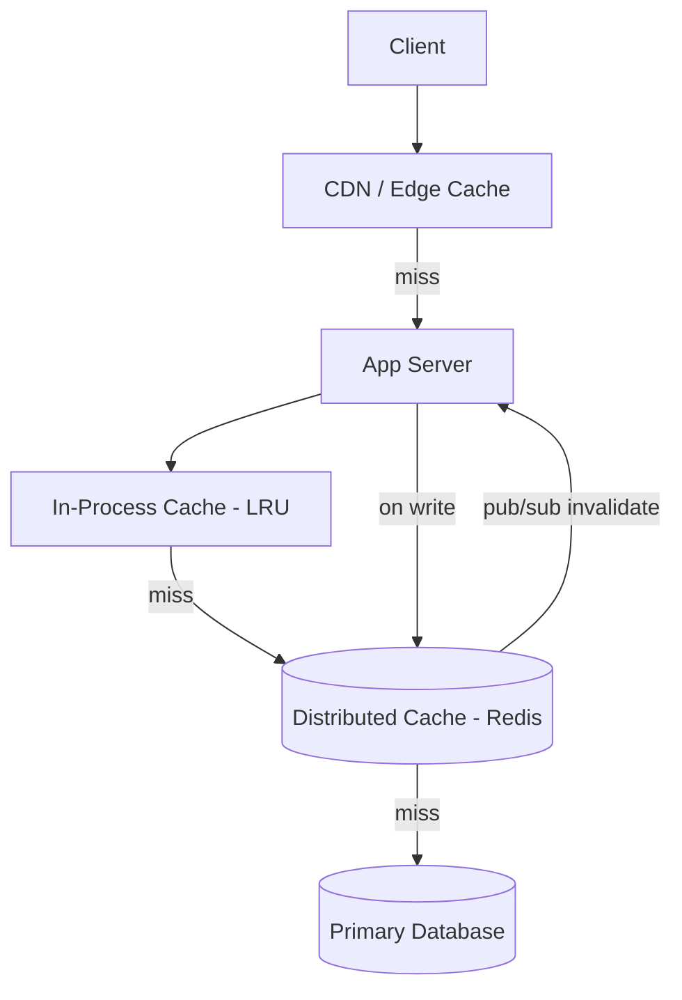

### 9.6 Optimized Code Snippet
```javascript
// Cache-aside pattern with Redis
const redis = require('ioredis').createClient();

async function getProduct(productId) {
  const cacheKey = `product:${productId}`;
  const cached = await redis.get(cacheKey);
  if (cached) return JSON.parse(cached);

  const product = await db.products.findById(productId);
  if (product) {
    await redis.set(cacheKey, JSON.stringify(product), 'EX', 300); // 5-min TTL
  }
  return product;
}

async function updateProduct(productId, updates) {
  const product = await db.products.update(productId, updates);
  await redis.del(`product:${productId}`); // explicit invalidation on write
  return product;
}
```

### 9.7 Common Follow-Up Questions
- How do you prevent a "thundering herd" / cache stampede on a popular key's expiry?
- Write-through vs write-behind — when would you choose each?
- How do you handle cache invalidation across multiple regions/data centers?
- How would you cache paginated or filtered query results?

### 9.8 Edge Cases & Pitfalls
- **Cache stampede**: many concurrent requests miss simultaneously on a hot key's expiry, hammering the DB — mitigate with request coalescing/locking or probabilistic early expiration.
- **Stale reads** after a write if invalidation is delayed/misses a replica in a distributed cache cluster.
- Caching error responses or `null` results without a distinguishing TTL, causing prolonged incorrect "not found" responses.

### 9.9 Performance & Scalability Considerations
- Redis Cluster for horizontal scaling of the distributed cache layer; watch for hot-key skew across shards.
- Use short TTL + background refresh ("stale-while-revalidate") for high-read, moderately-changing data to balance freshness and load.

### 9.10 Best Practices
- Always set a TTL as a safety net even with explicit invalidation (defense in depth).
- Use cache key namespacing/versioning to enable safe schema migrations (`v2:product:123`).
- Monitor cache hit ratio as a core metric; low hit ratio often indicates poor key design or too-short TTLs.

### 9.11 Trade-offs
| Pattern | Consistency | Write Latency | Complexity |
|---|---|---|---|
| Cache-aside | Eventual (until TTL/invalidation) | Low | Low |
| Write-through | Strong | Higher | Medium |
| Write-behind | Weak (risk of loss) | Lowest | High |

### 9.12 Interview Tips
> 🎯 Bring up cache stampede mitigation unprompted — it's a classic FAANG follow-up that separates candidates who've only used caching from those who've operated it at scale.

### 9.13 Summary
> ✅ Effective caching layers CDN, in-process, and distributed caches, using cache-aside as the default pattern. The senior-level differentiator is handling invalidation correctly — TTL, explicit deletes, and stampede protection — rather than just "adding Redis."

---

## 10. Database Connection Pooling

### 10.1 Interview Question
> "How does database connection pooling work in Node.js, and how do you size a pool correctly for production traffic?"

### 10.2 Concise Answer
> 💡 A connection pool maintains a reusable set of open DB connections rather than opening/closing one per request (expensive: TCP handshake + auth). Node drivers (`pg`, `mysql2`, ORMs) manage a pool internally; correct sizing balances DB server connection limits against application concurrency needs.

### 10.3 Deep Technical Explanation
Opening a new DB connection involves TCP handshake, TLS negotiation (if applicable), and authentication — costly relative to query execution time, especially at high request rates. A pool pre-establishes N connections and hands them out to callers, queuing requests when all are busy, and returning connections to the pool when queries complete.

Because Node.js is single-threaded but handles many concurrent I/O-bound requests, pool size should reflect **actual concurrent DB operations**, not requests-per-second — a common mistake is over-sizing pools per Node instance without accounting for total connections across all replicas (`pool_size * num_instances` must stay under the DB's `max_connections`).

Formula (per Little's Law-inspired heuristic): `pool_size ≈ concurrent_requests × avg_query_time / target_latency`, but in practice, most production teams start conservative (e.g., 10-20 per instance) and tune via observed wait times.

### 10.4 Real-World Production Examples
- **PostgreSQL** deployments commonly pair Node apps with **PgBouncer** as an external connection pooler/proxy, since Postgres's per-connection memory cost is much higher than MySQL's, and PgBouncer allows thousands of app-side connections to be multiplexed onto a small number of actual DB connections.
- A frequent **production incident pattern**: after scaling from 5 to 50 Node pod replicas without adjusting per-pod pool size, the database hits `max_connections` and starts rejecting new connections, causing cascading 500s.

### 10.5 Architecture Diagram
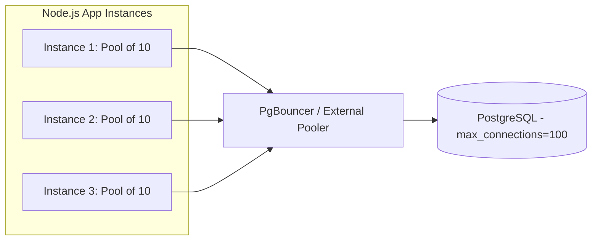

### 10.6 Optimized Code Snippet
```javascript
// pg (node-postgres) pool with production-sensible settings
const { Pool } = require('pg');

const pool = new Pool({
  host: process.env.DB_HOST,
  max: 15,                      // max clients per instance
  idleTimeoutMillis: 30000,     // close idle clients after 30s
  connectionTimeoutMillis: 5000, // fail fast if pool is exhausted
});

pool.on('error', (err) => {
  logger.error('Unexpected idle client error', err); // crucial: unhandled = crash
});

async function getUserById(id) {
  const client = await pool.connect();
  try {
    const { rows } = await client.query('SELECT * FROM users WHERE id = $1', [id]);
    return rows[0];
  } finally {
    client.release(); // always release back to pool, even on error
  }
}
```

### 10.7 Common Follow-Up Questions
- How would you size a connection pool across 20 replicas of your service?
- What's the difference between application-side pooling and an external pooler like PgBouncer?
- What happens to queued requests when the pool is exhausted, and how do you fail fast vs. queue?
- How do you monitor pool health (active/idle/waiting counts) in production?

### 10.8 Edge Cases & Pitfalls
- Forgetting `client.release()` in error paths leaks connections until the pool is exhausted.
- Not setting `connectionTimeoutMillis`, causing requests to hang indefinitely when the pool is saturated instead of failing fast.
- Total connections across all replicas exceeding DB `max_connections` after a scale-out event.

### 10.9 Performance & Scalability Considerations
- Use an external pooler (PgBouncer/ProxySQL) when horizontally scaling many app instances against a single DB.
- Monitor pool wait time / queue depth as an early warning signal before DB saturation causes visible latency.

### 10.10 Best Practices
- Always wrap connection use in try/finally to guarantee release.
- Set conservative `max` per instance and multiply by expected replica count to validate against DB limits.
- Alert on pool exhaustion metrics, not just DB CPU/latency.

### 10.11 Trade-offs
| Approach | Pros | Cons |
|---|---|---|
| Large per-instance pool | Higher local concurrency | Risk of exceeding DB max_connections at scale |
| Small pool + external pooler (PgBouncer) | Scales to many replicas safely | Extra infrastructure component/hop |

### 10.12 Interview Tips
> 🎯 Mention the "replicas × pool size vs. DB max_connections" math explicitly — it's a concrete, quantifiable insight interviewers love, and directly relevant to real incidents.

### 10.13 Summary
> ✅ Connection pools amortize the cost of DB connection setup across requests. Correct sizing must account for total connections across all app replicas versus the database's connection ceiling — often solved at scale with an external pooler like PgBouncer.

---
## 11. Authentication & Authorization (JWT / OAuth2 / Sessions)

### 11.1 Interview Question
> "Compare session-based auth, JWT, and OAuth2 — how would you design auth for a Node.js microservices architecture?"

### 11.2 Concise Answer
> 💡 **Session-based auth** stores state server-side (or in Redis) with a session ID cookie — simple revocation, but requires shared session storage across instances. **JWT** is stateless and self-contained (signed token carries claims) — scales easily but is hard to revoke before expiry. **OAuth2** is a delegation/authorization *framework* (not itself an auth mechanism) used for third-party access and SSO, often issuing JWTs as access tokens.

### 11.3 Deep Technical Explanation
- **Sessions**: server generates a session ID, stores session data server-side (Redis for multi-instance), sends ID via `httpOnly` cookie. Revocation is instant (delete server-side record). Requires sticky sessions or shared store across horizontally-scaled instances.
- **JWT**: a signed (HMAC or RSA/ECDSA) token containing claims (`sub`, `exp`, roles). Verified without a DB lookup — ideal for stateless, horizontally-scaled microservices. **Revocation problem**: since verification doesn't hit a datastore, a compromised/logged-out JWT remains valid until expiry unless you maintain a blocklist (defeating some statelessness benefit) or use short-lived access tokens + refresh token rotation.
- **OAuth2**: defines roles (Resource Owner, Client, Authorization Server, Resource Server) and grant flows (Authorization Code + PKCE for SPAs/mobile, Client Credentials for service-to-service). **OIDC** (OpenID Connect) layers identity (ID tokens) on top of OAuth2 for authentication.
- Production pattern: short-lived JWT **access tokens** (5-15 min) + long-lived, rotatable **refresh tokens** (stored server-side, revocable) — balances statelessness with revocability.

### 11.4 Real-World Production Examples
- **Auth0/Okta/AWS Cognito** implement the access+refresh token pattern as managed identity providers used broadly across FAANG-adjacent and startup stacks.
- **Google/GitHub "Sign in with X"** flows use OAuth2 Authorization Code + PKCE for SPA/mobile clients.
- Many **internal microservice meshes** use short-lived JWTs signed by a central auth service, verified independently by each downstream service via a shared public key (JWKS endpoint) — avoiding a synchronous auth-service call per request.

### 11.5 Architecture Diagram
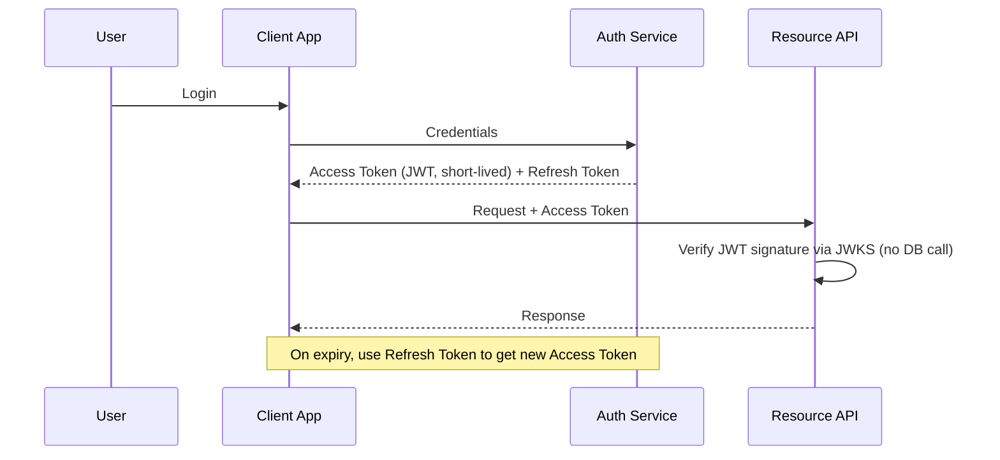

### 11.6 Optimized Code Snippet
```javascript
const jwt = require('jsonwebtoken');

function issueTokens(user) {
  const accessToken = jwt.sign(
    { sub: user.id, roles: user.roles },
    process.env.ACCESS_TOKEN_SECRET,
    { expiresIn: '15m' }
  );
  const refreshToken = jwt.sign(
    { sub: user.id, tokenVersion: user.tokenVersion },
    process.env.REFRESH_TOKEN_SECRET,
    { expiresIn: '7d' }
  );
  return { accessToken, refreshToken };
}

// Middleware: stateless verification, no DB hit
function authenticate(req, res, next) {
  const token = req.headers.authorization?.split(' ')[1];
  if (!token) return res.status(401).json({ message: 'Missing token' });
  try {
    req.user = jwt.verify(token, process.env.ACCESS_TOKEN_SECRET);
    next();
  } catch (err) {
    return res.status(401).json({ message: 'Invalid or expired token' });
  }
}

// Refresh token rotation with revocation support (tokenVersion in DB)
async function refreshAccessToken(refreshToken) {
  const payload = jwt.verify(refreshToken, process.env.REFRESH_TOKEN_SECRET);
  const user = await User.findById(payload.sub);
  if (user.tokenVersion !== payload.tokenVersion) {
    throw new AppError('Refresh token revoked', 401);
  }
  return issueTokens(user);
}
```

### 11.7 Common Follow-Up Questions
- How do you revoke a JWT before its expiry?
- What's the PKCE extension to OAuth2, and why is it required for public clients (SPAs/mobile)?
- Where should you store JWTs client-side — localStorage vs httpOnly cookies — and what are the XSS/CSRF trade-offs?
- How do you handle auth across microservices without a synchronous call to the auth service on every request?

### 11.8 Edge Cases & Pitfalls
- Storing JWTs in `localStorage` exposes them to XSS-based theft; `httpOnly` cookies mitigate this but reintroduce CSRF risk (mitigated via `SameSite` cookies + CSRF tokens).
- Long-lived JWTs with no revocation mechanism = large blast radius if leaked.
- Not rotating refresh tokens on use, allowing replay if a refresh token is stolen.

### 11.9 Performance & Scalability Considerations
- JWT verification is CPU-bound but DB-free — scales horizontally without a shared session store bottleneck.
- JWKS public key caching (with periodic refresh) avoids a network call per verification in each service.

### 11.10 Best Practices
- Short-lived access tokens (minutes) + rotatable, revocable refresh tokens (server-tracked).
- Always use `httpOnly`, `Secure`, `SameSite=Strict/Lax` cookies for token storage where possible.
- Use PKCE for any public client (SPA, mobile) OAuth2 flow.

### 11.11 Trade-offs
| Mechanism | Scalability | Revocation | Complexity |
|---|---|---|---|
| Server Sessions | Requires shared store | Instant | Low |
| JWT (stateless) | Excellent | Hard (until expiry) | Medium |
| JWT + Refresh Rotation | Excellent | Good (near-instant via version check) | Medium-High |

### 11.12 Interview Tips
> 🎯 Always mention the revocation trade-off of pure JWTs unprompted — it's the most commonly missed nuance among mid-level candidates.

### 11.13 Summary
> ✅ Sessions offer instant revocation but need shared state; JWTs are stateless and scale well but complicate revocation — solved in production via short-lived access tokens + rotatable refresh tokens. OAuth2/OIDC layer delegated authorization and federated identity on top.

---

## 12. Rate Limiting & Throttling

### 12.1 Interview Question
> "How would you implement distributed rate limiting for an API served by multiple Node.js instances?"

### 12.2 Concise Answer
> 💡 Use a **shared store (Redis)** with an atomic algorithm — **token bucket** or **sliding window log/counter** — so rate limits are enforced consistently across all instances, not per-process. Fixed-window counters are simplest but allow burst-at-boundary abuse; sliding window/token bucket are more accurate.

### 12.3 Deep Technical Explanation
- **Fixed window counter**: increment a Redis counter per time window (e.g., per minute), reset on expiry. Simple but allows 2x burst at window boundaries (e.g., 100 requests at 0:59 + 100 at 1:00).
- **Sliding window log**: store timestamps of each request in a sorted set, count entries within the trailing window. Accurate but memory-heavier.
- **Sliding window counter**: approximates sliding log by weighting the previous and current fixed windows — good accuracy/memory trade-off.
- **Token bucket**: bucket refills at a fixed rate up to a capacity; each request consumes a token. Naturally allows controlled bursts up to bucket capacity while enforcing a steady-state rate — the algorithm behind most production rate limiters (e.g., AWS API Gateway, Stripe API).
- Distributed correctness requires **atomic** Redis operations (Lua scripting or `INCR`+`EXPIRE` combos, or libraries like `rate-limiter-flexible`) to avoid race conditions across concurrent requests hitting different app instances simultaneously.

### 12.4 Real-World Production Examples
- **Stripe's API** documents a token-bucket-based rate limiter with published limits per endpoint and `Retry-After` headers on 429s.
- **GitHub API** uses a fixed-window-like counter exposed via `X-RateLimit-Remaining`/`X-RateLimit-Reset` headers.
- Many API gateways (Kong, AWS API Gateway, Cloudflare) implement rate limiting at the edge, but internal Node services often additionally implement **per-user/per-tenant** limits at the application layer using Redis-backed libraries.

### 12.5 Architecture Diagram
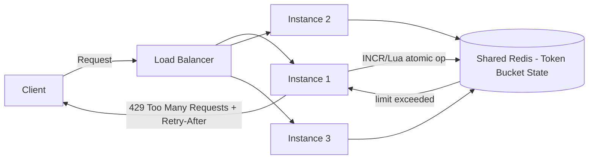

### 12.6 Optimized Code Snippet
```javascript
// Token bucket rate limiter using rate-limiter-flexible + Redis
const { RateLimiterRedis } = require('rate-limiter-flexible');
const Redis = require('ioredis');

const redisClient = new Redis();

const rateLimiter = new RateLimiterRedis({
  storeClient: redisClient,
  points: 100,       // 100 requests
  duration: 60,      // per 60 seconds
  blockDuration: 30, // block for 30s once exceeded
});

async function rateLimitMiddleware(req, res, next) {
  try {
    await rateLimiter.consume(req.user?.id || req.ip);
    next();
  } catch (rejRes) {
    res.set('Retry-After', String(Math.ceil(rejRes.msBeforeNext / 1000)));
    res.status(429).json({ message: 'Too many requests' });
  }
}
```

### 12.7 Common Follow-Up Questions
- Fixed window vs sliding window vs token bucket — trade-offs of each?
- How do you rate-limit per-user vs per-IP, and what happens behind a shared corporate NAT/proxy?
- How would you implement rate limiting at the API gateway/edge vs application layer — why both?
- How do you avoid Redis becoming a single point of failure/bottleneck for rate limiting at very high QPS?

### 12.8 Edge Cases & Pitfalls
- Rate limiting purely by IP breaks down behind NAT (many users sharing one IP) or is trivially bypassed via IP rotation.
- Non-atomic read-then-write counter logic causes race conditions under concurrent load, allowing limit bypass.
- Not returning `Retry-After` leaves clients guessing when to retry, worsening thundering-herd retry storms.

### 12.9 Performance & Scalability Considerations
- Use Redis Lua scripts or built-in atomic commands to avoid extra round trips and race conditions.
- For very high QPS, consider local in-memory pre-filtering (approximate) combined with periodic sync to Redis to reduce Redis load, accepting slight inaccuracy.

### 12.10 Best Practices
- Rate limit at multiple layers: edge/gateway (coarse, cheap) + application (fine-grained, per-user/tenant).
- Always return standard headers (`Retry-After`, `X-RateLimit-*`) for well-behaved client backoff.
- Combine with circuit breakers/bulkheads for full resilience against abusive or runaway clients.

### 12.11 Trade-offs
| Algorithm | Accuracy | Memory | Burst Handling |
|---|---|---|---|
| Fixed Window | Low (boundary bursts) | Low | Poor |
| Sliding Log | High | High | Excellent |
| Sliding Window Counter | Medium-High | Medium | Good |
| Token Bucket | High | Low | Good, configurable burst |

### 12.12 Interview Tips
> 🎯 Draw out the fixed-window boundary-burst problem with concrete numbers (e.g., "200 requests in 2 seconds despite a 100/min limit") — this concrete example is a strong signal of hands-on understanding.

### 12.13 Summary
> ✅ Distributed rate limiting requires shared, atomic state (Redis) and an algorithm chosen for the desired accuracy/burst trade-off — token bucket is the common production default. Layer limits at both edge and application level for full protection.

---

## 13. RESTful API Design & Versioning

### 13.1 Interview Question
> "How do you design and version a RESTful API that will be consumed by multiple external clients over years?"

### 13.2 Concise Answer
> 💡 Design around **resources** (nouns, not verbs), use proper HTTP semantics (methods, status codes, idempotency), and version explicitly (URI path `/v1/` or header-based) to allow breaking changes without disrupting existing clients. Favor **additive, backward-compatible** changes over breaking ones whenever possible.

### 13.3 Deep Technical Explanation
- **Resource modeling**: `/orders/{id}/items` not `/getOrderItems`. Use plural nouns, nested resources sparingly (max 2-3 levels deep).
- **HTTP method semantics**: `GET` (safe, idempotent, cacheable), `POST` (create, not idempotent), `PUT` (full replace, idempotent), `PATCH` (partial update), `DELETE` (idempotent).
- **Idempotency**: critical for `POST` in payment/order APIs — use client-supplied `Idempotency-Key` headers so retries (due to timeouts) don't create duplicate resources.
- **Versioning strategies**:
  - URI versioning (`/v1/orders`) — simple, visible, but "pollutes" the URL and implies the whole API version rather than per-resource evolution.
  - Header versioning (`Accept: application/vnd.api+json;version=2`) — cleaner URLs, less discoverable, harder to test manually.
  - Additive/backward-compatible evolution (new optional fields, new endpoints) avoids needing a version bump at all — the preferred default; reserve major version bumps for true breaking changes.
- **HATEOAS** (Hypermedia As The Engine Of Application State) is a purist REST ideal rarely fully implemented in production due to added complexity, but partial hypermedia (pagination links) is common.

### 13.4 Real-World Production Examples
- **Stripe's API** is a widely cited best-practice example: URI versioning is avoided in favor of a global "API version" tied to the account, with strict backward-compatibility guarantees and additive-only changes as the default evolution path.
- **GitHub API** uses both URI-implicit versioning (`v3` in Accept header historically) and has since moved toward GraphQL for more flexible client-driven queries alongside REST v3.
- **Twilio** documents strict idempotency key usage for all money-moving/critical POST endpoints.

### 13.5 Architecture Diagram
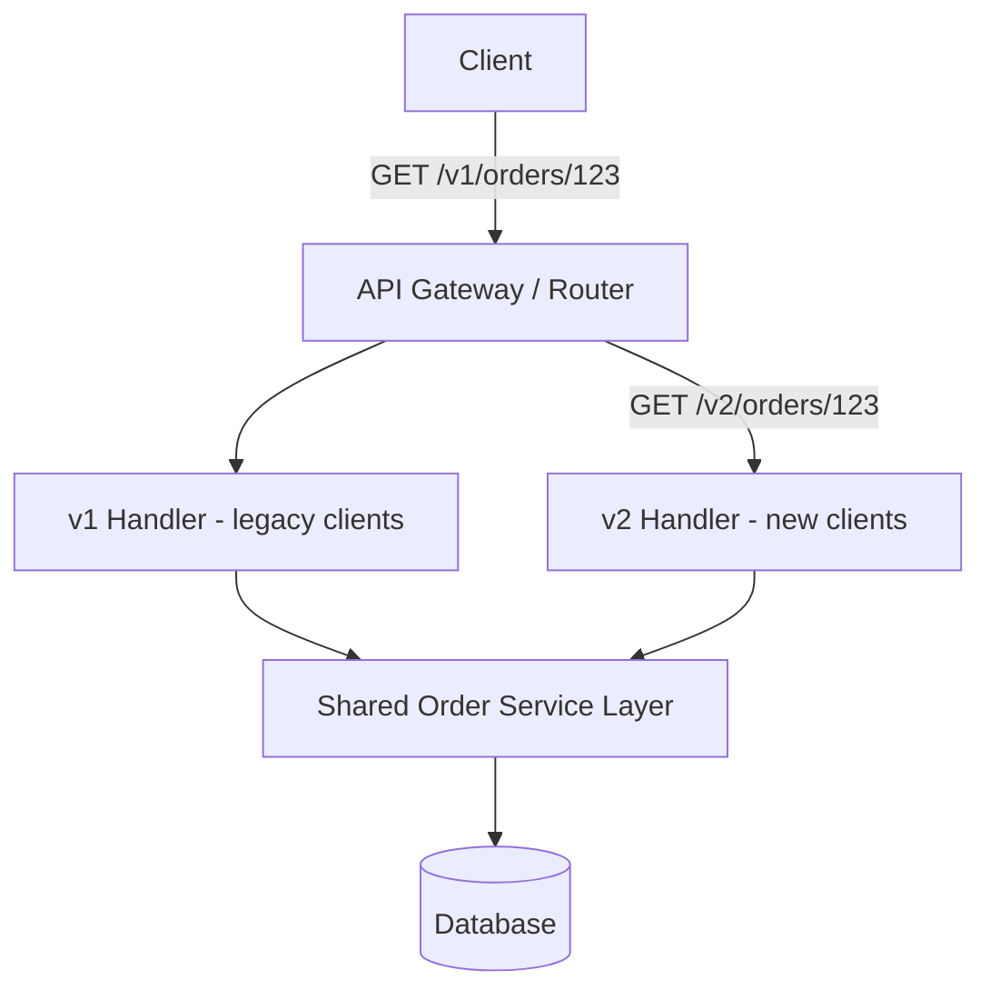

### 13.6 Optimized Code Snippet
```javascript
// Idempotent POST using client-supplied Idempotency-Key
app.post('/v1/payments', async (req, res, next) => {
  const idempotencyKey = req.headers['idempotency-key'];
  if (!idempotencyKey) {
    return res.status(400).json({ message: 'Idempotency-Key header required' });
  }

  const existing = await redis.get(`idem:${idempotencyKey}`);
  if (existing) {
    return res.status(200).json(JSON.parse(existing)); // return cached prior result
  }

  const payment = await PaymentService.charge(req.body);
  await redis.set(`idem:${idempotencyKey}`, JSON.stringify(payment), 'EX', 86400);
  res.status(201).json(payment);
});

// Simple URI-based versioning with Express routers
const v1Router = require('./routes/v1');
const v2Router = require('./routes/v2');
app.use('/v1', v1Router);
app.use('/v2', v2Router);
```

### 13.7 Common Follow-Up Questions
- URI versioning vs header versioning — pros/cons of each?
- How do you deprecate an API version gracefully without breaking existing integrations?
- Why is idempotency critical for payment/order creation endpoints specifically?
- REST vs RPC-style APIs — when would you choose one over the other?

### 13.8 Edge Cases & Pitfalls
- Breaking changes disguised as "minor" (renaming a field, changing a type) silently break client integrations without a version bump.
- Missing idempotency keys on critical POST endpoints causes duplicate charges/orders on network retries.
- Overly deep nested resource URLs (`/users/1/orders/2/items/3/reviews/4`) become unwieldy and tightly coupled.

### 13.9 Performance & Scalability Considerations
- Support proper HTTP caching semantics (`ETag`, `Cache-Control`) for `GET` endpoints to reduce load.
- Pagination (cursor-based over offset-based) is essential for large collections to avoid expensive `OFFSET` queries at scale.

### 13.10 Best Practices
- Default to additive, backward-compatible changes; reserve version bumps for genuine breaking changes.
- Enforce idempotency keys on all non-idempotent, side-effect-bearing endpoints.
- Use cursor-based pagination for large or frequently-changing collections.

### 13.11 Trade-offs
| Versioning Style | Discoverability | Cleanliness | Client Complexity |
|---|---|---|---|
| URI (`/v1/`) | High | Lower (URL pollution) | Low |
| Header-based | Low | High | Medium |
| No versioning (additive-only) | N/A | Highest | Lowest (if discipline maintained) |

### 13.12 Interview Tips
> 🎯 Bring up idempotency keys specifically for payment/order APIs — this is a very common senior-level follow-up at fintech and e-commerce companies.

### 13.13 Summary
> ✅ Good REST API design centers on resource modeling, correct HTTP semantics, and idempotency for critical writes. Versioning should favor additive/backward-compatible evolution first, with explicit versioning (URI or header) reserved for genuine breaking changes.

---

## 14. GraphQL vs REST

### 14.1 Interview Question
> "When would you choose GraphQL over REST for a Node.js backend, and what are the operational challenges of running GraphQL at scale?"

### 14.2 Concise Answer
> 💡 GraphQL lets clients request **exactly the fields they need** in a single round trip, solving REST's over-fetching/under-fetching problems — especially valuable for mobile clients and complex nested UI data needs. The trade-off is added complexity: query cost analysis, N+1 query problems, and caching being much harder than REST's HTTP-native caching.

### 14.3 Deep Technical Explanation
- REST typically requires multiple round trips for nested/related data (e.g., user → posts → comments) or returns more data than needed (over-fetching) if a single endpoint serves multiple client needs.
- GraphQL exposes a single endpoint with a strongly-typed schema; clients specify exact fields/nested relations in one query, resolved server-side by **resolvers**.
- **N+1 problem**: naive resolvers (e.g., resolving `author` for each of 100 posts individually) trigger 100 separate DB queries. Solved via **DataLoader**, which batches and caches requests within a single request lifecycle.
- **Caching challenge**: REST leverages HTTP caching (`GET` + `ETag`/CDN) trivially; GraphQL's single `POST` endpoint with arbitrary queries defeats standard HTTP caching, requiring persisted queries, response-level caching (e.g., Apollo's normalized cache), or field-level caching strategies.
- **Query complexity/cost analysis**: because clients construct arbitrary queries, a malicious or naive deeply-nested query can cause disproportionate server load — production GraphQL servers implement query depth limiting and cost-based rate limiting.

### 14.4 Real-World Production Examples
- **GitHub's GraphQL API v4** exists alongside REST v3, specifically to let integrators fetch complex, nested data (e.g., a repo's issues + comments + reactions) in one request instead of dozens.
- **Shopify** exposes GraphQL as its primary API for the Admin/Storefront APIs, citing reduced over-fetching for mobile storefronts and using query cost analysis to prevent abuse.
- **Facebook** (GraphQL's originator) uses it primarily to solve mobile over-fetching across deeply nested social graph data.

### 14.5 Architecture Diagram
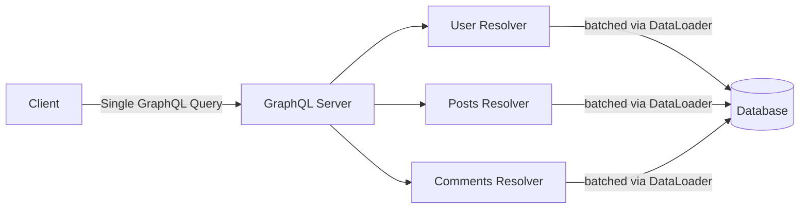

### 14.6 Optimized Code Snippet
```javascript
// Solving N+1 with DataLoader
const DataLoader = require('dataloader');

const userLoader = new DataLoader(async (userIds) => {
  const users = await db.users.findByIds(userIds); // single batched query
  const userMap = new Map(users.map(u => [u.id, u]));
  return userIds.map(id => userMap.get(id)); // must match input order
});

const resolvers = {
  Post: {
    author: (post) => userLoader.load(post.authorId), // batched + cached per-request
  },
};

// Basic query depth limiting to prevent abusive nested queries
const depthLimit = require('graphql-depth-limit');
const { ApolloServer } = require('@apollo/server');

const server = new ApolloServer({
  typeDefs,
  resolvers,
  validationRules: [depthLimit(7)],
});
```

### 14.7 Common Follow-Up Questions
- How do you solve the N+1 query problem in GraphQL resolvers?
- How would you implement caching for a GraphQL API given it typically uses a single POST endpoint?
- How do you prevent malicious deeply-nested or expensive queries from overloading your server?
- When would REST still be the better choice over GraphQL?

### 14.8 Edge Cases & Pitfalls
- Forgetting DataLoader batching leads to severe N+1 performance degradation invisible in small test datasets but catastrophic at scale.
- Unbounded query depth/complexity allows denial-of-service via a single malicious query.
- Over-fetching at the resolver level (fetching all fields from DB regardless of requested fields) negates GraphQL's efficiency benefits if not paired with field-aware data fetching.

### 14.9 Performance & Scalability Considerations
- Use persisted queries (client sends a hash, not raw query text) to enable CDN-level caching and reduce payload size.
- Implement query cost analysis/complexity scoring, not just depth limiting, for robust abuse prevention.
- Batch and cache with DataLoader **per-request** (not globally) to avoid stale cross-request data leaks.

### 14.10 Best Practices
- Always pair GraphQL resolvers with DataLoader for any relational field.
- Implement depth limiting and/or cost-based query analysis in production.
- Consider persisted queries for public-facing GraphQL APIs to enable caching and reduce attack surface.

### 14.11 Trade-offs
| Aspect | REST | GraphQL |
|---|---|---|
| Over/under-fetching | Common issue | Solved by design |
| HTTP Caching | Native, simple | Requires extra tooling |
| Learning curve | Low | Higher (schema, resolvers, N+1) |
| Abuse surface | Bounded (fixed endpoints) | Larger (arbitrary queries) |

### 14.12 Interview Tips
> 🎯 Proactively mention DataLoader and query cost limiting — many candidates can explain GraphQL's benefits but stumble on its operational challenges, which is exactly what senior-level interviews probe.

### 14.13 Summary
> ✅ GraphQL solves over/under-fetching via client-specified queries but introduces the N+1 problem (solved via DataLoader) and caching/abuse-prevention challenges absent in REST. Choose GraphQL when clients have diverse, nested data needs; choose REST for simpler, more cacheable, more operationally mature needs.

---

## 15. Message Queues (Kafka / RabbitMQ / SQS)

### 15.1 Interview Question
> "How would you choose between Kafka, RabbitMQ, and SQS for a Node.js-based event-driven system, and how do you ensure reliable message processing?"

### 15.2 Concise Answer
> 💡 **Kafka**: high-throughput, durable, ordered-per-partition log, ideal for event streaming/analytics with multiple independent consumers replaying history. **RabbitMQ**: flexible routing (exchanges/queues), better for complex task-routing and lower-latency work-queue patterns. **SQS**: fully-managed, simple, ideal when you want zero operational overhead and don't need Kafka's replay/ordering guarantees at scale.

### 15.3 Deep Technical Explanation
- **Kafka**: append-only distributed log partitioned by key; consumers track their own offset, enabling multiple consumer groups to independently replay the same data. Guarantees ordering **within a partition** only. Best for event sourcing, analytics pipelines, and systems needing message replay.
- **RabbitMQ**: broker-based with exchanges (direct/topic/fanout/headers) routing messages to queues; messages are typically consumed once and removed (though can fan out to multiple queues). Strong support for complex routing topologies, priority queues, and per-message TTL/dead-lettering. Generally lower throughput ceiling than Kafka but simpler operational model for classic task-queue patterns.
- **SQS**: fully managed by AWS, at-least-once delivery, supports **visibility timeouts** (message becomes invisible while being processed, reappears if not deleted in time — handles consumer crashes), **DLQs** (dead-letter queues) for poison messages, and FIFO queues for strict ordering (with a throughput trade-off).
- **Delivery guarantees**: all three commonly provide **at-least-once** delivery by default — consumers **must** be idempotent. Exactly-once is achievable (Kafka transactions, idempotent consumer patterns) but adds significant complexity.

### 15.4 Real-World Production Examples
- **LinkedIn** (Kafka's origin) uses it for its activity stream/analytics pipeline processing trillions of events.
- **E-commerce order pipelines** commonly use SQS + Lambda/Node consumers for simple, fully-managed async order-processing steps (payment confirmation → inventory → shipping) with minimal ops overhead.
- **RabbitMQ** is widely used in fintech/enterprise systems needing complex routing (e.g., routing orders by region/priority to different processing queues) with strict delivery guarantees per queue.

### 15.5 Architecture Diagram
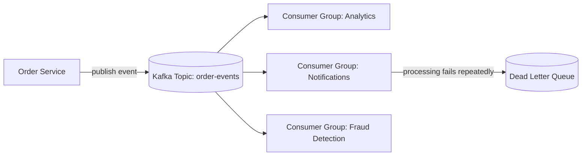

### 15.6 Optimized Code Snippet
```javascript
// Idempotent Kafka consumer (kafkajs) with manual offset commit
const { Kafka } = require('kafkajs');

const kafka = new Kafka({ clientId: 'order-consumer', brokers: ['kafka:9092'] });
const consumer = kafka.consumer({ groupId: 'notification-service' });

async function run() {
  await consumer.subscribe({ topic: 'order-events', fromBeginning: false });
  await consumer.run({
    eachMessage: async ({ topic, partition, message }) => {
      const event = JSON.parse(message.value.toString());

      const alreadyProcessed = await redis.get(`processed:${event.eventId}`);
      if (alreadyProcessed) return; // idempotency guard against redelivery

      await NotificationService.send(event);
      await redis.set(`processed:${event.eventId}`, '1', 'EX', 86400);
      // offset auto-committed after successful handler return (configurable)
    },
  });
}
```

### 15.7 Common Follow-Up Questions
- How does Kafka guarantee ordering, and what are the limits of that guarantee (partition-level only)?
- How do you handle a "poison message" that repeatedly fails processing?
- What's the difference between at-least-once, at-most-once, and exactly-once delivery?
- How would you design idempotent consumers for a payment-processing queue?

### 15.8 Edge Cases & Pitfalls
- Assuming global ordering in Kafka when it's only guaranteed per-partition — cross-partition ordering requires careful key design.
- Non-idempotent consumers causing duplicate side effects (double charges, duplicate emails) on redelivery.
- Not configuring dead-letter queues, causing poison messages to block a queue/partition indefinitely (or endlessly retry).

### 15.9 Performance & Scalability Considerations
- Kafka partition count determines maximum consumer parallelism within a consumer group — under-provisioning partitions caps throughput.
- SQS visibility timeout must exceed expected processing time, or messages become falsely visible again and get double-processed.
- Batch consumption (processing N messages per poll) improves throughput at the cost of per-message latency.

### 15.10 Best Practices
- Design all consumers to be idempotent regardless of broker choice (at-least-once is the practical default).
- Configure DLQs for every production queue to isolate and alert on poison messages.
- Choose partition/shard keys carefully to balance parallelism against ordering requirements.

### 15.11 Trade-offs
| System | Throughput | Ordering | Replay | Ops Overhead |
|---|---|---|---|---|
| Kafka | Very High | Per-partition | Yes | High (self-managed) / Medium (managed) |
| RabbitMQ | Medium-High | Per-queue (typically) | No (consumed & removed) | Medium |
| SQS | High (managed) | FIFO queues only | No | Very Low (fully managed) |

### 15.12 Interview Tips
> 🎯 Always state "at-least-once by default, so consumers must be idempotent" — this single sentence signals production maturity across nearly every messaging-system question.

### 15.13 Summary
> ✅ Kafka excels at high-throughput, replayable event streams; RabbitMQ suits complex routing/task-queue patterns; SQS offers zero-ops simplicity. All three are typically at-least-once — idempotent consumer design is the universal senior-level requirement.

---
## 16. Node.js Security Best Practices (OWASP)

### 16.1 Interview Question
> "What security vulnerabilities are you specifically watchful for in a Node.js/Express application, and how do you mitigate them?"

### 16.2 Concise Answer
> 💡 Focus on OWASP Top 10 applied to Node: injection (NoSQL/SQL), broken authentication, sensitive data exposure, XSS, insecure deserialization, vulnerable dependencies (`npm audit`), and prototype pollution — a Node/JS-specific class of vulnerability. Defense-in-depth: input validation, parameterized queries, security headers (`helmet`), and dependency scanning in CI.

### 16.3 Deep Technical Explanation
- **Prototype pollution**: JS-specific vulnerability where an attacker-controlled merge/assignment (e.g., `_.merge({}, userInput)` or a naive deep-merge) injects properties into `Object.prototype`, affecting all objects application-wide — can lead to privilege escalation or DoS. Mitigated by using `Object.create(null)`, `Map` instead of plain objects for untrusted keys, and validating/sanitizing keys like `__proto__`, `constructor`, `prototype`.
- **NoSQL injection**: MongoDB queries built from unsanitized user input (e.g., `{ $where: userInput }` or object-based query injection like `{ "password": { "$ne": null } }`) bypass intended logic. Mitigate via strict schema validation and avoiding operators from unsanitized input.
- **Dependency vulnerabilities**: Node's ecosystem relies heavily on third-party packages; supply-chain attacks (malicious npm packages) are a growing concern — mitigate with `npm audit`/Snyk in CI, lockfiles, and minimizing dependency footprint.
- **ReDoS (Regular Expression DoS)**: poorly constructed regexes with catastrophic backtracking can block the event loop for seconds on crafted input.
- Standard OWASP mitigations: `helmet` for security headers (CSP, HSTS, X-Frame-Options), parameterized queries/ORMs for SQL injection, output encoding for XSS, `bcrypt`/`argon2` for password hashing (never MD5/SHA1 unsalted), and CSRF tokens for state-changing cookie-authenticated requests.

### 16.4 Real-World Production Examples
- The widely publicized **`lodash` prototype pollution CVEs** (multiple versions) affected countless Node applications using vulnerable `merge`/`defaultsDeep` functions on user input.
- **npm supply-chain attacks** (e.g., compromised popular packages publishing malicious postinstall scripts) have prompted widespread adoption of lockfile integrity checks and `npm ci` in CI pipelines.
- Companies handling PII/PCI data (fintech, healthtech) commonly run automated dependency scanning (Snyk/Dependabot) as a hard CI gate blocking merges on high-severity CVEs.

### 16.5 Architecture Diagram
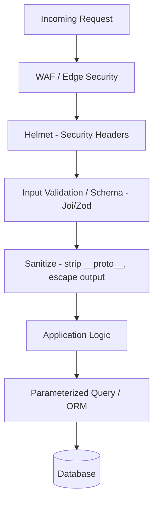

### 16.6 Optimized Code Snippet
```javascript
const helmet = require('helmet');
const rateLimit = require('express-rate-limit');
const { z } = require('zod');

app.use(helmet()); // sets CSP, HSTS, X-Frame-Options, etc.
app.use(rateLimit({ windowMs: 60_000, max: 100 }));

// Strict schema validation prevents NoSQL injection & prototype pollution vectors
const loginSchema = z.object({
  email: z.string().email(),
  password: z.string().min(8),
});

app.post('/login', (req, res, next) => {
  const parsed = loginSchema.safeParse(req.body);
  if (!parsed.success) return res.status(400).json({ errors: parsed.error.issues });
  req.validatedBody = parsed.data;
  next();
});

// Safe object merging: guard against prototype pollution
function safeMerge(target, source) {
  for (const key of Object.keys(source)) {
    if (key === '__proto__' || key === 'constructor' || key === 'prototype') continue;
    target[key] = source[key];
  }
  return target;
}

// Password hashing
const bcrypt = require('bcrypt');
const hashedPassword = await bcrypt.hash(plainPassword, 12);
```

### 16.7 Common Follow-Up Questions
- What is prototype pollution, and how would you defend against it?
- How do you securely handle dependency vulnerabilities in a large monorepo with hundreds of transitive dependencies?
- How does `helmet` mitigate specific attack vectors — walk through 2-3 headers it sets?
- What's the difference between authentication and authorization vulnerabilities, and give an example of each?

### 16.8 Edge Cases & Pitfalls
- Using unsanitized user input as MongoDB query operators (`$where`, `$gt`, etc.) enabling NoSQL injection.
- Deep-merging untrusted JSON without guarding `__proto__`/`constructor` keys.
- Logging sensitive data (passwords, tokens, PII) in plaintext application logs.
- Using outdated hashing (MD5/SHA1) or unsalted hashes for passwords.

### 16.9 Performance & Scalability Considerations
- Security middleware (helmet, validation) adds negligible latency relative to the risk mitigated — never skip for "performance" reasons.
- Rate limiting and WAF rules should be tuned to avoid false-positive blocking of legitimate high-volume clients (partners/API consumers).

### 16.10 Best Practices
- Validate **all** external input against a strict schema (Zod/Joi) before use.
- Run `npm audit`/Snyk/Dependabot in CI as a blocking gate for high/critical vulnerabilities.
- Use `bcrypt`/`argon2` for password hashing; never roll your own crypto.
- Apply the principle of least privilege for DB users/service accounts.

### 16.11 Trade-offs
| Mitigation | Effort | Coverage |
|---|---|---|
| Manual input sanitization | Low, ad hoc | Inconsistent, error-prone |
| Schema validation (Zod/Joi) | Medium (upfront schema work) | Comprehensive, consistent |
| WAF/Edge security | Low (managed) | Broad but coarse; doesn't replace app-level validation |

### 16.12 Interview Tips
> 🎯 Prototype pollution is a distinctly Node/JS interview differentiator — few non-JS engineers know it, so explaining it clearly is a strong senior-level signal.

### 16.13 Summary
> ✅ Node security requires OWASP fundamentals (injection, XSS, broken auth) plus JS-specific risks like prototype pollution and supply-chain/dependency vulnerabilities. Defense-in-depth — schema validation, parameterized queries, security headers, and CI-gated dependency scanning — is the production standard.

---

## 17. Logging, Monitoring & Observability

### 17.1 Interview Question
> "How would you design observability for a distributed Node.js microservices system so you can debug production incidents quickly?"

### 17.2 Concise Answer
> 💡 Observability rests on three pillars: **structured logs** (JSON, correlation IDs), **metrics** (RED/USE method via Prometheus/StatsD), and **distributed tracing** (OpenTelemetry spans across service boundaries). The key production requirement is a **correlation/trace ID** propagated through every service hop so a single request can be followed end-to-end.

### 17.3 Deep Technical Explanation
- **Structured logging**: emit JSON logs (not free-text) with consistent fields (`timestamp`, `level`, `service`, `traceId`, `message`) so log aggregators (ELK, Datadog, Splunk) can query/filter reliably. Libraries: `pino` (fast, low-overhead) or `winston` (flexible transports).
- **Metrics — RED method** (Rate, Errors, Duration) for services, or **USE method** (Utilization, Saturation, Errors) for resources — exposed via `/metrics` (Prometheus format) and scraped, or pushed via StatsD.
- **Distributed tracing**: each request gets a `traceId` generated at the edge (API gateway) and propagated via headers (`traceparent` — W3C Trace Context standard) through every downstream call; each service creates **spans** representing its work, which are stitched together in a tracing backend (Jaeger, Zipkin, Datadog APM) to visualize the full request path and pinpoint the slow/failing hop.
- **Correlation ID propagation** in Node requires care: since a single process handles many concurrent requests, you cannot use a global variable — must use `AsyncLocalStorage` (Node's continuation-local storage) to keep the trace context bound to the correct async execution context across `await`s.

### 17.4 Real-World Production Examples
- **Uber, Netflix, and most FAANG-scale companies** run OpenTelemetry-instrumented services feeding into internal or vendor (Datadog/Honeycomb) tracing backends, since a single user request often traverses dozens of microservices.
- A common **incident-response pattern**: given a customer-reported slow request with a trace ID from response headers, on-call engineers query the tracing backend directly to see exactly which of 15 downstream calls took 4 of the 5 total seconds — reducing MTTR from hours to minutes.

### 17.5 Architecture Diagram
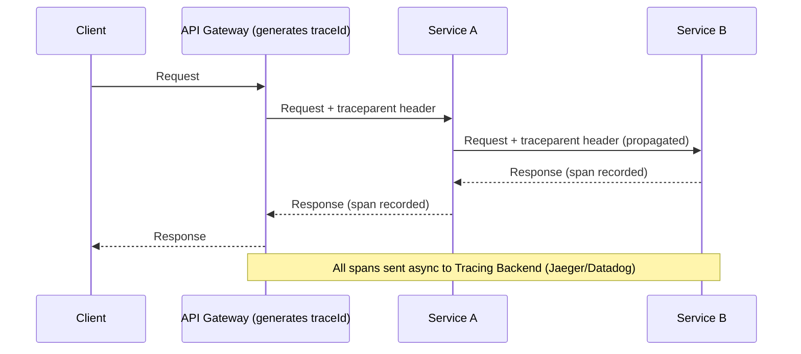

### 17.6 Optimized Code Snippet
```javascript
// AsyncLocalStorage for correlation ID propagation across async boundaries
const { AsyncLocalStorage } = require('async_hooks');
const asyncLocalStorage = new AsyncLocalStorage();

function requestContextMiddleware(req, res, next) {
  const traceId = req.headers['x-trace-id'] || crypto.randomUUID();
  asyncLocalStorage.run({ traceId }, () => next());
}

// Structured logger that automatically includes traceId from context
const pino = require('pino')();
function logger(msg, meta = {}) {
  const store = asyncLocalStorage.getStore();
  pino.info({ traceId: store?.traceId, ...meta }, msg);
}

// Usage anywhere downstream, even after multiple awaits — context is preserved
app.get('/orders/:id', requestContextMiddleware, async (req, res) => {
  logger('Fetching order', { orderId: req.params.id });
  const order = await OrderService.findById(req.params.id); // traceId still correct here
  res.json(order);
});
```

### 17.7 Common Follow-Up Questions
- How does `AsyncLocalStorage` preserve context across `await` boundaries, and what's its performance overhead?
- What's the difference between logs, metrics, and traces — and when do you reach for each during an incident?
- How would you sample traces in a very high-traffic system to control tracing backend costs?
- How do you propagate trace context across a message queue (async, not just synchronous HTTP)?

### 17.8 Edge Cases & Pitfalls
- Using a global/module-level variable to store "current request" context — breaks under concurrency since Node handles many requests interleaved on one thread.
- Logging unstructured free-text messages makes production log search/aggregation nearly useless at scale.
- 100% trace sampling at very high QPS can overwhelm tracing infrastructure and inflate costs — needs sampling strategy (head-based or tail-based).

### 17.9 Performance & Scalability Considerations
- `AsyncLocalStorage` has measurable but generally acceptable overhead (~single-digit % in most benchmarks) — worth it for the debugging value at scale.
- Use log levels appropriately (`debug` off in production by default) to control volume/cost.
- Implement trace sampling (e.g., 1-10% head-based, or tail-based sampling that always keeps error/slow traces) to balance visibility and cost.

### 17.10 Best Practices
- Always generate/propagate a trace ID at the edge and thread it through logs, metrics tags, and trace spans.
- Use `pino` for high-throughput structured logging with minimal overhead.
- Instrument RED metrics (rate, errors, duration) per endpoint as the baseline dashboard for every service.

### 17.11 Trade-offs
| Pillar | Purpose | Cost |
|---|---|---|
| Logs | Detailed, ad hoc debugging | High volume/storage cost |
| Metrics | Aggregate trends, alerting | Low cost, low granularity |
| Traces | Per-request causal path across services | Medium cost, highest debugging value for distributed systems |

### 17.12 Interview Tips
> 🎯 Explicitly mention `AsyncLocalStorage` — many candidates know "use a trace ID" conceptually but can't explain how Node specifically keeps that ID bound to the correct concurrent request.

### 17.13 Summary
> ✅ Full observability requires structured logs, RED/USE metrics, and distributed tracing unified by a trace ID propagated end-to-end. In Node specifically, `AsyncLocalStorage` is the mechanism that correctly binds context across concurrent async executions.

---

## 18. Testing Strategies (Unit / Integration / E2E)

### 18.1 Interview Question
> "How do you structure a testing strategy for a large Node.js backend, and how do you balance test coverage against velocity?"

### 18.2 Concise Answer
> 💡 Follow the **testing pyramid**: many fast, isolated **unit tests**, fewer **integration tests** (real DB/HTTP against test containers), and a small number of critical-path **E2E tests**. Mock external dependencies at unit level; use ephemeral real infrastructure (via `testcontainers`) for integration tests to catch real query/serialization bugs unit tests miss.

### 18.3 Deep Technical Explanation
- **Unit tests**: test a single function/module in isolation, mocking all I/O (DB, network, filesystem). Fast (ms), run on every commit. Frameworks: Jest, Vitest, Mocha+Chai.
- **Integration tests**: test how modules interact with real (or realistic) infrastructure — a real Postgres instance (via `testcontainers` spinning up an ephemeral Docker container), real Redis, etc. Catches issues unit tests with mocks miss: actual SQL syntax errors, serialization mismatches, transaction behavior.
- **E2E tests**: exercise the full deployed system (or a close staging replica) through its public interface (HTTP API, UI). Slowest, most brittle, but validate real user-facing flows. Kept intentionally few — critical business flows only (checkout, signup).
- **Contract testing** (e.g., Pact): for microservices, verifies that a consumer's expectations of a provider's API match the provider's actual behavior — without needing full E2E environments, catching integration breakage between independently-deployed services.
- **Test doubles**: distinguish mocks (verify interaction/calls), stubs (canned responses), and fakes (working lightweight implementation, e.g., in-memory DB) — using the right one avoids over-mocking that tests implementation details rather than behavior.

### 18.4 Real-World Production Examples
- **Google's testing philosophy** (documented widely) explicitly advocates the pyramid shape — heavy unit test investment, moderate integration, minimal E2E — to keep CI fast while maintaining confidence.
- Many companies use **`testcontainers`** (Node bindings) in CI to spin up real Postgres/Redis/Kafka containers per test run, avoiding the "works with mocks, breaks in production" class of bugs.
- **Contract testing (Pact)** is common at companies with many independently-deployed microservices (e.g., described in engineering blogs from companies practicing consumer-driven contracts) to catch breaking API changes before deployment without slow, flaky full-system E2E suites.

### 18.5 Architecture Diagram
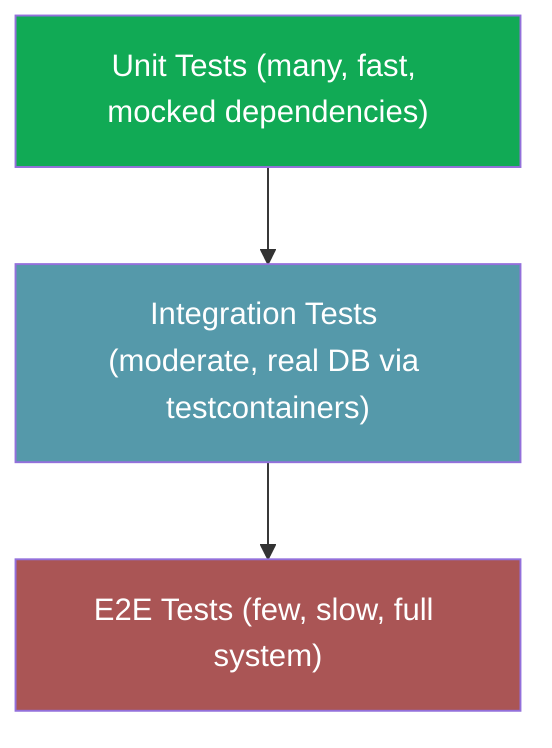

### 18.6 Optimized Code Snippet
```javascript
// Unit test: mocked dependency (Jest)
jest.mock('../services/paymentGateway');
const { chargeCard } = require('../services/paymentGateway');

test('OrderService throws AppError when payment fails', async () => {
  chargeCard.mockRejectedValue(new Error('Card declined'));
  await expect(OrderService.placeOrder({ amount: 100 }))
    .rejects.toThrow('Payment failed');
});

// Integration test with a real ephemeral Postgres container
const { GenericContainer } = require('testcontainers');

let container, pool;
beforeAll(async () => {
  container = await new GenericContainer('postgres:16')
    .withEnvironment({ POSTGRES_PASSWORD: 'test' })
    .withExposedPorts(5432)
    .start();
  pool = new Pool({ host: container.getHost(), port: container.getMappedPort(5432) });
  await pool.query('CREATE TABLE orders (id SERIAL PRIMARY KEY, amount NUMERIC)');
});

test('OrderRepository.create persists an order to real Postgres', async () => {
  const order = await OrderRepository.create(pool, { amount: 49.99 });
  const { rows } = await pool.query('SELECT * FROM orders WHERE id = $1', [order.id]);
  expect(rows[0].amount).toBe('49.99');
});

afterAll(async () => { await pool.end(); await container.stop(); });
```

### 18.7 Common Follow-Up Questions
- How do you decide what belongs in a unit test vs an integration test?
- What is contract testing, and why is it useful specifically for microservices?
- How do you handle flaky E2E tests in CI without just deleting them?
- Mocks vs stubs vs fakes — what's the practical difference, and when do you over-mock?

### 18.8 Edge Cases & Pitfalls
- Over-mocking leads to tests that pass while the real integration is broken ("mock drift" from actual API behavior).
- Flaky E2E tests due to timing/race conditions erode trust in CI, leading teams to ignore failures ("test fatigue").
- Testing implementation details (internal function calls) instead of observable behavior makes tests brittle to refactors.

### 18.9 Performance & Scalability Considerations
- Parallelize unit tests aggressively (they're cheap); run integration tests with contained, ephemeral infra to avoid shared-state flakiness across parallel CI runners.
- Keep E2E suites small and fast enough to run on every deploy, not just nightly, to catch regressions before they reach production.

### 18.10 Best Practices
- Maintain the pyramid shape — resist the temptation to over-invest in E2E tests for coverage vanity metrics.
- Use `testcontainers` (or equivalent) for integration tests instead of hitting shared, stateful staging databases.
- Adopt contract testing for critical cross-team microservice boundaries.

### 18.11 Trade-offs
| Test Type | Speed | Confidence | Brittleness |
|---|---|---|---|
| Unit | Very Fast | Lower (isolated) | Low |
| Integration | Medium | High (real deps) | Medium |
| E2E | Slow | Highest (full system) | High |

### 18.12 Interview Tips
> 🎯 Mention `testcontainers` by name — it signals you've moved past "mock everything" toward production-grade integration testing practices.

### 18.13 Summary
> ✅ A healthy testing strategy follows the pyramid — abundant fast unit tests, moderate real-infrastructure integration tests (via testcontainers), and few critical-path E2E tests — supplemented by contract testing at microservice boundaries to catch cross-team breakage early.

---

## 19. CI/CD Pipelines for Node.js

### 19.1 Interview Question
> "Walk me through how you'd design a CI/CD pipeline for a Node.js microservice deployed dozens of times a day."

### 19.2 Concise Answer
> 💡 A production pipeline runs: lint/type-check → unit tests → build → integration tests (ephemeral containers) → security/dependency scan → build & push container image → deploy via progressive rollout (canary/blue-green) with automated health-check-based rollback.

### 19.3 Deep Technical Explanation
- **Stages**: static analysis (ESLint, TypeScript check) fails fast and cheaply before expensive stages run. Unit tests next (fast feedback). Build the artifact (Docker image) once and promote the **same** image through environments (build-once, deploy-many — avoids "works in staging, breaks in prod" from rebuild drift).
- **Progressive delivery**: **canary** deployments route a small % of traffic to the new version, monitoring error rate/latency before full rollout; **blue-green** maintains two full environments and switches traffic atomically, enabling instant rollback by switching back.
- **Automated rollback**: tied to health checks/SLO metrics (error rate, latency) — if the canary's metrics degrade beyond a threshold within the bake time, the pipeline automatically halts/rolls back without human intervention.
- **Feature flags** decouple deployment from release — code can be deployed dark (inactive) and enabled gradually/instantly without a new deployment, reducing deployment risk further.

### 19.4 Real-World Production Examples
- **Netflix** popularized canary analysis (via their open-source **Kayenta** tool) — automatically comparing canary vs baseline metrics statistically before promoting a release.
- Most FAANG and high-growth startups use **GitHub Actions/GitLab CI/CircleCI** to build a container image once, then deploy that exact image through dev→staging→prod via Argo CD/Spinnaker/Kubernetes-native GitOps, rather than rebuilding per environment.
- **Etsy/Facebook**-style "ship many times a day" cultures rely heavily on feature flags to decouple risky code deployment from user-facing release timing.

### 19.5 Architecture Diagram
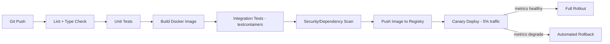

### 19.6 Optimized Code Snippet
```yaml
# Simplified GitHub Actions pipeline
name: CI/CD
on: [push]
jobs:
  test-and-build:
    runs-on: ubuntu-latest
    steps:
      - uses: actions/checkout@v4
      - uses: actions/setup-node@v4
        with: { node-version: '20' }
      - run: npm ci
      - run: npm run lint && npm run typecheck
      - run: npm run test:unit
      - run: npm run test:integration   # uses testcontainers
      - run: npx audit-ci --high        # fail build on high/critical CVEs
      - name: Build & push image
        run: |
          docker build -t registry/order-service:${{ github.sha }} .
          docker push registry/order-service:${{ github.sha }}
      - name: Deploy canary
        run: kubectl argo rollouts set image order-service order-service=registry/order-service:${{ github.sha }}
```

### 19.7 Common Follow-Up Questions
- Canary vs blue-green deployment — trade-offs of each?
- How do you decide the bake time/traffic percentage for a canary rollout?
- How do feature flags change your deployment risk model versus traditional deploys?
- What would you automatically monitor to trigger an automated rollback?

### 19.8 Edge Cases & Pitfalls
- Rebuilding the artifact separately per environment introduces "it worked in staging" drift from subtle build differences.
- Database migrations that aren't backward-compatible break canary/blue-green deployments where old and new code run simultaneously against the same schema.
- Missing automated rollback criteria means a bad canary silently rolls to 100% before anyone notices.

### 19.9 Performance & Scalability Considerations
- Build-once-deploy-many significantly reduces pipeline time for multi-environment promotion.
- Parallelize independent CI stages (lint + unit tests can run concurrently) to reduce feedback latency.

### 19.10 Best Practices
- Always design database migrations to be backward-compatible with the previous code version during rollout (expand-contract pattern).
- Gate deployments on automated health/SLO checks, not just "deploy succeeded."
- Use feature flags to separate deployment risk from release/business risk.

### 19.11 Trade-offs
| Strategy | Rollback Speed | Infra Cost | Complexity |
|---|---|---|---|
| Canary | Fast (partial traffic) | Low-Medium | Medium |
| Blue-Green | Instant (traffic switch) | Higher (2x environments) | Medium |
| Rolling update (basic) | Slower | Low | Low |

### 19.12 Interview Tips
> 🎯 Bring up the expand-contract pattern for backward-compatible DB migrations during canary/blue-green deploys — a frequently overlooked but critical detail at senior level.

### 19.13 Summary
> ✅ Production CI/CD builds an artifact once and progressively deploys it (canary/blue-green) gated by automated health metrics, with feature flags decoupling deployment from release. Backward-compatible database migrations are essential to support safe progressive rollout.

---

## 20. Containerization & Orchestration (Docker / Kubernetes)

### 20.1 Interview Question
> "How would you containerize and deploy a production Node.js service on Kubernetes, and what Node-specific gotchas do you watch for?"

### 20.2 Concise Answer
> 💡 Build a minimal, multi-stage Docker image (small attack surface, fast startup), run as a non-root user, and configure Kubernetes readiness/liveness probes plus resource requests/limits that account for Node's memory model (`--max-old-space-size` must fit within the container's memory limit). Handle `SIGTERM` for graceful shutdown to avoid dropped in-flight requests during pod termination.

### 20.3 Deep Technical Explanation
- **Multi-stage builds**: separate build stage (installs devDependencies, compiles TypeScript) from a slim runtime stage (only production dependencies + compiled output) — dramatically reduces image size and attack surface.
- **Signal handling**: Kubernetes sends `SIGTERM` to a pod before force-killing it (`SIGKILL`) after a grace period. Node apps must catch `SIGTERM`, stop accepting new connections, let in-flight requests finish, then exit — otherwise requests are abruptly dropped during rolling deploys/scale-downs.
- **Memory limit alignment**: V8's default heap limit is based on available system memory, which inside a cgroup-limited container can be misdetected (especially on older Node versions) — leading to either OOM kills (heap grows past container limit before V8 triggers GC) or under-utilization. Explicitly set `--max-old-space-size` below the container's memory limit (leaving headroom for non-heap memory: stack, buffers, native modules).
- **Probes**: **readiness probe** determines if a pod should receive traffic (e.g., DB connection established); **liveness probe** determines if the pod should be restarted (e.g., event loop responsive). Misconfigured liveness probes (too aggressive) can cause restart loops under normal load spikes.

### 20.4 Real-World Production Examples
- Companies running Node at scale on Kubernetes (widely discussed in engineering blogs, e.g., **Airbnb, Yelp**) commonly hit the container-memory-limit-vs-V8-heap misalignment issue, producing confusing OOMKilled events despite `process.memoryUsage()` looking "fine" — resolved by explicit `--max-old-space-size` tuning.
- Standard production pattern: **PM2 or the Node process itself** handles `SIGTERM` to drain connections, combined with a Kubernetes `preStop` hook that sleeps briefly before sending `SIGTERM`, to account for propagation delay in removing the pod from the load balancer's endpoint list.

### 20.5 Architecture Diagram
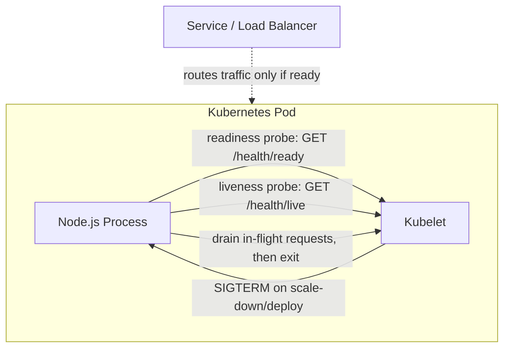

### 20.6 Optimized Code Snippet
```dockerfile
# Multi-stage Dockerfile
FROM node:20-alpine AS build
WORKDIR /app
COPY package*.json ./
RUN npm ci
COPY . .
RUN npm run build

FROM node:20-alpine AS runtime
WORKDIR /app
ENV NODE_ENV=production
COPY package*.json ./
RUN npm ci --omit=dev
COPY --from=build /app/dist ./dist
USER node
EXPOSE 3000
CMD ["node", "--max-old-space-size=384", "dist/index.js"]
```

```javascript
// Graceful shutdown handling SIGTERM
const server = app.listen(3000);

process.on('SIGTERM', () => {
  console.log('SIGTERM received, draining connections...');
  server.close(() => {
    console.log('All connections closed, exiting.');
    process.exit(0);
  });
  // force-exit safety net if connections hang
  setTimeout(() => process.exit(1), 10_000).unref();
});
```

### 20.7 Common Follow-Up Questions
- Why can a container be OOMKilled even when `process.memoryUsage()` looks normal?
- Difference between readiness and liveness probes, and what happens if you misconfigure each?
- How do you achieve zero-downtime deploys on Kubernetes for a stateful-ish Node service (in-flight WebSocket connections)?
- Why use Alpine-based images, and what are the trade-offs (musl vs glibc compatibility issues)?

### 20.8 Edge Cases & Pitfalls
- Not setting `--max-old-space-size`, causing V8 to size its heap based on host memory rather than the container's cgroup limit, leading to OOMKilled events.
- Aggressive liveness probes (short timeout/low failure threshold) causing restart loops under legitimate GC pauses or brief load spikes.
- Not handling `SIGTERM`, causing dropped requests on every deploy/scale-down.
- Alpine's `musl` libc occasionally causing subtle incompatibilities with native Node addons built against `glibc`.

### 20.9 Performance & Scalability Considerations
- Right-size CPU/memory requests and limits based on actual profiling, not guesses — over-provisioning wastes cluster capacity, under-provisioning causes throttling/OOM.
- Use Horizontal Pod Autoscaler (HPA) tied to CPU or custom metrics (e.g., request queue depth) for elastic scaling.

### 20.10 Best Practices
- Always handle `SIGTERM` for graceful shutdown; pair with a K8s `preStop` hook for LB deregistration timing.
- Explicitly set `--max-old-space-size` below the container memory limit.
- Use multi-stage builds and run as a non-root user for security and image size.

### 20.11 Trade-offs
| Aspect | Choice A | Choice B |
|---|---|---|
| Base image | `node:alpine` (small, musl) | `node:slim`/`bullseye` (larger, glibc compatible) |
| Scaling | `cluster` module in-pod | One process per pod + HPA |
| Probe strictness | Aggressive (fast detection) | Lenient (fewer false-positive restarts) |

### 20.12 Interview Tips
> 🎯 The `--max-old-space-size` vs container memory limit mismatch is a classic "have you actually run Node in production on K8s" question — concrete familiarity here is a strong signal.

### 20.13 Summary
> ✅ Production Node containers need multi-stage builds, explicit V8 heap sizing aligned with container memory limits, and proper `SIGTERM` handling for graceful shutdown. Kubernetes readiness/liveness probes must be tuned thoughtfully to avoid false-positive restarts.

---
## 21. Scaling Node.js Applications

### 21.1 Interview Question
> "A Node.js API is struggling under 10x traffic growth. Walk me through how you'd diagnose and scale it."

### 21.2 Concise Answer
> 💡 First diagnose **where** the bottleneck is (CPU-bound event loop, DB, memory, or downstream service) using profiling/metrics — don't scale blindly. Then apply the right lever: horizontal scaling (more instances/replicas) for stateless CPU/request-bound load, vertical/architectural fixes (caching, query optimization, connection pooling) for DB bottlenecks, and async offloading for heavy work.

### 21.3 Deep Technical Explanation
Scaling Node systematically follows a diagnosis-first approach:
1. **Identify the bottleneck**: check event loop lag, CPU utilization, DB query latency/connection saturation, and downstream service latency via APM/tracing (Topic 17) before making changes.
2. **Horizontal scaling (scale-out)**: add more stateless instances behind a load balancer — the default first lever since Node instances are cheap to replicate and mostly stateless (session state externalized to Redis).
3. **Vertical scaling**: more CPU/memory per instance — has diminishing returns for a single-threaded event loop unless paired with `cluster`/worker threads to actually use extra cores.
4. **Database scaling**: read replicas for read-heavy workloads, sharding for write-heavy workloads, query optimization/indexing, and connection pooling (Topic 10) — often the *actual* bottleneck when "the API is slow," not the Node process itself.
5. **Caching** (Topic 9) to reduce repeated expensive work/DB round trips.
6. **Async offloading**: move non-critical-path work (emails, analytics, image processing) to background queues (Topic 15) so request-serving instances aren't blocked by it.
7. **CDN/edge caching** for static/cacheable responses to reduce origin load entirely.

The senior-level insight: **scaling Node instances doesn't fix a database bottleneck** — a very common mistake is over-provisioning app servers while the actual constraint is DB connections or slow queries.

### 21.4 Real-World Production Examples
- A frequently-discussed pattern (echoed across many engineering blogs) is teams scaling app server replicas 5x during a traffic spike, only to hit `max_connections` on the database (Topic 10) and see error rates *increase* — the real fix was read replicas + query optimization, not more app instances.
- **Discord's** engineering blog has documented scaling challenges specifically around a single hot resource (a "big guild" with millions of members) requiring architectural sharding changes beyond simple horizontal scaling.

### 21.5 Architecture Diagram
```mermaid
flowchart TB
    Client --> CDN[CDN / Edge Cache]
    CDN --> LB[Load Balancer]
    LB --> N1[Node Instance 1]
    LB --> N2[Node Instance 2]
    LB --> N3[Node Instance N - HPA scaled]
    N1 --> Cache[(Redis Cache)]
    N1 --> PoolReader[(Read Replica Pool)]
    N1 --> PoolWriter[(Primary DB - Writes)]
    N1 -->|async offload| Queue[(Message Queue)]
    Queue --> Worker[Background Workers]
```

### 21.6 Optimized Code Snippet
```javascript
// Read/write splitting to scale DB reads independently of writes
const writePool = new Pool({ host: process.env.DB_PRIMARY_HOST, max: 10 });
const readPool = new Pool({ host: process.env.DB_REPLICA_HOST, max: 20 });

async function getOrder(id) {
  const { rows } = await readPool.query('SELECT * FROM orders WHERE id = $1', [id]);
  return rows[0];
}

async function createOrder(data) {
  const { rows } = await writePool.query(
    'INSERT INTO orders (amount, user_id) VALUES ($1, $2) RETURNING *',
    [data.amount, data.userId]
  );
  return rows[0];
}

// Offloading non-critical work off the request path
async function placeOrder(data) {
  const order = await createOrder(data); // critical path, synchronous
  queue.publish('order-created', { orderId: order.id }); // fire-and-forget, async
  return order; // respond immediately, don't wait on email/analytics
}
```

### 21.7 Common Follow-Up Questions
- How do you determine whether to scale horizontally vs vertically for a given bottleneck?
- What metrics would immediately tell you "this is a database problem, not an app-server problem"?
- How would you shard a dataset that's outgrown a single database instance?
- How does statelessness (externalizing sessions/cache) enable horizontal scaling?

### 21.8 Edge Cases & Pitfalls
- Scaling app instances without checking DB connection limits (Topic 10), causing connection exhaustion under the "fix."
- In-memory state (local caches, WebSocket connection maps) breaking or behaving inconsistently once horizontally scaled without externalization or sticky sessions.
- Assuming vertical scaling helps a single-threaded CPU-bound bottleneck without also adding `cluster`/worker threads to use the extra cores.

### 21.9 Performance & Scalability Considerations
- Always profile/measure before scaling — "scale first, diagnose later" often wastes cost and can worsen the actual bottleneck (e.g., DB connections).
- Read replicas and caching typically yield the highest ROI for read-heavy APIs before considering sharding.

### 21.10 Best Practices
- Externalize all shared state to enable trivial horizontal scaling of stateless app instances.
- Use APM/tracing to pinpoint the actual bottleneck layer before choosing a scaling strategy.
- Combine horizontal app scaling with DB read replicas/caching for compounding effect on read-heavy systems.

### 21.11 Trade-offs
| Strategy | Cost | Complexity | Best For |
|---|---|---|---|
| Horizontal (app) scaling | Linear cost | Low (if stateless) | Request/CPU-bound load |
| DB read replicas | Medium | Medium | Read-heavy bottlenecks |
| Sharding | High | High | Write-heavy, dataset-outgrows-single-instance scenarios |
| Caching | Low-Medium | Low-Medium | Repeated expensive reads |

### 21.12 Interview Tips
> 🎯 Explicitly say "I'd diagnose before scaling" and name the specific metrics you'd check first — this diagnosis-first framing is exactly what separates senior candidates from those who jump straight to "add more servers."

### 21.13 Summary
> ✅ Scaling Node.js is a diagnosis-first exercise: identify whether the bottleneck is app-layer (CPU/event loop), database, or downstream, then apply the matching lever — horizontal app scaling, read replicas/sharding, caching, or async offloading. Blindly scaling app instances without addressing the real constraint often worsens the problem.

---

## 22. Database Design & ORM vs Query Builder

### 22.1 Interview Question
> "When would you use a full ORM (e.g., Prisma/TypeORM/Sequelize) versus a query builder (e.g., Knex) versus raw SQL in a Node.js backend?"

### 22.2 Concise Answer
> 💡 ORMs offer productivity and type-safety for standard CRUD-heavy domains but can generate inefficient queries (N+1, over-fetching) for complex relational logic. Query builders offer a middle ground — SQL-like control with less boilerplate than raw queries. Raw SQL remains best for complex reporting/analytics queries where full control over query plans matters.

### 22.3 Deep Technical Explanation
- **ORMs** (Prisma, TypeORM, Sequelize) map database rows to objects/models, provide migrations, and abstract SQL — great developer velocity, but their generated queries can be suboptimal (e.g., eager-loading causing N+1 patterns, or over-fetching all columns when only a few are needed) without careful configuration (`select`, `include` tuning).
- **Query builders** (Knex, Kysely) provide a fluent JS API that maps closely to SQL without full object-relational mapping overhead — useful when you want composability and safety (parameterized queries) but full control over exactly what SQL executes.
- **Raw SQL** remains necessary for complex analytical queries, window functions, CTEs, or database-specific optimizations that ORMs abstract away or handle poorly.
- **Schema design fundamentals** remain ORM-agnostic: proper normalization (up to 3NF for transactional data, selective denormalization for read-heavy/reporting paths), correct indexing (covering indexes for hot queries, composite index column-order matters), and choosing appropriate data types (avoid overly wide `VARCHAR`, use proper enum/check constraints).
- **Migrations**: all three approaches need a migration strategy; the critical production concern is ensuring migrations are **backward-compatible** during rolling/canary deploys (expand-contract: add new column nullable → deploy code using it → backfill → make non-null → remove old column in a later release).

### 22.4 Real-World Production Examples
- Many high-growth startups begin with Prisma/Sequelize for velocity, then selectively drop to raw SQL or a query builder for specific hot-path/reporting queries once N+1 or over-fetching issues surface under load testing.
- **Analytics/reporting services** (dashboards, BI) commonly bypass ORMs entirely, using raw parameterized SQL or dedicated OLAP query engines, since ORMs poorly express window functions/complex aggregations.

### 22.5 Architecture Diagram
```mermaid
flowchart TD
    App[Application Code] --> Decision{Query Complexity?}
    Decision -->|Simple CRUD| ORM[ORM - Prisma/TypeORM]
    Decision -->|Composable, moderate complexity| QB[Query Builder - Knex/Kysely]
    Decision -->|Complex analytics/reporting| Raw[Raw Parameterized SQL]
    ORM --> DB[(Database)]
    QB --> DB
    Raw --> DB
```

### 22.6 Optimized Code Snippet
```javascript
// Prisma: avoiding N+1 via explicit 'include' (eager loading)
const ordersWithItems = await prisma.order.findMany({
  where: { userId },
  include: { items: true }, // single JOIN query, not N+1
  select: { id: true, total: true, items: { select: { name: true, qty: true } } },
});

// Knex query builder: explicit control, still parameterized/safe
const orders = await knex('orders')
  .join('order_items', 'orders.id', 'order_items.order_id')
  .where('orders.user_id', userId)
  .select('orders.id', 'orders.total', 'order_items.name');

// Raw SQL for a complex analytics query (window function)
const { rows } = await pool.query(`
  SELECT user_id, amount,
         SUM(amount) OVER (PARTITION BY user_id ORDER BY created_at) as running_total
  FROM orders
  WHERE created_at > $1
`, [startDate]);
```

### 22.7 Common Follow-Up Questions
- How would you detect and fix an N+1 query problem introduced by an ORM?
- Explain the expand-contract migration pattern and why it's needed for zero-downtime deploys.
- When would you denormalize a schema, and what are the trade-offs?
- How do covering indexes improve query performance, and how do you decide index column order for composite indexes?

### 22.8 Edge Cases & Pitfalls
- ORM lazy-loading relations inside a loop causing an N+1 query storm invisible in local testing with small datasets.
- Non-backward-compatible migrations (e.g., dropping a column still used by the previous app version) breaking canary/rolling deploys.
- Over-normalized schemas causing excessive JOINs on hot read paths without appropriate denormalization/caching.

### 22.9 Performance & Scalability Considerations
- Always review generated SQL (via ORM query logging) under realistic data volumes before shipping — small-dataset testing hides N+1 and full-table-scan issues.
- Composite index column order matters: place the most selective/most-frequently-filtered column first (aligned with query patterns).

### 22.10 Best Practices
- Enable query logging in staging/dev to catch N+1 patterns before production.
- Use the expand-contract pattern for all schema migrations affecting live traffic.
- Reserve raw SQL for genuinely complex queries (analytics, window functions); use ORM/query builder for standard CRUD.

### 22.11 Trade-offs
| Approach | Velocity | Control | N+1/Over-fetch Risk |
|---|---|---|---|
| Full ORM | High | Lower | Higher (without care) |
| Query Builder | Medium | High | Lower |
| Raw SQL | Lower | Highest | Lowest (fully explicit) |

### 22.12 Interview Tips
> 🎯 Describe a concrete N+1 debugging story if you have one ("I noticed 200 queries for a page that should need 2, traced it to an unguarded ORM relation") — this is a very commonly probed real-world scenario.

### 22.13 Summary
> ✅ Choose ORMs for CRUD-heavy velocity, query builders for composable control, and raw SQL for complex analytics — and always verify generated queries under realistic data volume to catch N+1/over-fetching. Schema migrations must follow the expand-contract pattern for zero-downtime deploys.

---

## 23. File Uploads & Large Payload Handling

### 23.1 Interview Question
> "How would you design a robust file upload system in Node.js that handles large files (e.g., multi-GB videos) without exhausting server memory?"

### 23.2 Concise Answer
> 💡 Never buffer entire large uploads into memory — stream directly from the incoming HTTP request to the destination (disk or object storage like S3) using multipart parsing streams. For very large files, use **direct-to-S3 presigned URLs** or **multipart/chunked uploads** so the Node server itself never handles the full file body.

### 23.3 Deep Technical Explanation
- **Naive approach** (buffering the whole request body via `body-parser`-style middleware) is fine for small JSON payloads but catastrophic for large file uploads — memory usage scales with concurrent upload size, risking OOM.
- **Streaming multipart parsing** (e.g., `busboy`, which `multer` is built on) parses `multipart/form-data` incrementally, emitting file streams as they arrive, allowing direct piping to disk or cloud storage without full buffering.
- **Presigned URLs**: for object storage (S3/GCS), the Node backend generates a short-lived, permission-scoped upload URL, and the **client uploads directly to storage**, completely bypassing the application server for the file bytes — the best pattern for very large files at scale, since it removes the app server as a bottleneck/single point of memory pressure entirely.
- **Chunked/multipart upload protocols** (S3 Multipart Upload API) split large files into parts uploaded independently (parallelizable, resumable on failure) — essential for multi-GB files where a single-shot upload risks network failure requiring a full restart.
- **Validation concerns**: file type/size limits should be enforced both client-side (UX) and server-side (security) — never trust `Content-Type` header alone (validate actual file signature/magic bytes for security-sensitive uploads).

### 23.4 Real-World Production Examples
- **YouTube/Vimeo-style upload flows** use client-side chunked/resumable uploads (e.g., the tus.io protocol) directly to storage, with the app server only managing upload session metadata.
- **Dropbox/Google Drive** style consumer apps use presigned-URL-based direct-to-storage uploads to avoid routing massive file traffic through application servers.
- A common **anti-pattern** seen in production incidents: an Express app using default `body-parser`/`multer` memory storage (not disk/stream storage) for user file uploads, leading to OOM crashes under concurrent large uploads — fixed by switching to disk/stream-based storage or presigned S3 URLs.

### 23.5 Architecture Diagram
```mermaid
sequenceDiagram
    participant Client
    participant API as Node API Server
    participant S3 as Object Storage (S3)
    Client->>API: Request upload URL
    API->>S3: Generate presigned PUT URL (scoped, short-lived)
    API-->>Client: Presigned URL
    Client->>S3: PUT file directly (bypasses API server entirely)
    S3-->>Client: 200 OK
    Client->>API: Notify upload complete (metadata only)
    API->>API: Persist file metadata to DB
```

### 23.6 Optimized Code Snippet
```javascript
// Streaming multipart upload directly to disk (never buffered fully in memory)
const multer = require('multer');
const upload = multer({
  storage: multer.diskStorage({
    destination: '/tmp/uploads',
    filename: (req, file, cb) => cb(null, `${Date.now()}-${file.originalname}`),
  }),
  limits: { fileSize: 500 * 1024 * 1024 }, // 500MB hard limit
});

app.post('/upload', upload.single('file'), (req, res) => {
  res.json({ path: req.file.path, size: req.file.size });
});

// Preferred at scale: presigned S3 URL, bypassing the app server entirely
const { S3Client, PutObjectCommand } = require('@aws-sdk/client-s3');
const { getSignedUrl } = require('@aws-sdk/s3-request-presigner');

app.post('/upload-url', async (req, res) => {
  const key = `uploads/${req.user.id}/${crypto.randomUUID()}`;
  const command = new PutObjectCommand({ Bucket: 'my-bucket', Key: key, ContentType: req.body.contentType });
  const url = await getSignedUrl(s3Client, command, { expiresIn: 300 }); // 5-min expiry
  res.json({ uploadUrl: url, key });
});
```

### 23.7 Common Follow-Up Questions
- How does `busboy`/`multer` avoid buffering the entire file into memory?
- Why are presigned URLs preferable to routing uploads through the app server at scale?
- How would you implement resumable uploads for unreliable mobile network conditions?
- How do you validate that an uploaded file's actual content matches its claimed type (security)?

### 23.8 Edge Cases & Pitfalls
- Using `multer`'s memory storage (default) instead of disk/S3 storage for large files, causing OOM under concurrent uploads.
- Trusting the `Content-Type` header for security-sensitive validation without checking actual file magic bytes/signature.
- Not setting a hard file size limit, allowing a single malicious upload to exhaust disk or memory.
- Presigned URLs with overly long expiry or overly broad permissions creating a security exposure window.

### 23.9 Performance & Scalability Considerations
- Presigned direct-to-storage uploads remove the app server as a throughput/memory bottleneck entirely for file-heavy workloads.
- Multipart upload (splitting large files) enables parallelism and resumability, critical for very large files over unreliable networks.

### 23.10 Best Practices
- Stream, never buffer, file uploads through the application server.
- Prefer presigned direct-to-storage uploads for large files at scale.
- Enforce both size and type validation server-side, including magic-byte verification for security-sensitive contexts.

### 23.11 Trade-offs
| Approach | App Server Load | Complexity | Best For |
|---|---|---|---|
| Stream to disk via app server | Medium (bandwidth passthrough) | Low | Small-medium files, simpler infra |
| Presigned direct-to-storage | Minimal (metadata only) | Medium (extra flow/security config) | Large files, high scale |

### 23.12 Interview Tips
> 🎯 Proactively mention presigned URLs as the scale-appropriate solution — many candidates only know the `multer`-through-app-server pattern, which doesn't scale for large/high-volume uploads.

### 23.13 Summary
> ✅ Never buffer large file uploads fully in memory — stream via `busboy`/`multer` disk storage for moderate scale, or use presigned direct-to-storage URLs to bypass the app server entirely for large files at scale. Always validate size/type server-side, including magic-byte checks for security.

---

## 24. WebSockets & Real-Time Communication

### 24.1 Interview Question
> "How would you design a scalable real-time notification system using WebSockets in Node.js across multiple server instances?"

### 24.2 Concise Answer
> 💡 A single Node instance can hold many WebSocket connections, but horizontally-scaled instances need a **shared pub/sub backplane** (Redis pub/sub, or a dedicated broker) so a message published on any instance reaches connected clients regardless of which instance they're attached to — since a WebSocket connection is pinned to one specific server process.

### 24.3 Deep Technical Explanation
- A WebSocket is a **persistent, stateful TCP connection** pinned to the specific server process that accepted it — unlike stateless HTTP requests, a client's WebSocket connection cannot simply "move" to another instance behind the load balancer.
- This creates the **cross-instance broadcast problem**: if User A (connected to Instance 1) sends a message that User B (connected to Instance 2) needs to receive, Instance 1 must somehow notify Instance 2. Solved via a shared **pub/sub layer** (Redis pub/sub is the most common, via the `socket.io-redis` / `@socket.io/redis-adapter` for Socket.IO) — each instance subscribes to relevant channels and re-broadcasts to its own locally-connected clients.
- **Sticky sessions**: load balancers must route a given client's WebSocket connection (and its HTTP upgrade handshake) consistently to the same backend instance for the connection's lifetime — typically via IP hash or cookie-based affinity — since mid-connection re-routing isn't possible for a stateful TCP stream.
- **Scaling considerations**: each instance has a practical connection ceiling (file descriptor limits, memory per connection) — horizontal scaling with the pub/sub backplane is the standard approach, alongside connection-count-aware load balancing (not just round-robin, since connections are long-lived and unevenly distributed over time).
- **Fallbacks**: Socket.IO (built on WebSocket + long-polling fallback) is often chosen in production over raw `ws` for its automatic reconnection, room/namespace abstractions, and fallback transport support for restrictive network environments.

### 24.4 Real-World Production Examples
- **Slack/Discord**-style chat systems rely on exactly this pattern: WebSocket gateway servers pinned per-connection, backed by a pub/sub/message bus (often Kafka or Redis-based) to fan out messages across the fleet of gateway instances.
- **Socket.IO's official Redis adapter** is the standard production solution for horizontally scaling Socket.IO deployments, explicitly built to solve the cross-instance broadcast problem described above.

### 24.5 Architecture Diagram
```mermaid
flowchart TB
    ClientA[Client A] -->|WebSocket, sticky| Inst1[WS Instance 1]
    ClientB[Client B] -->|WebSocket, sticky| Inst2[WS Instance 2]
    Inst1 -->|publish message| Redis[(Redis Pub/Sub)]
    Redis -->|broadcast to subscribers| Inst1
    Redis -->|broadcast to subscribers| Inst2
    Inst2 -->|deliver over local WS connection| ClientB
    LB[Load Balancer - sticky sessions] --> Inst1
    LB --> Inst2
```

### 24.6 Optimized Code Snippet
```javascript
// Socket.IO with Redis adapter for horizontal scaling
const { Server } = require('socket.io');
const { createAdapter } = require('@socket.io/redis-adapter');
const { createClient } = require('redis');

const io = new Server(httpServer, { cors: { origin: '*' } });

const pubClient = createClient({ url: process.env.REDIS_URL });
const subClient = pubClient.duplicate();
await Promise.all([pubClient.connect(), subClient.connect()]);
io.adapter(createAdapter(pubClient, subClient));

io.on('connection', (socket) => {
  socket.on('join-room', (roomId) => socket.join(roomId));

  socket.on('send-message', ({ roomId, message }) => {
    // io.to() broadcasts across ALL instances via the Redis adapter transparently
    io.to(roomId).emit('new-message', message);
  });
});
```

### 24.7 Common Follow-Up Questions
- Why can't a WebSocket connection simply move to another server instance behind the load balancer?
- How do sticky sessions work at the load balancer level, and what happens if an instance dies mid-connection?
- WebSockets vs Server-Sent Events (SSE) vs long-polling — when would you choose each?
- How would you handle authentication for a WebSocket connection (since headers work differently than typical HTTP requests)?

### 24.8 Edge Cases & Pitfalls
- Deploying without a pub/sub backplane in a horizontally-scaled setup causes messages to only reach clients connected to the *same* instance as the sender — silent partial delivery failures.
- Sticky session load balancer misconfiguration causing reconnection storms to redistribute unevenly, overloading a subset of instances.
- Not handling reconnection/backoff client-side, causing thundering-herd reconnect storms after an instance restart/deploy.

### 24.9 Performance & Scalability Considerations
- Each WebSocket connection consumes a file descriptor and some baseline memory — tune `ulimit`/container FD limits accordingly for high-connection-count instances.
- Redis pub/sub throughput can become a bottleneck at very high message fan-out rates — consider sharding channels or a more purpose-built message bus (Kafka) at extreme scale.

### 24.10 Best Practices
- Always use a pub/sub backplane (Redis adapter or equivalent) for any horizontally-scaled WebSocket deployment.
- Configure sticky sessions correctly at the load balancer for connection affinity.
- Implement client-side reconnection with exponential backoff + jitter to avoid reconnect storms.

### 24.11 Trade-offs
| Transport | Bi-directional | Overhead | Firewall/Proxy Friendliness |
|---|---|---|---|
| WebSocket | Yes | Low (persistent connection) | Can be blocked by some proxies |
| Server-Sent Events | Server→Client only | Low-Medium | Very friendly (plain HTTP) |
| Long Polling | Emulated | High (repeated requests) | Most friendly (plain HTTP) |

### 24.12 Interview Tips
> 🎯 Explicitly explain *why* a shared pub/sub layer is architecturally necessary (connection pinning) rather than just naming "use Redis" — the reasoning is what interviewers are actually testing for.

### 24.13 Summary
> ✅ WebSocket connections are pinned to a single server instance, so horizontally-scaled real-time systems require a shared pub/sub backplane (commonly Redis) to broadcast messages across all instances, plus sticky-session load balancing and robust client-side reconnection handling.

---

## 25. Design Patterns in Node.js

### 25.1 Interview Question
> "Which design patterns do you find yourself using most in production Node.js codebases, and why?"

### 25.2 Concise Answer
> 💡 The most production-relevant patterns in Node are **Middleware** (Express/Koa's core pattern, itself a Chain of Responsibility variant), **Dependency Injection** (testability, decoupling), **Singleton** (shared resources like DB pools/config, used carefully), **Factory** (abstracting object creation, e.g., strategy-based service instantiation), and **Observer** (Node's `EventEmitter` is a built-in implementation).

### 25.3 Deep Technical Explanation
- **Middleware pattern**: Express/Koa process requests through a pipeline of functions, each able to modify the request/response or short-circuit the chain (`next()`) — a direct application of Chain of Responsibility, foundational to nearly all Node web frameworks.
- **Observer pattern**: Node's core `EventEmitter` class *is* the Observer pattern — used pervasively (streams, HTTP servers, process events). Understanding its internals (listener arrays, `emit` synchronously invoking listeners) is foundational to debugging many Node behaviors.
- **Singleton**: useful for shared, expensive-to-create resources (DB connection pools, config objects) — but must be used carefully in Node, since module caching (`require` caches modules by resolved path) naturally provides singleton behavior, which can surprise developers unfamiliar with Node's module system (e.g., unintentionally sharing mutable state across "separate" imports).
- **Dependency Injection**: critical for testability — injecting dependencies (DB client, logger, external service clients) rather than importing them directly inside modules allows mocking in unit tests without complex module-mocking gymnastics. Frameworks like NestJS build DI as a first-class citizen; in plain Express, DI is often achieved via factory functions or lightweight containers (`awilix`, `inversify`).
- **Factory pattern**: useful for creating instances based on runtime configuration (e.g., a `PaymentGatewayFactory` returning a Stripe or PayPal client based on region/config) — decouples calling code from concrete implementation selection.
- **Repository pattern**: abstracts data access behind an interface, decoupling business logic from the specific ORM/database — enables swapping persistence implementations and simplifies testing via fake repositories.
- **Circuit Breaker** (behavioral/resilience pattern, e.g., via `opossum`): wraps calls to unreliable external services, "opening" (short-circuiting calls) after a failure threshold to prevent cascading failures, and periodically testing ("half-open") for recovery.

### 25.4 Real-World Production Examples
- **Express/Koa/Fastify** are themselves built entirely around the middleware pattern, used by virtually every Node HTTP service in production.
- **NestJS** (widely adopted at enterprises wanting Angular-style structure for Node backends) makes Dependency Injection a core architectural pillar via decorators and a DI container.
- **Netflix's Hystrix** (and its Node-world equivalents like `opossum`) popularized the Circuit Breaker pattern specifically for resilient microservice-to-microservice calls at scale.

### 25.5 Architecture Diagram
```mermaid
flowchart LR
    Req[Request] --> MW1[Auth Middleware]
    MW1 --> MW2[Logging Middleware]
    MW2 --> MW3[Validation Middleware]
    MW3 --> Handler[Route Handler]
    Handler --> Repo[Repository - abstracts DB]
    Handler --> CB[Circuit Breaker] --> ExtAPI[External Service]
    Repo --> DB[(Database)]
```

### 25.6 Optimized Code Snippet
```javascript
// Dependency Injection via factory function (no framework needed)
function createOrderService({ db, paymentGateway, logger }) {
  return {
    async placeOrder(data) {
      logger.info('Placing order', { userId: data.userId });
      const charge = await paymentGateway.charge(data.amount);
      return db.orders.create({ ...data, chargeId: charge.id });
    },
  };
}
// In tests: createOrderService({ db: fakeDb, paymentGateway: mockGateway, logger: noopLogger })
// In production: createOrderService({ db: realDb, paymentGateway: stripeClient, logger: pinoLogger })

// Circuit breaker around an unreliable external call
const CircuitBreaker = require('opossum');

const breaker = new CircuitBreaker(callExternalInventoryService, {
  timeout: 3000,
  errorThresholdPercentage: 50,
  resetTimeout: 10000, // try again (half-open) after 10s
});

breaker.fallback(() => ({ available: false, source: 'fallback' }));
const result = await breaker.fire(sku);

// EventEmitter (Observer pattern) built into Node core
const { EventEmitter } = require('events');
class OrderEvents extends EventEmitter {}
const orderEvents = new OrderEvents();
orderEvents.on('order:created', (order) => notificationService.send(order));
orderEvents.emit('order:created', newOrder);
```

### 25.7 Common Follow-Up Questions
- How does Node's module caching relate to the Singleton pattern, and where can this surprise developers?
- How would you implement dependency injection in a plain Express app without a DI framework?
- Walk through the Circuit Breaker's closed/open/half-open state machine.
- Why is the Repository pattern useful for testability, and what's the trade-off (abstraction overhead)?

### 25.8 Edge Cases & Pitfalls
- Assuming `require()` always returns a fresh module instance — Node's module cache means mutable state in a "singleton" module is shared everywhere it's imported, causing subtle cross-request bugs if not intentional.
- Overusing DI containers/frameworks for simple scripts, adding unnecessary abstraction overhead.
- Circuit breakers without a sensible fallback response can convert a downstream outage into an unhandled error spike instead of a graceful degradation.

### 25.9 Performance & Scalability Considerations
- Circuit breakers reduce load on already-struggling downstream services, improving overall system resilience during partial outages.
- DI/factory patterns have negligible runtime performance cost but meaningfully improve testability and maintainability at scale (team velocity, not raw performance).

### 25.10 Best Practices
- Use DI (even simple factory-function based) for any service touching external I/O, to enable clean unit testing.
- Wrap all calls to external/unreliable services in circuit breakers with sensible fallbacks.
- Be deliberate about intentional vs accidental singletons — document shared mutable module state clearly.

### 25.11 Trade-offs
| Pattern | Benefit | Cost |
|---|---|---|
| Middleware | Composable, familiar | Order-dependent, can be hard to debug deeply nested chains |
| DI | Testability, decoupling | Extra indirection/boilerplate |
| Circuit Breaker | Resilience against cascading failure | Added complexity, requires tuning thresholds |
| Singleton (via module cache) | Simple shared state | Easy to misuse unintentionally |

### 25.12 Interview Tips
> 🎯 Connect patterns to *why* they matter in Node specifically (e.g., module-cache-as-singleton) rather than reciting generic GoF definitions — this Node-specific grounding is what distinguishes a senior Node answer from a generic OOP-pattern answer.

### 25.13 Summary
> ✅ Node's most production-relevant patterns are middleware (Chain of Responsibility), Observer (`EventEmitter`), Dependency Injection (testability), Factory (flexible instantiation), Repository (persistence abstraction), and Circuit Breaker (resilience). Understanding Node's module-caching-as-singleton behavior is a distinctly Node-specific nuance worth knowing cold.

---

## 🎓 Final Interview Preparation Notes

> **General tips for a 7+ years Senior Node.js interview:**
> - Lead with **trade-offs**, not just "correct" answers — seniority is demonstrated by knowing *when* a pattern/technology fits, not reciting definitions.
> - Ground answers in **real production experience** wherever possible — a specific incident (a memory leak you diagnosed, an N+1 you fixed, a rate limiter you built) is more convincing than textbook recall.
> - Expect **system design crossover** — many of these topics (Topics 8, 15, 21, 24) blend into broader distributed-systems design interviews at FAANG-level companies.
> - Practice **drawing diagrams live** (event loop phases, service architecture, sequence diagrams) — whiteboarding ability is explicitly evaluated at senior+ levels.
> - Be ready to go **one level deeper** on any answer — interviewers commonly probe the "Common Follow-Up Questions" style depth shown throughout this guide.

---

*Document prepared as a comprehensive Senior Node.js Engineer interview reference. Content reflects widely-recognized production patterns and practices as of 2026.*
