# React.js Senior Software Engineer (7+ Years) — Top 25 Interview Topics

> A production-oriented, FAANG/high-growth-startup-style deep dive into the React topics most commonly probed in Staff/Senior-level interviews. Each topic covers the question, a quick answer, internals, production examples, diagrams, code, follow-ups, pitfalls, performance notes, best practices, trade-offs, interview tips, and a summary.

**How to use this guide:** Skim the quick answers first for a refresher; go deep on topics where your production experience is thinner. Diagrams are included where they meaningfully clarify architecture or data flow.

---

## Table of Contents

1. [Virtual DOM & Reconciliation](#1-virtual-dom--reconciliation)
2. [React Fiber Architecture](#2-react-fiber-architecture)
3. [Hooks Internals & the Rules of Hooks](#3-hooks-internals--the-rules-of-hooks)
4. [Custom Hooks Design](#4-custom-hooks-design)
5. [Memoization: `useMemo`, `useCallback`, `React.memo`](#5-memoization-usememo-usecallback-reactmemo)
6. [Context API — Performance Pitfalls & Patterns](#6-context-api--performance-pitfalls--patterns)
7. [State Management at Scale](#7-state-management-at-scale)
8. [React Server Components vs SSR vs CSR](#8-react-server-components-vs-ssr-vs-csr)
9. [Concurrent Rendering (`startTransition`, `useDeferredValue`, Suspense)](#9-concurrent-rendering-starttransition-usedeferredvalue-suspense)
10. [Code Splitting & Lazy Loading](#10-code-splitting--lazy-loading)
11. [Error Boundaries & Resilience](#11-error-boundaries--resilience)
12. [Testing Strategy at Scale](#12-testing-strategy-at-scale)
13. [Micro-Frontend Architecture with React](#13-micro-frontend-architecture-with-react)
14. [Performance Profiling & Re-render Diagnosis](#14-performance-profiling--re-render-diagnosis)
15. [List Virtualization](#15-list-virtualization)
16. [Component Architecture Patterns](#16-component-architecture-patterns)
17. [Forms at Scale](#17-forms-at-scale)
18. [SSR Hydration & Mismatches](#18-ssr-hydration--mismatches)
19. [Security in React Applications](#19-security-in-react-applications)
20. [Accessibility (a11y) at Scale](#20-accessibility-a11y-at-scale)
21. [Build Tooling & Bundle Optimization](#21-build-tooling--bundle-optimization)
22. [Server-State Synchronization (React Query / SWR)](#22-server-state-synchronization-react-query--swr)
23. [Monorepo Architecture for React Apps](#23-monorepo-architecture-for-react-apps)
24. [Migration Strategy: Class → Hooks → React 18/19](#24-migration-strategy-class--hooks--react-1819)
25. [React 19: Actions, `useOptimistic`, `use()`](#25-react-19-actions-useoptimistic-use)

---

## 1. Virtual DOM & Reconciliation

**Q: How does React's Virtual DOM and reconciliation algorithm actually work, and why is it fast?**

> **Quick Answer:** React keeps a lightweight JS object tree (the Virtual DOM) mirroring the UI. On state change, it builds a new tree, diffs it against the previous one using a heuristic O(n) algorithm (instead of the classical O(n³) tree-diff), and applies only the minimal set of DOM mutations in a single batch.

### Deep Technical Explanation
React's diffing is **not** a generic tree-diff — it relies on two assumptions to stay O(n):
1. **Elements of different types produce different trees** — React tears down the old subtree and builds a new one rather than trying to match children.
2. **Keys hint at stable identity** across renders for list children, letting React match elements by key instead of position.

The diff happens element-by-element, level-by-level (not full tree matching). Same type + same key → update props in place. Different type → unmount + remount, losing state.

### Production Example
A common real bug: rendering a list with `index` as key when items are reorderable (e.g., a Kanban board or a reorderable todo list) causes input state (like text field focus/cursor) to jump between rows because React matches by position, not identity.

### Architecture Diagram
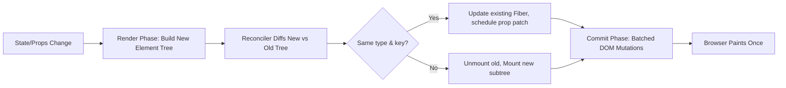

### Optimized Code Snippet
```jsx
// BAD: index as key breaks identity across reorders
{items.map((item, i) => <Row key={i} data={item} />)}

// GOOD: stable, unique key tied to entity identity
{items.map((item) => <Row key={item.id} data={item} />)}
```

### Common Follow-Up Questions
- Why is Virtual DOM diffing O(n) instead of O(n³)?
- What happens to component state when the element type changes between renders?
- How does React batch DOM mutations in the commit phase?

### Edge Cases & Pitfalls
- Using array index as `key` in dynamic/reorderable lists.
- Conditionally rendering different component types in the same slot causes full remounts (and lost local state) even if visually similar.
- Assuming Virtual DOM is "always faster than direct DOM" — for static content, direct DOM manipulation can outperform it; the VDOM's value is developer ergonomics + predictable updates, not raw speed.

### Performance & Scalability Considerations
- Diffing cost scales with the number of elements in the tree per render — deeply nested trees with large fan-out benefit from memoization to prune subtrees from the diff entirely.
- `key` stability is a first-class performance lever, not just correctness.

### Best Practices
- Always use stable, unique keys derived from data identity.
- Keep component trees shallow where reasonable; extract stable subtrees into memoized components.

### Trade-offs
- Virtual DOM adds memory/CPU overhead for the diff itself — for extremely high-frequency updates (e.g., real-time canvas/game loops), bypassing React (imperative refs, WebGL, Canvas API) is often the right call.

### Interview Tips
- Don't just say "Virtual DOM is faster" — interviewers at this level want to hear *why* (heuristic diffing assumptions) and *when it isn't* the right tool.

### Summary
Virtual DOM + heuristic reconciliation trades a small, predictable diff cost for large wins in developer productivity and batched, minimal DOM writes — but keys and stable element types are what make that diff cheap and correct.

---

## 2. React Fiber Architecture

**Q: What is React Fiber, and how does it enable features like Concurrent Mode and Suspense?**

> **Quick Answer:** Fiber (introduced in React 16) is a complete rewrite of React's reconciler as an incremental, interruptible unit of work — a linked-list data structure that lets React pause, resume, prioritize, or abort rendering work instead of the old synchronous, recursive stack reconciler.

### Deep Technical Explanation
Each **Fiber node** corresponds to a component instance/element and holds: type, pending props, memoized state, a pointer to `child`, `sibling`, and `return` (parent) — forming a linked list traversable without the native call stack, so React can yield to the browser mid-render.

Fiber has two phases:
- **Render/Reconciliation phase** (interruptible): builds the "work-in-progress" tree, can be paused for higher-priority work (e.g., user input) via the scheduler's priority lanes.
- **Commit phase** (synchronous, never interrupted): applies mutations to the real DOM in one pass, runs lifecycle/effects.

### Production Example
A large data-grid app typing into a search box while a large filtered list re-renders: with Fiber + `startTransition`, React can keep the input responsive (high priority) while deferring the expensive list re-render (low priority) — impossible under the pre-Fiber stack reconciler.

### Architecture Diagram
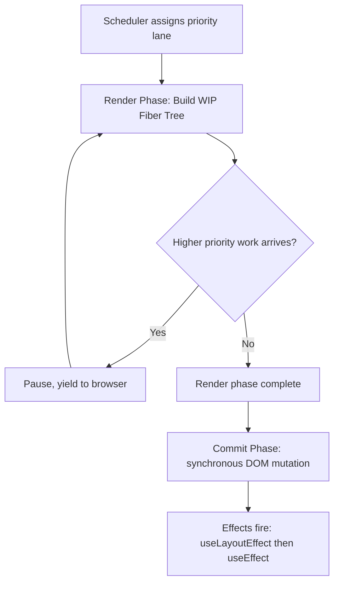

### Optimized Code Snippet
```jsx
import { startTransition, useState } from 'react';

function Search({ list }) {
  const [query, setQuery] = useState('');
  const [filtered, setFiltered] = useState(list);

  function handleChange(e) {
    const value = e.target.value;
    setQuery(value); // urgent: keep input responsive
    startTransition(() => {
      setFiltered(list.filter(i => i.includes(value))); // low priority
    });
  }

  return <input value={query} onChange={handleChange} />;
}
```

### Common Follow-Up Questions
- What's the difference between the render phase and commit phase?
- How does Fiber's linked-list structure avoid stack overflows on deep trees?
- What are "lanes" in React's scheduler?

### Edge Cases & Pitfalls
- Side effects (network calls, DOM mutation) inside the render phase can run twice under Strict Mode / concurrent rendering — render must stay pure.
- Assuming `startTransition` makes work "faster" — it doesn't; it only deprioritizes it relative to urgent updates.

### Performance & Scalability Considerations
- Fiber is what makes time-slicing possible on large trees — without it, one giant render blocks the main thread and janks scrolling/typing.

### Best Practices
- Keep render functions pure and side-effect-free so interruption/replay is safe.
- Use `startTransition`/`useDeferredValue` for expensive, non-urgent UI updates rather than manual debouncing where possible.

### Trade-offs
- Concurrent features add conceptual overhead (priority lanes, tearing considerations) — not every app needs them; simple CRUD UIs may see no visible benefit.

### Interview Tips
- Be ready to explain Fiber conceptually without reciting internal field names verbatim — the "why" (interruptibility, prioritization) matters more than internals trivia.

### Summary
Fiber replaced React's recursive stack reconciler with an interruptible, priority-aware unit-of-work model, which is the architectural foundation for concurrent rendering, Suspense, and responsive UIs under heavy load.

---

## 3. Hooks Internals & the Rules of Hooks

**Q: How do Hooks actually work under the hood, and why do the "Rules of Hooks" exist?**

> **Quick Answer:** Each component's Fiber node holds a **linked list of hook state**. Hooks are associated with their state purely by **call order**, not by name — which is exactly why hooks can't be called conditionally or in loops: it would desynchronize the call order from the stored linked list between renders.

### Deep Technical Explanation
On the first render, `useState`/`useEffect`/etc. push a new hook object onto the fiber's `memoizedState` linked list. On re-render, React walks that same list in the same order, and the Nth hook call reads the Nth hook object. There's no key/name — order **is** identity. This is why:
- Hooks must be called at the top level (not in `if`, loops, or after early returns).
- Hooks must be called in the same order every render.

`useState` is implemented on top of the same primitive as `useReducer` internally — both use a queue of pending updates processed during the next render.

### Production Example
A common production bug: conditionally calling `useEffect` based on a feature flag check placed *before* the hook call, causing hook order to shift between renders and React throwing "Rendered more hooks than during the previous render."

### Architecture Diagram
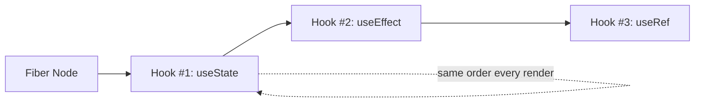

### Optimized Code Snippet
```jsx
// BAD: hook called conditionally
function Profile({ showBio }) {
  if (showBio) {
    const [bio, setBio] = useState(''); // breaks order between renders
  }
}

// GOOD: hook always called, condition applied to usage
function Profile({ showBio }) {
  const [bio, setBio] = useState('');
  return showBio ? <p>{bio}</p> : null;
}
```

### Common Follow-Up Questions
- Why can't hooks be called inside loops or conditionals?
- How does React know which `useState` call corresponds to which piece of state on re-render?
- How is `useState` related to `useReducer` internally?

### Edge Cases & Pitfalls
- Early `return` statements placed above hook calls.
- Custom hooks that internally branch hook calls based on props.
- ESLint's `react-hooks/rules-of-hooks` catches most of this — disabling it is a red flag in code review.

### Performance & Scalability Considerations
- The linked-list lookup is O(1) per hook, so hook count itself isn't a performance concern — but hooks with unstable dependency arrays causing effect re-runs are.

### Best Practices
- Always run `eslint-plugin-react-hooks` in CI, not just locally.
- Extract conditional logic to *inside* the hook body, never around the hook call.

### Trade-offs
- Order-based identity is simple and fast but rigid — it's why hooks feel restrictive compared to class lifecycle methods, in exchange for composability.

### Interview Tips
- Explaining the linked-list-by-call-order mechanism (rather than just reciting "don't call hooks conditionally") signals real internals knowledge.

### Summary
Hooks track state via call-order position in a per-fiber linked list, not by name — which is the root technical reason the Rules of Hooks exist and must be enforced.

---

## 4. Custom Hooks Design

**Q: How do you design custom hooks for a large codebase, and what makes a custom hook "good"?**

> **Quick Answer:** A good custom hook encapsulates one cohesive piece of stateful logic, has a minimal/stable return signature, composes cleanly with other hooks, and hides implementation details (subscriptions, cleanup, memoization) from the consuming component.

### Deep Technical Explanation
Custom hooks are just functions that call other hooks — they don't create new "hook state" mechanisms, they just let you *extract and reuse* stateful logic across components without HOC/render-prop wrapper hell. Each call site gets its own independent state (no shared instance).

Good custom-hook API design mirrors good function design: stable references (memoize returned callbacks/objects), clear single responsibility, and predictable dependency arrays for consumers.

### Production Example
`useDebouncedValue`, `useIntersectionObserver` (infinite scroll/lazy image loading), `usePrevious`, `useMediaQuery`, and `useWebSocket` are common cross-cutting custom hooks in production design systems, replacing what used to be HOCs like `withSubscription`.

### Optimized Code Snippet
```jsx
function useDebouncedValue(value, delayMs = 300) {
  const [debounced, setDebounced] = useState(value);

  useEffect(() => {
    const id = setTimeout(() => setDebounced(value), delayMs);
    return () => clearTimeout(id); // cleanup avoids stale updates
  }, [value, delayMs]);

  return debounced;
}

// Usage
function SearchBox() {
  const [query, setQuery] = useState('');
  const debouncedQuery = useDebouncedValue(query, 400);
  useEffect(() => {
    if (debouncedQuery) fetchResults(debouncedQuery);
  }, [debouncedQuery]);
  return <input value={query} onChange={e => setQuery(e.target.value)} />;
}
```

### Common Follow-Up Questions
- Do two components using the same custom hook share state? (No — each call site has isolated state.)
- How do you avoid returning a new object/array reference from a custom hook on every render?
- When should logic be a custom hook vs. a plain utility function?

### Edge Cases & Pitfalls
- Returning a fresh `{}`/`[]` literal from a hook every render, causing consumers using it as a `useEffect` dependency to re-run infinitely.
- Overloading a single hook with too many responsibilities ("god hooks") that become hard to test.
- Forgetting cleanup (subscriptions, timers, listeners) inside the hook's `useEffect`.

### Performance & Scalability Considerations
- Memoize returned objects/callbacks (`useMemo`/`useCallback`) when the hook's output is likely to be used as a dependency elsewhere.
- Extract expensive computations into the hook itself so consuming components stay simple and testable.

### Best Practices
- Prefix with `use`, enforced by lint rules so React treats it as a hook (for the rules-of-hooks checks).
- Keep return shape stable (same shape/keys) across renders and refactors.
- Unit test hooks directly via `@testing-library/react`'s `renderHook`.

### Trade-offs
- Custom hooks compose beautifully but can obscure *where* re-renders originate if overused/nested deeply — good naming and documentation matter more as hook count grows.

### Interview Tips
- Have 2-3 real custom hooks from your own production code ready to describe, including a bug you hit (stale closures, missing cleanup) and how you fixed it.

### Summary
Custom hooks are the primary reuse mechanism in modern React — they replace HOCs/render props for sharing stateful logic, with each call site owning independent state, and their design quality hinges on stable APIs and proper cleanup.

---

## 5. Memoization: `useMemo`, `useCallback`, `React.memo`

**Q: When and why would you use `useMemo`, `useCallback`, and `React.memo` — and what happens if you overuse them?**

> **Quick Answer:** `useMemo` memoizes a **computed value**, `useCallback` memoizes a **function reference**, and `React.memo` memoizes a **component's rendered output** by shallow-comparing props. They only help when the memoized thing is expensive to recompute *or* is passed to a memoized child/effect dependency — otherwise they add overhead for no benefit.

### Deep Technical Explanation
`React.memo` wraps a component so React skips re-rendering it if props are shallow-equal to the previous render. It's only useful if the parent re-renders more often than the child's props change. `useMemo`/`useCallback` matter most for **referential stability** — preventing a new object/function identity from invalidating a memoized child's shallow-prop comparison or retriggering a `useEffect`.

### Production Example
A dashboard with a heavy chart component (`<RevenueChart data={...} />`) re-rendering on every keystroke in an unrelated search box — wrapping `RevenueChart` in `React.memo` and memoizing its `data`/`onClick` props with `useMemo`/`useCallback` prevents the expensive re-render entirely.

### Architecture Diagram
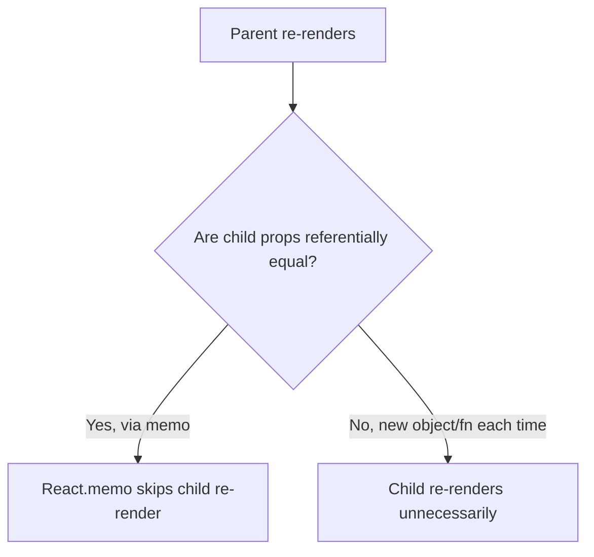

### Optimized Code Snippet
```jsx
const RevenueChart = React.memo(function RevenueChart({ data, onPointClick }) {
  return <Chart data={data} onClick={onPointClick} />;
});

function Dashboard({ rawSales }) {
  const [search, setSearch] = useState('');

  // Without useMemo, this array is a new reference every render,
  // defeating React.memo on RevenueChart.
  const chartData = useMemo(
    () => rawSales.map(s => ({ x: s.date, y: s.amount })),
    [rawSales]
  );

  const handlePointClick = useCallback((point) => {
    console.log('clicked', point);
  }, []);

  return (
    <>
      <input value={search} onChange={e => setSearch(e.target.value)} />
      <RevenueChart data={chartData} onPointClick={handlePointClick} />
    </>
  );
}
```

### Common Follow-Up Questions
- What does `React.memo` compare, and can you customize the comparison?
- Why can `useMemo`/`useCallback` sometimes make performance *worse*?
- How does the React Compiler (React 19) change the need for manual memoization?

### Edge Cases & Pitfalls
- Memoizing everything "just in case" — each `useMemo`/`useCallback` has its own bookkeeping cost and adds cognitive overhead; profile before optimizing.
- `React.memo` does a **shallow** comparison — passing new inline objects/arrays/functions as props defeats it silently.
- Custom comparator functions in `React.memo(Component, areEqual)` that are wrong/incomplete cause subtle stale-UI bugs.

### Performance & Scalability Considerations
- Memoization is a targeted fix for measured bottlenecks (via the Profiler), not a default coding style.
- In large lists, memoizing row components matters far more than memoizing top-level containers.

### Best Practices
- Profile first (React DevTools Profiler) — memoize only components confirmed to re-render expensively and unnecessarily.
- Keep memo dependency arrays exhaustive and correct (use the ESLint hooks-exhaustive-deps rule).

### Trade-offs
- Manual memoization increases code complexity and can hide bugs (stale closures) if dependency arrays are wrong; the upcoming React Compiler aims to auto-memoize and reduce this burden.

### Interview Tips
- Be ready to say *when memoization doesn't help* — that nuance separates senior from mid-level answers.

### Summary
`useMemo`/`useCallback`/`React.memo` are targeted tools for referential stability and skipping expensive re-renders — valuable when profiling proves a bottleneck, but harmful noise when applied reflexively everywhere.

---

## 6. Context API — Performance Pitfalls & Patterns

**Q: What are the performance pitfalls of React Context, and how do you architect around them in a large app?**

> **Quick Answer:** Every consumer of a Context re-renders whenever the Provider's value changes, regardless of whether the consumer actually uses the part of the value that changed — Context has no built-in selector mechanism, so large/monolithic contexts can cause widespread unnecessary re-renders.

### Deep Technical Explanation
Context is a **broadcast** mechanism, not a fine-grained subscription store — `useContext` subscribes a component to the *entire* value object. If a Provider re-renders with a new value reference (even if only one field changed), every consumer re-renders too. There's no shallow-diffing of individual keys as there is with `React.memo` on props.

### Production Example
An app-wide `AuthContext` that bundles `user`, `theme`, and `notifications` in one value causes every themed component to re-render on every notification arrival — splitting into `UserContext`, `ThemeContext`, `NotificationContext` (or moving to Zustand/Jotai with selector-based subscriptions) fixes it.

### Architecture Diagram
```mermaid
flowchart TD
    Provider[AuthContext.Provider value=&#123;user, theme, notifications&#125;] --> C1[ThemeToggle]
    Provider --> C2[UserAvatar]
    Provider --> C3[NotificationBell]
    style Provider fill:#f96
    Note["Any field change re-renders ALL consumers"]
```

### Optimized Code Snippet
```jsx
// BAD: one giant context, new object every render
const AppContext = createContext();
function AppProvider({ children }) {
  const [user, setUser] = useState(null);
  const [theme, setTheme] = useState('light');
  const value = { user, setUser, theme, setTheme }; // new ref every render
  return <AppContext.Provider value={value}>{children}</AppContext.Provider>;
}

// GOOD: split contexts + memoized value
const UserContext = createContext(null);
const ThemeContext = createContext(null);

function AppProviders({ children }) {
  const [user, setUser] = useState(null);
  const userValue = useMemo(() => ({ user, setUser }), [user]);

  const [theme, setTheme] = useState('light');
  const themeValue = useMemo(() => ({ theme, setTheme }), [theme]);

  return (
    <UserContext.Provider value={userValue}>
      <ThemeContext.Provider value={themeValue}>
        {children}
      </ThemeContext.Provider>
    </UserContext.Provider>
  );
}
```

### Common Follow-Up Questions
- How would you build a selector-like subscription on top of Context (`use-context-selector` pattern)?
- Why doesn't wrapping a Provider's children in `React.memo` prevent context-triggered re-renders?
- When would you reach for Redux/Zustand instead of Context?

### Edge Cases & Pitfalls
- `React.memo`ing a consumer component does **not** stop it re-rendering from a context change — memo only guards against *prop* changes, not context subscriptions.
- Deeply nested Providers ("provider hell") from splitting contexts too granularly without composition helpers.

### Performance & Scalability Considerations
- Context is fine for low-frequency values (theme, locale, auth) but a poor fit for high-frequency state (form input, real-time data) shared broadly — use a dedicated store with selectors there.

### Best Practices
- Split contexts by update-frequency and by consumer, not just by domain.
- Memoize Provider `value` with `useMemo`.
- Consider `useSyncExternalStore`-based libraries (Zustand, Jotai) for fine-grained, selector-driven subscriptions at scale.

### Trade-offs
- Context requires no extra dependency and is great for DI-style values; but it lacks selectors, middleware, and devtools that dedicated state libraries provide.

### Interview Tips
- Mention `useContext` triggers re-renders on **any** value change — this specific fact is a frequent trip-up point interviewers listen for.

### Summary
Context broadcasts to all consumers on any value change with no selector granularity — architect around this by splitting contexts by change-frequency, memoizing provider values, and reserving high-frequency global state for selector-based stores.

---

## 7. State Management at Scale

**Q: How do you choose between Context, Redux, Zustand, Recoil/Jotai, and server-state libraries in a large application?**

> **Quick Answer:** Separate **client (UI) state**, **global app state**, and **server (remote) state** — they have different lifecycles and different tools fit best: local `useState`/`useReducer` for component state, Zustand/Redux for shared client state, and React Query/SWR for server state (caching, revalidation, dedication).

### Deep Technical Explanation
A frequent architecture mistake is putting server data (API responses) into Redux/Context and hand-rolling caching, loading, and invalidation — reinventing what React Query/SWR already solve (stale-while-revalidate, request dedup, background refetch). Client state (UI toggles, form drafts, wizard steps) is genuinely different: it has no "server truth" to sync against.

| State Type | Example | Recommended Tool |
|---|---|---|
| Local UI state | modal open/closed, input value | `useState`/`useReducer` |
| Shared client state | theme, cart drawer, auth session | Context (low-freq) or Zustand |
| Complex global state w/ middleware needs | large app with time-travel debugging needs | Redux Toolkit |
| Server/remote state | API data, pagination, caching | React Query / SWR / RTK Query |
| URL-derived state | filters, tab selection | URL/search params (source of truth) |

### Production Example
A large e-commerce app: product catalog & cart totals come from the server via React Query (with optimistic updates), while "is the filter sidebar open" lives in local `useState`, and "logged-in user" lives in a small Zustand/Context store — no single library owns everything.

### Architecture Diagram
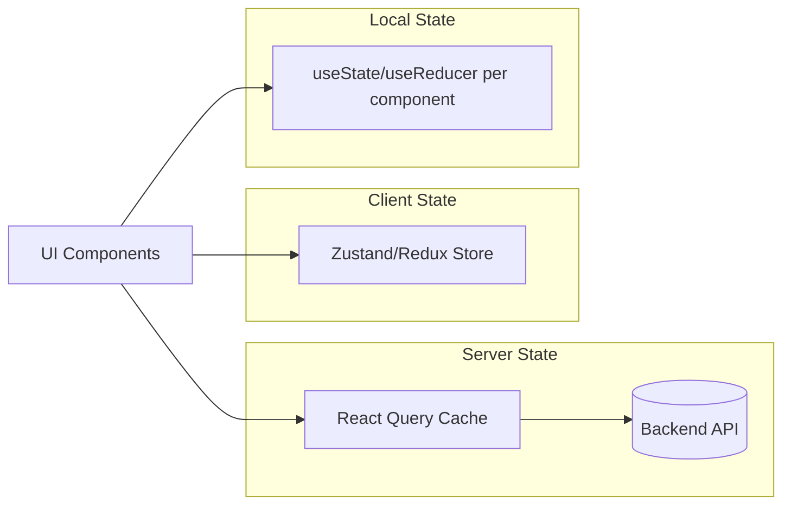

### Optimized Code Snippet
```jsx
// Server state via React Query — caching/dedup handled for you
function ProductList() {
  const { data, isLoading } = useQuery({
    queryKey: ['products'],
    queryFn: fetchProducts,
    staleTime: 60_000,
  });
  if (isLoading) return <Spinner />;
  return <List items={data} />;
}

// Client state via Zustand — simple, selector-based, no Provider needed
import { create } from 'zustand';
const useCartStore = create((set) => ({
  isOpen: false,
  toggle: () => set((s) => ({ isOpen: !s.isOpen })),
}));

function CartButton() {
  const isOpen = useCartStore((s) => s.isOpen); // fine-grained subscription
  const toggle = useCartStore((s) => s.toggle);
  return <button onClick={toggle}>{isOpen ? 'Close' : 'Open'} Cart</button>;
}
```

### Common Follow-Up Questions
- Why shouldn't server data live in Redux long-term?
- How does Zustand achieve selector-based re-renders without a Provider (`useSyncExternalStore`)?
- When is Redux Toolkit still the right choice over Zustand in 2026?

### Edge Cases & Pitfalls
- Duplicating server data into client state manually, causing cache-invalidation bugs and stale UI.
- Storing derived state (e.g., filtered/sorted lists) instead of computing it from source state.
- Over-centralizing state that only one component tree actually needs.

### Performance & Scalability Considerations
- Selector-based stores (Zustand/Redux with `useSelector`) avoid the "any change re-renders everyone" problem inherent to Context.
- Server-state libraries reduce network chatter via caching/dedup — critical at scale for API cost and perceived performance.

### Best Practices
- Default to local state; lift only when truly shared.
- Treat the URL as state for shareable/bookmarkable UI (filters, tabs, pagination).
- Use React Query/SWR for anything fetched from a server — don't hand-roll caching.

### Trade-offs
- More tools = more concepts for the team to learn; a single "one library for everything" approach is simpler to onboard but scales worse architecturally.

### Interview Tips
- Frame your answer around **state categorization** (local/client/server/URL) rather than naming a favorite library — this is what distinguishes staff-level architectural thinking.

### Summary
Senior-level state management is about categorizing state by lifecycle (local, shared client, server, URL) and matching each category to a purpose-built tool, rather than forcing one library to do everything.

---

## 8. React Server Components vs SSR vs CSR

**Q: What's the difference between React Server Components, traditional SSR, and CSR — and when would you use each?**

> **Quick Answer:** CSR renders entirely in the browser (blank shell + JS bundle). SSR renders HTML on the server for the *initial* load, then hydrates into a full client app. **Server Components (RSC)** render on the server on **every** request/navigation and ship zero JS for that component — they're not just "SSR for the first paint," they're a persistent server/client split in the component tree.

### Deep Technical Explanation
- **CSR:** Client downloads JS, renders everything client-side. Simple, but slow first paint and requires shipping all component code to the browser.
- **SSR (traditional, e.g., Next.js Pages Router, classic ReactDOMServer):** Server renders HTML for the initial page; client then **hydrates** by re-running the same component code to attach event listeners. All components still ship as JS to the client (needed for hydration).
- **RSC:** Introduces two component types — Server Components (render only on the server, can access DBs/secrets directly, ship **no JS** to the client) and Client Components (marked with `'use client'`, hydrate normally). The server sends a special serialized tree format the client reconciles against, not raw HTML alone.

### Production Example
Next.js App Router: a product page's static description/price (Server Component, no interactivity) is fetched directly from the DB with zero client JS shipped, while the "Add to Cart" button (Client Component) hydrates normally for `onClick` interactivity — reducing bundle size substantially versus shipping the whole page as client JS.

### Architecture Diagram
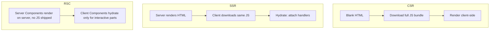

### Optimized Code Snippet
```jsx
// app/product/[id]/page.jsx — Server Component (default, no directive needed)
async function ProductPage({ params }) {
  const product = await db.products.findById(params.id); // direct DB access, server-only
  return (
    <div>
      <h1>{product.name}</h1>
      <p>{product.description}</p>
      <AddToCartButton productId={product.id} /> {/* Client Component boundary */}
    </div>
  );
}
export default ProductPage;
```
```jsx
// AddToCartButton.jsx
'use client';
import { useState } from 'react';

export default function AddToCartButton({ productId }) {
  const [added, setAdded] = useState(false);
  return (
    <button onClick={() => setAdded(true)}>
      {added ? 'Added!' : 'Add to Cart'}
    </button>
  );
}
```

### Common Follow-Up Questions
- Can a Server Component import a Client Component, and vice versa? (Server → Client: yes. Client → Server component import: no, only via `children`/props composition.)
- How does RSC reduce bundle size compared to SSR?
- What are the caching implications of Server Components (per-request vs cached)?

### Edge Cases & Pitfalls
- Using browser-only APIs (`window`, `localStorage`) inside a Server Component — fails at build/render time.
- Passing non-serializable props (functions, class instances) from a Server Component to a Client Component.
- Assuming RSC replaces the need for client state entirely — interactive state still requires Client Components.

### Performance & Scalability Considerations
- RSC meaningfully cuts client bundle size for content-heavy, low-interactivity pages (marketing pages, product listings, docs).
- SSR improves Time-to-First-Byte/perceived load but still ships full JS, so hydration cost remains a bottleneck on large pages ("hydration tax").

### Best Practices
- Push Client Component boundaries as deep/leaf as possible ("client islands") to minimize shipped JS.
- Fetch data directly in Server Components rather than client-side `useEffect` + fetch waterfalls.

### Trade-offs
- RSC requires a compatible framework/bundler (Next.js App Router primarily) and a mental model shift (server/client boundary awareness) — not a drop-in upgrade for arbitrary React apps.

### Interview Tips
- Clarify that RSC is **not** just "SSR but newer" — the zero-client-JS aspect and per-navigation server rendering is the key differentiator interviewers are checking for.

### Summary
CSR, SSR, and RSC differ in *where* rendering happens and *how much JS* reaches the client — RSC's unique contribution is a persistent server/client component split that ships zero JS for non-interactive parts of the tree, not merely faster first paint.

---

## 9. Concurrent Rendering (`startTransition`, `useDeferredValue`, Suspense)

**Q: How do React's concurrent features let you keep an app responsive under heavy render load?**

> **Quick Answer:** Concurrent rendering lets React mark some updates as **urgent** (typing, clicks) and others as **transitions** (non-urgent, interruptible) so the browser stays responsive — via `startTransition`/`useTransition` for actions and `useDeferredValue` for values, with `Suspense` handling async loading boundaries declaratively.

### Deep Technical Explanation
Before Fiber's concurrent features, all state updates were rendered with equal priority — an expensive re-render (e.g., filtering 10k rows) would block the main thread and make typing feel laggy. `startTransition` tells React "this update can be interrupted/delayed if something more urgent comes in," so React renders the urgent update (input) first, then resumes the transition. `useDeferredValue` achieves a similar effect for a *value* rather than a state setter, useful when you don't own the setter (e.g., value from props/URL).

### Production Example
A large enterprise table/dashboard filtering thousands of rows as the user types in a search box — wrapping the filter/render update in `startTransition` keeps the input itself lag-free while the table catches up a beat later, and React shows a pending indicator via `isPending`.

### Architecture Diagram
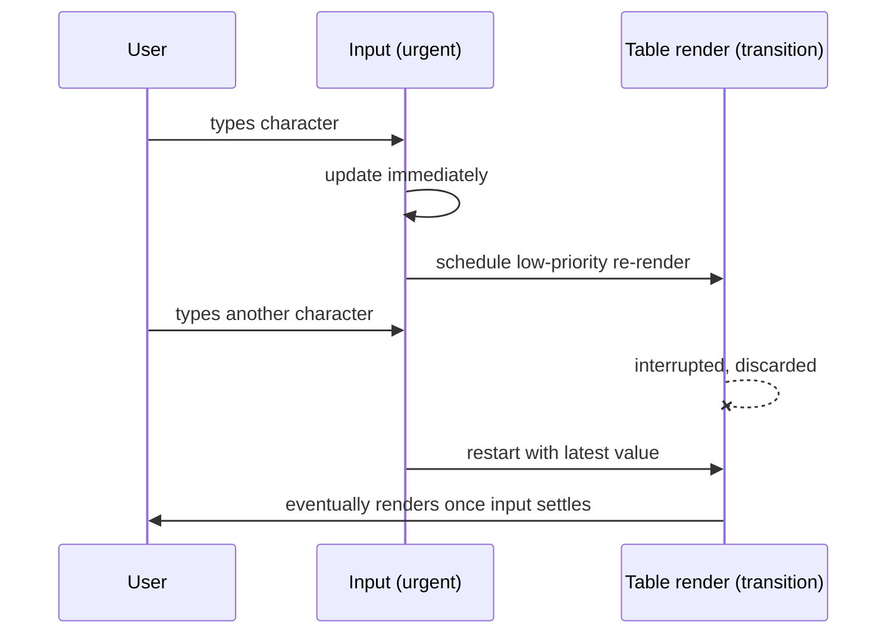

### Optimized Code Snippet
```jsx
import { useState, useDeferredValue, useMemo } from 'react';

function FilterableTable({ rows }) {
  const [query, setQuery] = useState('');
  const deferredQuery = useDeferredValue(query); // lags behind on purpose
  const isStale = query !== deferredQuery;

  const filtered = useMemo(
    () => rows.filter(r => r.name.includes(deferredQuery)),
    [rows, deferredQuery]
  );

  return (
    <div style={{ opacity: isStale ? 0.6 : 1 }}>
      <input value={query} onChange={e => setQuery(e.target.value)} />
      <Table rows={filtered} />
    </div>
  );
}
```

### Common Follow-Up Questions
- What's the difference between `useTransition` and `useDeferredValue`?
- Can `startTransition` updates be discarded/interrupted mid-render? (Yes — that's the point.)
- How does `Suspense` interact with transitions during data fetching?

### Edge Cases & Pitfalls
- Wrapping *every* update in `startTransition` "just in case" — urgent updates (direct user input feedback) should never be deprioritized.
- Forgetting that transitions don't make the underlying computation faster — they only reprioritize *when* it happens.
- Suspense boundaries placed too high in the tree causing large chunks of UI to blank out during any nested fetch.

### Performance & Scalability Considerations
- Concurrent features shine specifically under CPU-bound render bottlenecks (large lists, heavy computed views) — they don't help network-bound slowness (that's Suspense + streaming's job).

### Best Practices
- Use `isPending` from `useTransition` to show subtle loading affordances instead of blocking the whole UI.
- Place `Suspense` boundaries at meaningful UI regions (a card, a panel) rather than one giant top-level boundary.

### Trade-offs
- Adds complexity (stale/pending state to manage in UI) for a responsiveness win that's only noticeable at meaningful data/render scale — premature use adds cognitive load without benefit.

### Interview Tips
- Be precise: transitions **reprioritize**, they do not parallelize or speed up computation — a common interview trap answer conflates the two.

### Summary
`startTransition`/`useDeferredValue` let React defer expensive, non-urgent renders behind urgent ones like typing, using Fiber's interruptible rendering — a targeted fix for CPU-bound UI jank, not a general performance silver bullet.

---

## 10. Code Splitting & Lazy Loading

**Q: How do you architect code splitting in a large React app to minimize initial bundle size?**

> **Quick Answer:** Split by **route** first (each page loads its own chunk via `React.lazy` + dynamic `import()`), then by **heavy, conditionally-rendered components** (modals, charts, editors), always wrapped in `Suspense` with a meaningful fallback — driven by real bundle-analyzer data, not guesswork.

### Deep Technical Explanation
`React.lazy(() => import('./Component'))` returns a component that suspends until its chunk resolves; `Suspense` provides the fallback UI during that wait. Bundlers (Webpack/Vite/Rollup) turn each dynamic `import()` into a separate chunk, fetched on demand. Route-based splitting is the highest-leverage first step since users only need code for the page they're on.

### Production Example
A SaaS dashboard with a rarely-used "Advanced Report Builder" (heavy charting libs) code-split behind a dynamic import so the main dashboard bundle stays small; the report builder chunk only downloads when a user actually opens that feature.

### Architecture Diagram
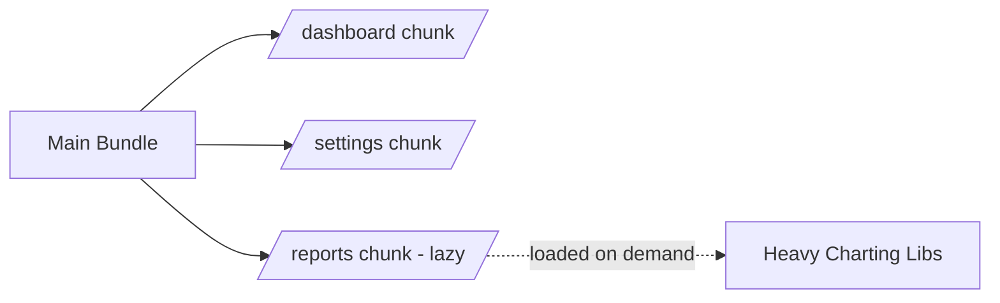

### Optimized Code Snippet
```jsx
import { lazy, Suspense } from 'react';

const ReportBuilder = lazy(() => import('./ReportBuilder'));

function Reports() {
  const [showBuilder, setShowBuilder] = useState(false);
  return (
    <div>
      <button onClick={() => setShowBuilder(true)}>Open Report Builder</button>
      {showBuilder && (
        <Suspense fallback={<SkeletonLoader />}>
          <ReportBuilder />
        </Suspense>
      )}
    </div>
  );
}
```

### Common Follow-Up Questions
- What happens if a lazy-loaded chunk fails to load (network error)? How do you handle it? (Wrap in an Error Boundary alongside Suspense.)
- How do you decide the granularity of code splitting (per-route vs per-component)?
- How does prefetching (`<link rel="prefetch">`, route-based preloading on hover) complement lazy loading?

### Edge Cases & Pitfalls
- Lazy-loading components that are needed immediately on first paint — causes a visible loading flash for no benefit.
- Not handling chunk-load failures (e.g., after a deployment invalidates old chunk hashes) — needs an Error Boundary + reload-on-failure strategy.
- Over-splitting into too many tiny chunks increases request overhead (though HTTP/2 mitigates this).

### Performance & Scalability Considerations
- Analyze real bundle composition (`webpack-bundle-analyzer`, `source-map-explorer`, or Vite's `rollup-plugin-visualizer`) before deciding what to split — intuition about "big" components is often wrong.
- Combine code splitting with route-based prefetching for perceived-instant navigation.

### Best Practices
- Route-level splitting by default in any framework router.
- Split heavy third-party libs (rich text editors, charting, PDF viewers) behind interaction (modal open, tab click).
- Always pair `Suspense` fallback with an Error Boundary for network failures.

### Trade-offs
- More chunks = smaller initial bundle but more moving parts (loading states, failure handling, potential waterfalls if split too aggressively in a dependency chain).

### Interview Tips
- Mention bundle analysis as the *first* step — jumping straight to "I'd lazy-load X" without measurement is a common junior tell.

### Summary
Effective code splitting starts at the route level, extends to heavy/conditional components based on real bundle-analyzer data, and always pairs `Suspense` with error handling for chunk-load failures.

---

## 11. Error Boundaries & Resilience

**Q: How do Error Boundaries work, and how do you design a resilient error-handling strategy across a large app?**

> **Quick Answer:** Error Boundaries are class components (no hook equivalent yet) implementing `static getDerivedStateFromError` and/or `componentDidCatch` that catch render-phase errors in their child tree and show a fallback UI — but they do **not** catch errors in event handlers, async code, or SSR, which need separate handling (try/catch, error reporting).

### Deep Technical Explanation
An Error Boundary only catches errors thrown **during rendering, in lifecycle methods, or in constructors** of the tree below it. It cannot catch:
- Errors in event handlers (use try/catch there directly).
- Errors in asynchronous code (setTimeout, promises) unless re-thrown during render.
- Errors in the boundary component itself (bubbles to the next boundary up).
- Server-side rendering errors (need separate SSR error handling).

Since there's no hook equivalent, most teams use the community `react-error-boundary` package for functional-component ergonomics (render-prop-style `FallbackComponent`, `onReset`).

### Production Example
Placing granular Error Boundaries around independent widgets on a dashboard (each chart, each card) so one failing widget shows a small inline error state instead of crashing the entire page — paired with Sentry/Datadog reporting in `componentDidCatch`.

### Architecture Diagram
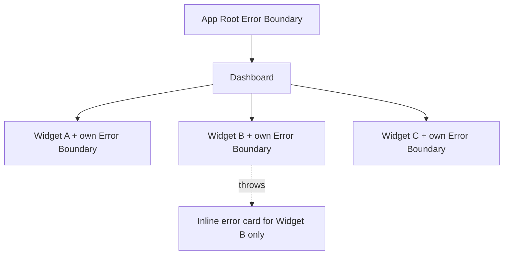

### Optimized Code Snippet
```jsx
import { ErrorBoundary } from 'react-error-boundary';

function WidgetFallback({ error, resetErrorBoundary }) {
  return (
    <div role="alert" className="widget-error">
      <p>Something went wrong loading this widget.</p>
      <button onClick={resetErrorBoundary}>Retry</button>
    </div>
  );
}

function Dashboard() {
  return (
    <div className="grid">
      <ErrorBoundary FallbackComponent={WidgetFallback} onError={logToSentry}>
        <RevenueWidget />
      </ErrorBoundary>
      <ErrorBoundary FallbackComponent={WidgetFallback} onError={logToSentry}>
        <UsersWidget />
      </ErrorBoundary>
    </div>
  );
}
```

### Common Follow-Up Questions
- Why doesn't an Error Boundary catch an error thrown inside an `onClick` handler?
- How would you combine Error Boundaries with `Suspense` for both loading and error states?
- How do you test that an Error Boundary correctly catches a specific error?

### Edge Cases & Pitfalls
- Assuming a single top-level Error Boundary is sufficient — a single widget crash then takes down the entire app.
- Forgetting to reset boundary state after a retry (stale error stuck on screen even after the underlying issue is fixed).
- Errors thrown in async callbacks (e.g., inside `.then()`) not re-thrown during render, silently swallowed.

### Performance & Scalability Considerations
- Granular boundaries have negligible runtime overhead but require discipline in component architecture (independent widgets, not deeply intertwined state).

### Best Practices
- Wrap independent, isolate-able UI regions (widgets, route segments) in their own boundary.
- Log caught errors to an observability tool (Sentry/Datadog) inside `componentDidCatch`/`onError`.
- Provide a retry/reset path, not just a dead-end error message.

### Trade-offs
- Too many fine-grained boundaries adds boilerplate; too few creates a fragile "one bug crashes everything" app — the right granularity matches your independent-failure-domain boundaries (e.g., per widget, per route).

### Interview Tips
- Explicitly state what Error Boundaries **don't** catch — this is the detail interviewers most often probe to separate surface-level from real understanding.

### Summary
Error Boundaries catch render-phase errors in their subtree and are best placed around independently-failing UI regions, but event-handler and async errors require separate try/catch and reporting — a resilient app combines both.

---

## 12. Testing Strategy at Scale

**Q: How do you design a testing strategy for a large React codebase, and why does React Testing Library favor behavior over implementation?**

> **Quick Answer:** Use a **testing pyramid**: many fast unit/component tests (Jest + React Testing Library) asserting on user-visible behavior, a moderate layer of integration tests for critical flows, and a thin layer of E2E tests (Cypress/Playwright) for the highest-value user journeys — avoiding tests that assert on internal implementation details (state, instance methods).

### Deep Technical Explanation
Enzyme-style testing (shallow rendering, inspecting internal state/instances) tightly couples tests to implementation, so refactors that don't change behavior still break tests. RTL's philosophy — "the more your tests resemble the way your software is used, the more confidence they can give you" — queries the DOM the way a user would (role, label, text) rather than component internals, making tests resilient to refactors (hooks vs classes, internal state shape changes).

### Production Example
Testing a checkout form by simulating a user typing into fields and clicking "Submit" (via `userEvent`), then asserting the success message appears — rather than asserting on the component's internal `state.errors` object, which would break if the form were refactored from `useState` to `useReducer` with no behavior change.

### Architecture Diagram
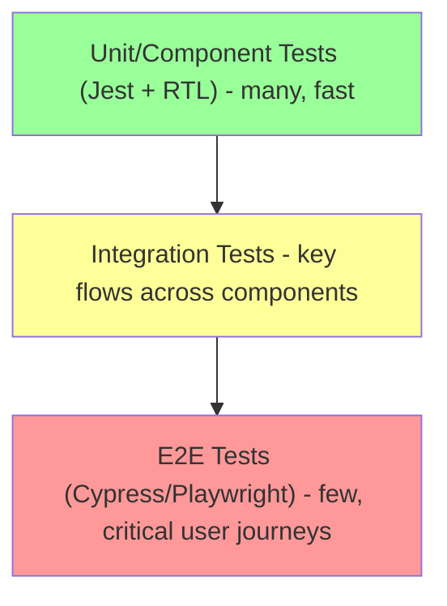

### Optimized Code Snippet
```jsx
import { render, screen } from '@testing-library/react';
import userEvent from '@testing-library/user-event';
import CheckoutForm from './CheckoutForm';

test('shows success message after valid submission', async () => {
  const user = userEvent.setup();
  render(<CheckoutForm />);

  await user.type(screen.getByLabelText(/card number/i), '4242424242424242');
  await user.click(screen.getByRole('button', { name: /pay now/i }));

  expect(await screen.findByText(/payment successful/i)).toBeInTheDocument();
});
```
```jsx
// Testing a custom hook in isolation
import { renderHook, act } from '@testing-library/react';
import { useCounter } from './useCounter';

test('increments count', () => {
  const { result } = renderHook(() => useCounter());
  act(() => result.current.increment());
  expect(result.current.count).toBe(1);
});
```

### Common Follow-Up Questions
- How do you mock API calls in component tests (MSW vs manual `jest.mock`)?
- Why does RTL discourage querying by class name or test-only data attributes as a first choice (prefer role/label/text)?
- How do you decide what deserves an E2E test vs a component test?

### Edge Cases & Pitfalls
- Over-mocking to the point tests no longer catch real integration bugs.
- Snapshot tests that assert on large DOM trees — brittle, low-signal, and frequently just re-approved blindly ("snapshot rubber-stamping").
- Flaky E2E tests from race conditions (not awaiting async UI updates) causing CI instability and eroded trust in the suite.

### Performance & Scalability Considerations
- Fast unit/component tests should dominate the suite (seconds, run on every save); E2E suites are slow and expensive — keep them focused on revenue-critical or highest-risk flows.
- Use Mock Service Worker (MSW) to intercept network calls at the network level, keeping component code untouched by test-specific mocking hooks.

### Best Practices
- Query by accessible role/label/text (mirrors how users and assistive tech interact with the UI) over test IDs where possible.
- Co-locate tests with components; treat test coverage of critical business logic (checkout, auth) as non-negotiable in CI gating.
- Use `renderHook` for custom hook logic that's awkward to test via full component rendering.

### Trade-offs
- Behavior-driven tests are more resilient but sometimes give less precise failure localization than implementation-detail tests — pair with good component-level unit tests for complex internal logic (reducers, utility functions) tested directly.

### Interview Tips
- Quote the RTL philosophy in your own words and back it with a concrete refactor example where implementation-detail tests would've broken unnecessarily.

### Summary
A resilient React testing strategy layers many fast behavior-driven component tests (RTL + Jest) under a thin layer of E2E tests for critical journeys, deliberately avoiding assertions on internal implementation details that don't reflect actual user-facing behavior.

---

## 13. Micro-Frontend Architecture with React

**Q: How would you architect a micro-frontend system using React, and what are the trade-offs vs a monolith SPA?**

> **Quick Answer:** Micro-frontends split a large app into independently deployable units (per team/domain), commonly via **Webpack Module Federation** (runtime code sharing) or build-time composition — trading simplicity and bundle efficiency for team autonomy and independent deployability at organizational scale.

### Deep Technical Explanation
Module Federation lets separately built/deployed apps expose and consume modules **at runtime** — a "host" shell app dynamically loads "remote" micro-frontends (e.g., `checkout`, `search`) without a shared build step, each potentially on independent release cadences and even different React versions (with care). This solves the organizational problem of multiple teams needing independent deploy pipelines on one product, at the cost of shared-dependency complexity (React/React-DOM must usually be shared as singletons to avoid duplicate-React bugs like broken hooks/context across boundaries).

### Production Example
A large marketplace platform where `search`, `checkout`, and `account` are separately owned React micro-frontends, each deployed independently by its own team, composed at runtime into one shell shopping experience via Module Federation — enabling teams to ship without a company-wide release train.

### Architecture Diagram
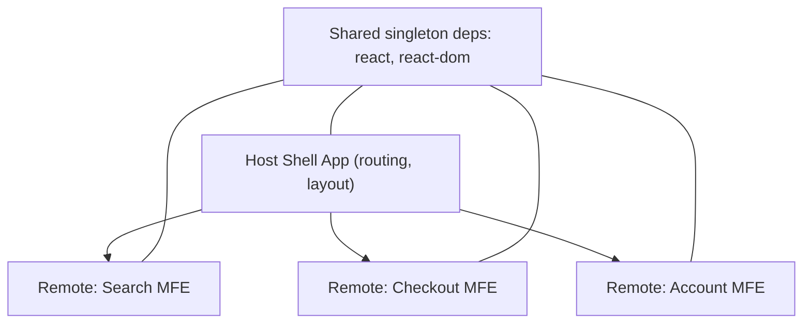

### Optimized Code Snippet
```js
// webpack.config.js (host shell)
const { ModuleFederationPlugin } = require('webpack').container;

module.exports = {
  plugins: [
    new ModuleFederationPlugin({
      name: 'shell',
      remotes: {
        checkout: 'checkout@https://cdn.example.com/checkout/remoteEntry.js',
      },
      shared: { react: { singleton: true }, 'react-dom': { singleton: true } },
    }),
  ],
};
```
```jsx
// Host consuming a remote component
const CheckoutMFE = React.lazy(() => import('checkout/CheckoutApp'));

function App() {
  return (
    <Suspense fallback={<Spinner />}>
      <CheckoutMFE />
    </Suspense>
  );
}
```

### Common Follow-Up Questions
- Why must `react`/`react-dom` be shared as singletons across federated modules?
- How do you handle shared design-system components across independently deployed MFEs?
- What are alternatives to Module Federation (iframe-based MFEs, build-time npm package composition, single-spa)?

### Edge Cases & Pitfalls
- Duplicate React instances (mismatched versions across remotes) causing "invalid hook call" errors or broken context across MFE boundaries.
- Inconsistent design-system versions across teams causing visual drift.
- Cross-MFE state sharing (e.g., cart state needed by both search and checkout) requiring a clear contract (custom events, shared minimal store) instead of ad-hoc coupling.

### Performance & Scalability Considerations
- Runtime composition adds network overhead (multiple remoteEntry fetches) versus a single optimized monolith bundle — mitigate with aggressive caching/CDN and shared-dependency dedup.
- Independent deploys reduce blast radius of a bad release to one MFE instead of the whole app.

### Best Practices
- Enforce a shared design-system package and shared React version policy across teams.
- Define explicit, versioned contracts (props/events) between shell and remotes rather than implicit coupling.
- Reserve micro-frontends for genuine multi-team scale — it's an organizational solution more than a technical one.

### Trade-offs
- Micro-frontends buy team autonomy and independent deploys at the cost of bundle efficiency, cross-cutting consistency effort, and debugging complexity across boundaries — not worth it below a certain team/org size.

### Interview Tips
- Frame this as primarily a **Conway's Law / organizational scaling** answer, not just a technical pattern — interviewers at Staff level want to see you connect architecture to team structure.

### Summary
Micro-frontends (often via Module Federation) trade bundle efficiency and cross-app consistency for independent team deployability — a fit for genuine multi-team scale, with shared-dependency singleton management as the main technical risk.

---

## 14. Performance Profiling & Re-render Diagnosis

**Q: Walk through how you'd diagnose and fix a React performance problem in production.**

> **Quick Answer:** Start with the **React DevTools Profiler** to identify *which* components re-render, *how often*, and *why* ("ranked" and "flamegraph" views), correlate with Chrome Performance/Lighthouse for actual frame timing, then apply targeted fixes (memoization, state colocation, virtualization) — never optimize blind.

### Deep Technical Explanation
The Profiler's flamegraph shows render duration per commit; the "why did this render" info (via `Profiler` `onRender` callback or the `why-did-you-render` library) reveals whether a re-render was due to props, state, context, or a parent re-render cascading down. A common root cause pattern: state that's too high in the tree, causing large subtrees to re-render for a change only one leaf actually needs — the fix is **state colocation** (move state down to the smallest component that needs it) before reaching for memoization.

### Production Example
A form with 50 fields where typing in any single field re-rendered the entire form (all 50 field components) because form state lived in one parent `useState` object — diagnosed via Profiler showing all 50 `FieldRow` components re-rendering on every keystroke, fixed by colocating each field's state locally (or via an uncontrolled-forms library like React Hook Form, which avoids re-rendering on every keystroke entirely).

### Architecture Diagram
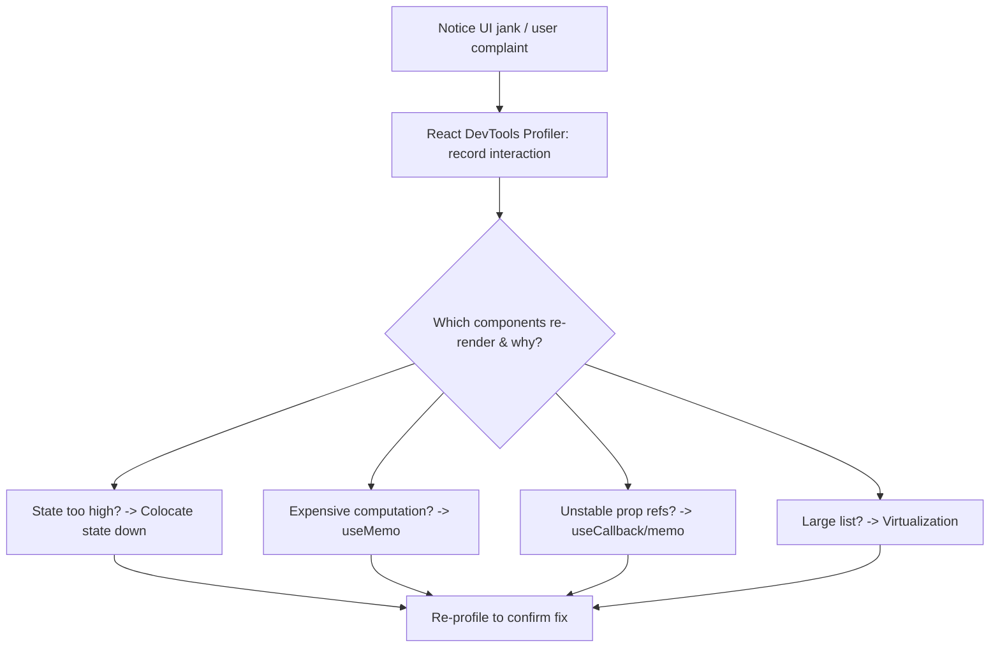

### Optimized Code Snippet
```jsx
// BAD: single state object causes all fields to re-render on any keystroke
function Form() {
  const [values, setValues] = useState({ a: '', b: '', /* ...50 fields */ });
  return Object.keys(values).map(key => (
    <Field key={key} value={values[key]}
      onChange={v => setValues(prev => ({ ...prev, [key]: v }))} />
  ));
}

// GOOD: each field owns its own state (colocation) — typing in one
// field no longer re-renders the other 49.
function Field({ name }) {
  const [value, setValue] = useState('');
  return <input value={value} onChange={e => setValue(e.target.value)} />;
}
```

### Common Follow-Up Questions
- What's "state colocation" and why is it usually the first fix before memoization?
- How do you measure whether a fix actually improved real-world performance (Core Web Vitals, INP)?
- How does the React DevTools Profiler differ from Chrome's own Performance tab?

### Edge Cases & Pitfalls
- Chasing re-renders that are cheap (a small `<span>`) instead of ones that are expensive (large lists, heavy computation) — the Profiler's *duration*, not just re-render *count*, should drive prioritization.
- "Fixing" performance by wrapping everything in `React.memo` without confirming it addresses the measured bottleneck.

### Performance & Scalability Considerations
- Track Core Web Vitals (especially INP — Interaction to Next Paint) in production via RUM (real user monitoring), not just synthetic Lighthouse runs, since real device/network conditions vary widely.

### Best Practices
- Always profile before *and* after a fix to confirm actual impact, not perceived impact.
- Prefer state colocation and structural fixes over reflexive memoization.
- Set up production performance monitoring (Web Vitals reporting) so regressions are caught automatically, not just in local dev.

### Trade-offs
- Deep profiling investigation takes real time investment — for low-traffic internal tools, "good enough" perf may not justify the engineering cost; prioritize by user impact.

### Interview Tips
- Narrate a full story: symptom → profiler evidence → root cause → fix → re-measurement. This structured diagnostic narrative is exactly what senior interviews are probing for over a shopping list of optimization APIs.

### Summary
Real-world React performance work starts with profiling to find *why* something re-renders, prioritizes state colocation over reflexive memoization, and always closes the loop by re-measuring against real user metrics like INP.

---

## 15. List Virtualization

**Q: How do you efficiently render very large lists (10k+ rows) in React?**

> **Quick Answer:** Render only the rows currently visible in the viewport (plus a small buffer) using a **windowing/virtualization** library (`react-window`, `TanStack Virtual`) instead of mounting every row — DOM node count, not just React render cost, is the real bottleneck at scale.

### Deep Technical Explanation
Rendering thousands of DOM nodes is expensive regardless of how efficient React's diffing is — layout, paint, and memory cost scale with actual DOM node count. Virtualization keeps a small, fixed number of DOM nodes mounted, repositioning/recycling them (via absolute positioning + `transform`) as the user scrolls, calculating which "window" of items is visible based on scroll offset and item size.

### Production Example
A trading/analytics dashboard displaying a real-time table of 50,000 rows: without virtualization, initial mount alone can take seconds and scrolling becomes unusable; with `react-window`'s `FixedSizeList`, only ~20-30 rows are ever in the DOM at once, giving smooth 60fps scrolling regardless of total row count.

### Architecture Diagram
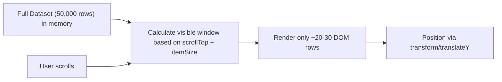

### Optimized Code Snippet
```jsx
import { FixedSizeList as List } from 'react-window';

function Row({ index, style, data }) {
  return <div style={style}>{data[index].name}</div>; // style positions the row
}

function BigTable({ items }) {
  return (
    <List
      height={600}
      itemCount={items.length}
      itemSize={35}
      itemData={items}
      width="100%"
    >
      {Row}
    </List>
  );
}
```

### Common Follow-Up Questions
- How do you virtualize a list with variable-height rows?
- How does virtualization interact with accessibility (screen readers navigating a list)?
- How would you combine virtualization with infinite scroll/pagination?

### Edge Cases & Pitfalls
- Browser "find on page" (Ctrl+F) and screen readers can't see unmounted rows — a real accessibility trade-off to weigh for content-heavy lists (search/docs) vs data-grid tools (dashboards).
- Variable row heights require more complex measurement logic (`VariableSizeList` or dynamic measurement) — naive fixed-size assumptions cause visual glitches.
- Losing scroll position or focus state on data updates if list keys aren't stable.

### Performance & Scalability Considerations
- Virtualization is the standard fix once row count crosses roughly a few hundred to a thousand, depending on row complexity — measure DOM node count and paint time, not just row count in isolation.
- Combine with pagination/infinite-scroll at the data-fetching layer for very large datasets that shouldn't be fully loaded into memory either.

### Best Practices
- Use `TanStack Virtual` or `react-window` rather than hand-rolling windowing logic.
- Provide accessible alternatives (e.g., a "jump to row" or search feature) when virtualizing content users would otherwise Ctrl+F.

### Trade-offs
- Virtualization adds implementation complexity and can complicate SEO/accessibility for content-style lists — appropriate for data-grid/dashboard UX, less ideal for indexable article/content lists.

### Interview Tips
- Mention the accessibility/Ctrl+F trade-off unprompted — it shows awareness beyond the "obviously faster" surface-level answer.

### Summary
List virtualization keeps DOM node count constant regardless of dataset size by rendering only the visible window of rows, solving the real bottleneck (DOM size, not React's diff) for large lists — at a deliberate cost to find-on-page and screen-reader traversal.

---

## 16. Component Architecture Patterns

**Q: Compare Compound Components, Render Props, and HOCs — when is each the right pattern today?**

> **Quick Answer:** **Compound Components** (e.g., `<Select><Select.Option/></Select>`) share implicit state via Context for flexible, composable UI; **Render Props** pass rendering control via a function-as-child for maximum flexibility; **HOCs** wrap a component to inject props/behavior. Hooks have replaced most HOC/render-prop use cases for *logic* reuse, but compound components remain the best pattern for *flexible composite UI* (like a `Tabs` or `Select`).

### Deep Technical Explanation
- **HOC** (`withAuth(Component)`): wraps and returns a new component; can cause "wrapper hell" and prop-name collisions; mostly superseded by custom hooks for logic sharing.
- **Render Props** (`<DataFetcher>{data => <List data={data}/>}</DataFetcher>`): flexible but verbose, and creates a function-as-child that's a new reference each render (perf consideration); largely replaced by custom hooks for the *data* aspect, but still useful when a *rendering decision* itself needs to be delegated.
- **Compound Components**: parent manages shared state (often via Context), children (dot-notation sub-components) consume it implicitly — ideal when a UI has interrelated parts (Tabs, Accordion, Select) that need to coordinate without prop-drilling every value through.

### Production Example
A design-system `<Tabs>` component: `<Tabs><Tabs.List><Tabs.Tab/></Tabs.List><Tabs.Panels><Tabs.Panel/></Tabs.Panels></Tabs>` — internal active-tab state lives in the `Tabs` root via Context, letting consumers freely rearrange/compose sub-parts without the root needing to know about every child explicitly.

### Architecture Diagram
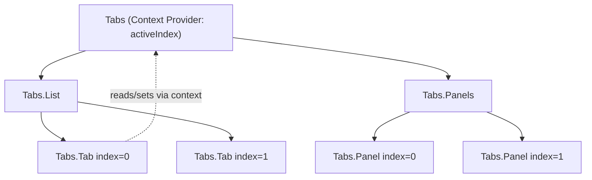

### Optimized Code Snippet
```jsx
const TabsContext = createContext(null);

function Tabs({ children, defaultIndex = 0 }) {
  const [activeIndex, setActiveIndex] = useState(defaultIndex);
  const value = useMemo(() => ({ activeIndex, setActiveIndex }), [activeIndex]);
  return <TabsContext.Provider value={value}>{children}</TabsContext.Provider>;
}

function Tab({ index, children }) {
  const { activeIndex, setActiveIndex } = useContext(TabsContext);
  return (
    <button
      aria-selected={activeIndex === index}
      onClick={() => setActiveIndex(index)}
    >
      {children}
    </button>
  );
}

Tabs.Tab = Tab;
// Usage: <Tabs><Tabs.Tab index={0}>Home</Tabs.Tab><Tabs.Tab index={1}>Profile</Tabs.Tab></Tabs>
```

### Common Follow-Up Questions
- Why have hooks largely replaced HOCs/render props for logic reuse but not for UI composition?
- What happens if a compound sub-component is rendered outside its parent's Context Provider?
- How would you make compound components type-safe in TypeScript?

### Edge Cases & Pitfalls
- Compound components rendered without their required parent throw unclear errors unless you add a guard (`if (!context) throw new Error(...)`) in the child.
- HOC prop collisions when stacking multiple HOCs that inject similarly-named props.
- Render props causing an extra re-render layer if the render function isn't memoized.

### Performance & Scalability Considerations
- Compound components via Context re-render all consuming children on state change (same Context caveats as Topic 6) — fine for typically-small UI widgets like tabs/accordions, less so if compounded into huge lists.

### Best Practices
- Reach for compound components for flexible, multi-part UI widgets in a design system.
- Reach for custom hooks (not HOCs/render props) for sharing non-UI stateful logic.
- Add clear runtime errors when compound sub-components are misused outside their required parent.

### Trade-offs
- Compound components are more flexible but implicit (harder to statically see the full API surface than plain props) — good docs/TypeScript types matter more.

### Interview Tips
- Show you know *why* the industry moved from HOCs/render props to hooks (composition ergonomics, avoiding wrapper hell) rather than just naming all three patterns.

### Summary
Hooks have taken over most logic-reuse use cases once served by HOCs and render props, but compound components (state shared via Context between dot-notation sub-components) remain the best pattern for building flexible, composable UI widgets in a design system.

---

## 17. Forms at Scale

**Q: How do you architect complex, high-performance forms in React (validation, large field counts, async validation)?**

> **Quick Answer:** Use an **uncontrolled-first** form library (React Hook Form) that subscribes individual fields to updates via refs rather than re-rendering the whole form tree on every keystroke, layer schema-based validation (Zod/Yup) for type-safe, declarative rules, and debounce/async-validate only where truly needed (e.g., username availability).

### Deep Technical Explanation
Fully "controlled" forms (every field's value in React state) re-render the entire form component on every keystroke — fine for small forms, painful at 50+ fields (see Topic 14). React Hook Form instead registers fields via refs (uncontrolled by default) and only re-renders on submit/validation events, subscribing individual field components to their own state slice — dramatically reducing re-render count on large forms.

### Production Example
A multi-step insurance quote form with 80+ fields across steps: switching from a fully-controlled `useState`-per-field implementation to React Hook Form with Zod schema validation cut re-renders per keystroke from "entire form" to "single field," fixing visible input lag reported by users on lower-end devices.

### Architecture Diagram
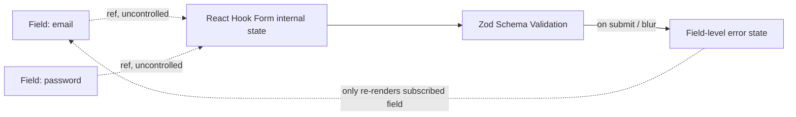

### Optimized Code Snippet
```jsx
import { useForm } from 'react-hook-form';
import { zodResolver } from '@hookform/resolvers/zod';
import { z } from 'zod';

const schema = z.object({
  email: z.string().email(),
  password: z.string().min(8),
});

function SignupForm() {
  const { register, handleSubmit, formState: { errors, isSubmitting } } =
    useForm({ resolver: zodResolver(schema) });

  const onSubmit = async (data) => { await api.signup(data); };

  return (
    <form onSubmit={handleSubmit(onSubmit)}>
      <input {...register('email')} />
      {errors.email && <span>{errors.email.message}</span>}

      <input type="password" {...register('password')} />
      {errors.password && <span>{errors.password.message}</span>}

      <button disabled={isSubmitting}>Submit</button>
    </form>
  );
}
```

### Common Follow-Up Questions
- Why is an uncontrolled approach faster for large forms than fully controlled `useState` per field?
- How would you implement debounced async validation (e.g., "is this username taken?")?
- How do you handle deeply nested/dynamic field arrays (add/remove rows)?

### Edge Cases & Pitfalls
- Async validation (API calls) firing on every keystroke without debouncing — hammers the backend and creates race conditions (a slow earlier request resolving after a faster later one).
- Losing accessibility (error announcements) when custom-styling validation messages — must use `aria-invalid`/`aria-describedby` correctly.
- Schema/validation logic duplicated between client and server, drifting out of sync — sharing a schema (e.g., Zod) across client/server when the stack allows it avoids this.

### Performance & Scalability Considerations
- Uncontrolled, ref-based field registration scales to very large forms far better than per-field `useState`.
- Debounce async validators (typically 300-500ms) and cancel in-flight requests on new input to avoid race conditions.

### Best Practices
- Centralize validation rules in a schema (Zod/Yup) shared with the submit-time payload shape.
- Validate on blur/submit rather than on every keystroke for less naggy UX, reserving live validation for specific high-value fields (password strength).
- Ensure accessible error association (`aria-describedby`) for every field-level error.

### Trade-offs
- Uncontrolled form libraries are less "obviously React-y" (relying on refs) which can feel unfamiliar to teams used to fully controlled state — the performance win is usually worth the adjustment past a handful of fields.

### Interview Tips
- Tie the answer back to the re-render/state-colocation concepts from Topic 14 — interviewers like seeing you connect concepts across the interview rather than treating each question in isolation.

### Summary
High-performance forms at scale favor uncontrolled, ref-based field registration (React Hook Form) with schema-based validation over per-keystroke controlled state, minimizing re-renders while keeping validation declarative and type-safe.

---

## 18. SSR Hydration & Mismatches

**Q: What causes hydration mismatches in SSR React apps, and how do you prevent/debug them?**

> **Quick Answer:** Hydration mismatches happen when the server-rendered HTML doesn't match what the client would render on first pass — usually from environment-dependent values (`Date.now()`, `window`, locale-dependent formatting, random IDs) or `Math.random()` calls that differ between server and client execution.

### Deep Technical Explanation
Hydration reuses the server-rendered DOM and attaches event listeners/state rather than re-creating markup — React compares what it *would* render against the existing DOM. If they differ, React logs a warning and re-renders client-side to reconcile (in the affected subtree), causing a flash of content change and wasted work. Common root causes: `typeof window !== 'undefined'` branches that render differently server vs client, timezone/locale-dependent date formatting, and non-deterministic IDs generated fresh on each render.

### Production Example
A dashboard showing "time since last login" formatted via `new Date().toLocaleString()` rendered a different string on the server (UTC, server timezone) than the client (user's local timezone) — every page load logged a hydration mismatch warning and briefly flashed the wrong time before correcting; fixed by rendering the raw timestamp on the server and formatting it client-side only after mount, or using a consistent, timezone-explicit formatter.

### Architecture Diagram
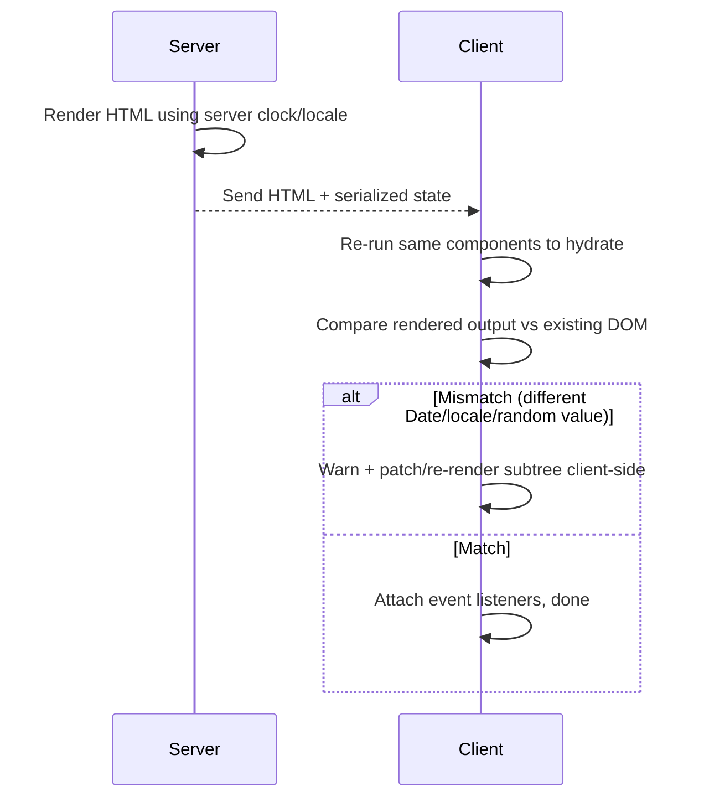

### Optimized Code Snippet
```jsx
// BAD: renders differently on server vs client
function LastLogin({ timestamp }) {
  return <span>{new Date(timestamp).toLocaleString()}</span>; // locale/timezone differs
}

// GOOD: render raw/stable value on server, format after mount client-side
function LastLogin({ timestamp }) {
  const [formatted, setFormatted] = useState(null);

  useEffect(() => {
    setFormatted(new Date(timestamp).toLocaleString()); // client-only formatting
  }, [timestamp]);

  return <span>{formatted ?? new Date(timestamp).toISOString()}</span>;
}
```

### Common Follow-Up Questions
- Why does React prefer patching over fully discarding server HTML on a mismatch?
- How would you use `useId` to avoid ID-mismatch hydration warnings?
- What's the purpose of `suppressHydrationWarning`, and why should it be used sparingly?

### Edge Cases & Pitfalls
- Browser extensions injecting DOM attributes before hydration (a false-positive mismatch source outside your control) — usually safe to ignore/suppress narrowly.
- Conditionally rendering based on `typeof window !== 'undefined'` directly in render output (rather than via `useEffect`), guaranteeing a server/client difference.
- Using `Math.random()` or `Date.now()` to generate keys/IDs during render.

### Performance & Scalability Considerations
- Frequent hydration mismatches cause extra client-side re-renders across a page, negating some of SSR's perceived-performance benefit — worth monitoring via console warnings in staging/CI, not just production bug reports.

### Best Practices
- Use React's `useId` hook for stable, SSR-safe unique IDs instead of custom random-ID generation.
- Defer environment-specific rendering (locale-formatted dates, `window`-dependent UI) to post-mount `useEffect`.
- Treat hydration-mismatch console warnings as build-blocking in CI where feasible.

### Trade-offs
- Deferring client-only content to post-mount avoids mismatches but introduces a brief "loading"/blank state for that content — an intentional trade rather than a free fix.

### Interview Tips
- Naming concrete root causes (Date/locale, `window` checks, random IDs) rather than a vague "server and client rendered differently" shows hands-on SSR debugging experience.

### Summary
Hydration mismatches stem from non-deterministic or environment-dependent render output between server and client — fixed by deferring such content to post-mount effects, using `useId` for stable identifiers, and treating mismatch warnings as real bugs to fix, not noise to ignore.

---

## 19. Security in React Applications

**Q: What are the main security considerations specific to React applications, and how does React's default behavior help/hurt?**

> **Quick Answer:** React escapes values rendered via JSX by default (preventing basic XSS), but `dangerouslySetInnerHTML`, unsanitized third-party libraries, URL-based attacks (`javascript:` hrefs), and client-side secrets/dependency vulnerabilities remain real risks that React doesn't protect against automatically.

### Deep Technical Explanation
JSX text interpolation (`{userInput}`) is auto-escaped, converting `<script>` to inert text — this blocks the most naive XSS. But `dangerouslySetInnerHTML` bypasses this entirely and must be paired with a sanitizer (DOMPurify) if the HTML source isn't fully trusted. React also doesn't protect against: XSS via user-controlled `href`/`src` attributes using `javascript:` URIs, insecure dependency supply-chain risks (a compromised npm package running in every user's browser), or storing sensitive tokens in `localStorage` (accessible to any injected script, unlike `httpOnly` cookies).

### Production Example
A comment/rich-text feature rendering user-submitted HTML via `dangerouslySetInnerHTML` without sanitization allowed a stored XSS attack (a malicious `` payload) — fixed by sanitizing all user HTML through DOMPurify server- and client-side before render, plus a Content-Security-Policy header restricting inline script execution as defense-in-depth.

### Architecture Diagram
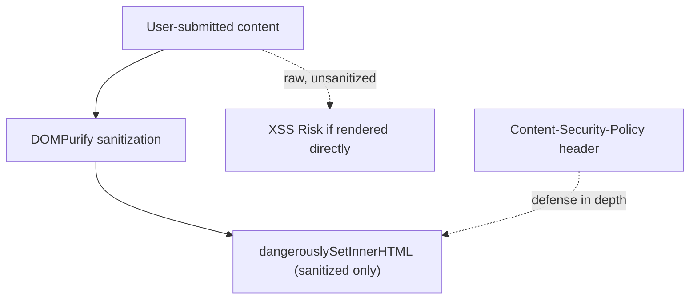

### Optimized Code Snippet
```jsx
import DOMPurify from 'dompurify';

function RichComment({ html }) {
  const clean = useMemo(() => DOMPurify.sanitize(html), [html]);
  return <div dangerouslySetInnerHTML={{ __html: clean }} />;
}

// Guard against javascript: URI XSS in user-supplied links
function SafeLink({ href, children }) {
  const isSafe = /^https?:\/\//i.test(href);
  return isSafe ? <a href={href}>{children}</a> : <span>{children}</span>;
}
```

### Common Follow-Up Questions
- Why is storing an auth token in `localStorage` riskier than an `httpOnly` cookie?
- How does a Content-Security-Policy header add defense-in-depth beyond React's own escaping?
- How do you audit/mitigate third-party dependency vulnerabilities in a large React app (supply-chain risk)?

### Edge Cases & Pitfalls
- Assuming JSX auto-escaping means "React apps are immune to XSS" — it only covers text interpolation, not `dangerouslySetInnerHTML`, URL attributes, or unsafe third-party widgets.
- Embedding secrets/API keys in client bundles (anything shipped to the browser is fully readable).
- Trusting client-side-only validation for security-sensitive logic (must always be re-validated server-side).

### Performance & Scalability Considerations
- Sanitization (DOMPurify) has a real CPU cost for large/frequent rich-text content — cache sanitized output where content doesn't change often (e.g., memoize per comment ID).

### Best Practices
- Sanitize all user-generated HTML before `dangerouslySetInnerHTML`, both client- and ideally server-side.
- Prefer `httpOnly`, `Secure`, `SameSite` cookies for auth tokens over `localStorage`.
- Set a strict Content-Security-Policy and run automated dependency vulnerability scanning (`npm audit`, Snyk, Dependabot) in CI.

### Trade-offs
- Strict CSPs can break third-party embeds/analytics scripts — requires careful allowlisting rather than blanket application, needing ongoing maintenance as integrations change.

### Interview Tips
- Be specific about what React's default escaping does and doesn't cover — vague "React is secure by default" answers read as surface-level.

### Summary
React's JSX escaping blocks basic text-injection XSS, but real-world security requires sanitizing any `dangerouslySetInnerHTML` content, avoiding client-side secret storage, validating URLs, and layering CSP and dependency-scanning as defense-in-depth.

---

## 20. Accessibility (a11y) at Scale

**Q: How do you build and enforce accessibility across a large React component library/design system?**

> **Quick Answer:** Bake accessibility into shared primitive components (semantic HTML, ARIA roles/states, keyboard interaction, focus management) once in the design system rather than relying on every feature team to get it right individually, and enforce it via automated linting/testing (`eslint-plugin-jsx-a11y`, `axe-core`) in CI.

### Deep Technical Explanation
Accessibility bugs compound at scale: if a design system's base `Modal`, `Select`, or `Tabs` component mishandles focus trapping or keyboard navigation, every feature built on top inherits the bug. The highest-leverage a11y investment is correct semantics and interaction patterns in shared primitives (focus trap on modal open/close, roving `tabIndex` for composite widgets, proper `aria-*` state on custom controls) — not per-feature audits after the fact.

### Production Example
A custom `<Dropdown>` built from `<div>`s instead of a native `<select>`/`<button>` lacked keyboard support (arrow-key navigation, Escape to close, focus return to trigger on close) — screen-reader users couldn't operate it at all; fixing it once in the shared design-system component (proper `role="listbox"`/`role="option"`, roving focus, `aria-activedescendant`) fixed every feature using it simultaneously.

### Architecture Diagram
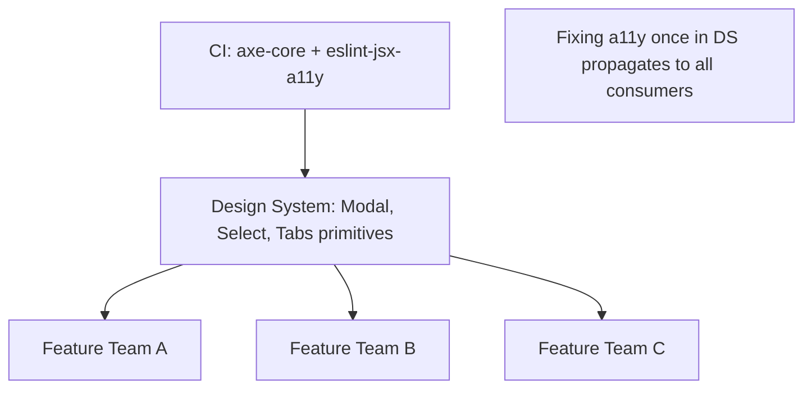

### Optimized Code Snippet
```jsx
function Modal({ isOpen, onClose, children, titleId }) {
  const ref = useRef(null);

  useEffect(() => {
    if (!isOpen) return;
    const previouslyFocused = document.activeElement;
    ref.current?.focus();

    function handleKeyDown(e) {
      if (e.key === 'Escape') onClose();
    }
    document.addEventListener('keydown', handleKeyDown);

    return () => {
      document.removeEventListener('keydown', handleKeyDown);
      previouslyFocused?.focus(); // return focus on close
    };
  }, [isOpen, onClose]);

  if (!isOpen) return null;
  return (
    <div role="dialog" aria-modal="true" aria-labelledby={titleId}
         ref={ref} tabIndex={-1}>
      {children}
    </div>
  );
}
```

### Common Follow-Up Questions
- What is a focus trap, and why does a modal need one?
- How does `axe-core` integrate into automated CI testing?
- What's the difference between `aria-label`, `aria-labelledby`, and `aria-describedby`?

### Edge Cases & Pitfalls
- Building custom interactive widgets from non-semantic `<div>`s instead of native elements, losing built-in keyboard/AT support "for free."
- Modals/drawers that don't trap focus, letting Tab escape to background content.
- Icon-only buttons with no accessible name (missing `aria-label`).

### Performance & Scalability Considerations
- Automated a11y checks (`jest-axe`, `axe-core` in CI, `eslint-plugin-jsx-a11y` at lint time) catch the bulk of common issues cheaply and scale across hundreds of components — manual audits alone don't scale to a large org.

### Best Practices
- Prefer native semantic HTML elements first; only build custom widgets with full ARIA + keyboard support when native elements truly can't do the job.
- Manage focus explicitly on route changes and modal open/close.
- Run automated a11y linting/testing in CI as a merge gate, not an optional nice-to-have.

### Trade-offs
- Full custom-widget accessibility (focus trapping, roving tabindex, live regions) takes real engineering time — investing it once in shared design-system primitives amortizes the cost across the whole org, which is the argument for centralizing it there rather than per-feature.

### Interview Tips
- Concrete keyboard/focus-management details (Escape closes modal, focus returns to trigger, arrow-key roving focus in composite widgets) demonstrate real hands-on a11y work, more than reciting "we use semantic HTML."

### Summary
Accessibility scales best when correct semantics, keyboard interaction, and focus management are solved once in shared design-system primitives and enforced automatically in CI, rather than relying on every feature team to reimplement it correctly.

---

## 21. Build Tooling & Bundle Optimization

**Q: How do you optimize a React app's build/bundle for production, and how do you decide between Webpack and Vite?**

> **Quick Answer:** Optimize via tree-shaking (ES modules + `sideEffects: false`), route/component-level code splitting, dependency auditing (avoid importing entire libraries for one function), and modern build tools (Vite's esbuild/Rollup pipeline) that offer much faster dev-server cold starts and HMR than traditional Webpack for most app sizes today.

### Deep Technical Explanation
Tree-shaking relies on static ES module analysis — importing `import { debounce } from 'lodash'` from a CommonJS build may pull in the entire library if the bundler can't statically determine unused exports; using `lodash-es` or per-function packages (`lodash.debounce`) avoids this. Vite serves source files over native ESM in dev (no bundling needed until production build), giving near-instant cold starts versus Webpack's dev-time bundling — a major DX win at scale, while production builds still go through Rollup for optimized, tree-shaken output.

### Production Example
A large dashboard app importing a full charting library's default export (200KB) when only one chart type was used — switching to named/sub-path imports (or a lighter chart lib) plus enabling `sideEffects: false` in `package.json` cut the vendor bundle significantly after verifying with `webpack-bundle-analyzer`.

### Architecture Diagram
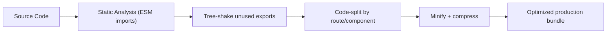

### Optimized Code Snippet
```js
// package.json — enables aggressive tree-shaking
{
  "sideEffects": false
}
```
```js
// BAD: may import the entire library depending on build config
import _ from 'lodash';
_.debounce(fn, 300);

// GOOD: named import from ESM build, or scoped package
import { debounce } from 'lodash-es';
debounce(fn, 300);
```
```js
// vite.config.js — basic production optimization
export default {
  build: {
    rollupOptions: {
      output: {
        manualChunks: {
          vendor: ['react', 'react-dom'],
        },
      },
    },
  },
};
```

### Common Follow-Up Questions
- Why is tree-shaking harder with CommonJS modules than ES modules?
- What's the practical difference between Vite's dev-server model and Webpack's?
- How do you set a bundle-size budget and enforce it in CI?

### Edge Cases & Pitfalls
- Marking `sideEffects: false` on a package that actually has side effects (e.g., CSS imports, polyfills) can silently strip needed code.
- Barrel files (`index.js` re-exporting everything) can defeat tree-shaking if the bundler can't prove individual exports are unused.
- Duplicate dependency versions bloating the bundle (e.g., two versions of a UI library) from inconsistent lockfile management in a monorepo.

### Performance & Scalability Considerations
- Set a bundle-size budget (e.g., via `bundlesize` or CI-integrated `webpack-bundle-analyzer` thresholds) so regressions are caught automatically per PR, not discovered post-release.
- Vite's native-ESM dev server scales dev-server startup/HMR speed far better than traditional Webpack as an app's source size grows.

### Best Practices
- Prefer ESM-first, per-function imports over full-library default imports.
- Analyze real bundle composition regularly, not just at initial setup.
- Split vendor code (React, design-system) into a separate long-term-cacheable chunk from app code that changes more often.

### Trade-offs
- Migrating a large legacy Webpack config to Vite has real migration cost (plugin compatibility, custom loader logic) — often justified for new projects or DX-starved teams, less clearly so for a stable, already-optimized large legacy build.

### Interview Tips
- Mention concrete tools (`webpack-bundle-analyzer`, `sideEffects: false`, manual chunking) rather than only high-level concepts — this signals hands-on build-optimization experience.

### Summary
Bundle optimization combines ESM-friendly tree-shaking, deliberate code splitting, dependency-import hygiene, and vendor-chunk separation — with Vite generally preferred for dev-server speed today, while both tools converge on Rollup-based, tree-shaken production output.

---

## 22. Server-State Synchronization (React Query / SWR)

**Q: Why do teams adopt React Query/SWR instead of putting API data in Redux, and how do they solve caching/synchronization?**

> **Quick Answer:** Server state is fundamentally different from client state — it's owned elsewhere, can go stale, and needs revalidation/deduplication/background-refresh logic. React Query/SWR implement the **stale-while-revalidate** pattern out of the box (cache key-based, automatic refetch on focus/reconnect, request dedup), which teams would otherwise hand-roll imperfectly in Redux.

### Deep Technical Explanation
React Query treats each unique `queryKey` as a cache entry with metadata (`staleTime`, `cacheTime`/`gcTime`, `isFetching`, `isStale`). On mount, if data exists and is within `staleTime`, it's served instantly from cache while (optionally) a background refetch runs — giving instant perceived loads with eventual consistency. It also **deduplicates** concurrent requests for the same key (multiple components requesting the same query at once trigger only one network call) and supports optimistic updates with automatic rollback on mutation failure.

### Production Example
A social feed app where multiple components (header notification count, feed list, profile page) all need the current user — React Query's cache + dedup means only one network request fires regardless of how many components call `useQuery(['user'])` simultaneously, and all three surfaces update coherently when a mutation invalidates that key.

### Architecture Diagram
```mermaid
sequenceDiagram
    participant CompA
    participant CompB
    participant Cache as React Query Cache
    participant API
    CompA->>Cache: useQuery(['user'])
    CompB->>Cache: useQuery(['user'])
    Cache->>API: single deduped fetch
    API-->>Cache: data
    Cache-->>CompA: data (shared)
    Cache-->>CompB: data (shared)
    Note over Cache: Mutation later calls invalidateQueries(['user'])
    Cache->>API: refetch
    API-->>Cache: fresh data
    Cache-->>CompA: updated
    Cache-->>CompB: updated
```

### Optimized Code Snippet
```jsx
function useUser() {
  return useQuery({
    queryKey: ['user'],
    queryFn: fetchCurrentUser,
    staleTime: 30_000,
  });
}

function useUpdateName() {
  const queryClient = useQueryClient();
  return useMutation({
    mutationFn: updateUserName,
    onMutate: async (newName) => {
      await queryClient.cancelQueries({ queryKey: ['user'] });
      const previous = queryClient.getQueryData(['user']);
      queryClient.setQueryData(['user'], (old) => ({ ...old, name: newName })); // optimistic
      return { previous };
    },
    onError: (err, newName, context) => {
      queryClient.setQueryData(['user'], context.previous); // rollback
    },
    onSettled: () => queryClient.invalidateQueries({ queryKey: ['user'] }),
  });
}
```

### Common Follow-Up Questions
- What does "stale-while-revalidate" mean in practice, and what problem does it solve for UX?
- How does request deduplication work when two components query the same key simultaneously?
- How do you handle optimistic updates and rollback on mutation failure?

### Edge Cases & Pitfalls
- Forgetting to invalidate/refetch related queries after a mutation, leaving stale UI in other parts of the app.
- Race conditions between an optimistic update and a slower in-flight refetch overwriting it — mitigated by `cancelQueries` before applying an optimistic update.
- Over-fetching due to overly short `staleTime` causing excessive background network chatter.

### Performance & Scalability Considerations
- Cache-key design (granularity of `queryKey`) determines dedup/invalidation precision — too coarse invalidates too much, too fine misses related updates.
- Background refetch-on-focus/reconnect keeps data fresh without manual polling logic, but should be tuned per data volatility to avoid unnecessary API load.

### Best Practices
- Use structured, hierarchical query keys (`['user', userId, 'posts']`) for precise invalidation.
- Set `staleTime` per query based on actual data volatility (e.g., near-static reference data vs. live notification counts).
- Prefer library-managed caching over hand-rolled Redux-based API-state duplication.

### Trade-offs
- Adds a dependency and a caching mental model the team must learn, but removes a large class of hand-rolled loading/error/cache-invalidation bugs that Redux-only approaches historically accumulated.

### Interview Tips
- Explicitly name "stale-while-revalidate" and describe request deduplication — these two mechanisms are what interviewers are checking you understand beyond "it fetches data for you."

### Summary
React Query/SWR solve server-state's unique lifecycle (staleness, deduplication, background revalidation, optimistic updates) far more robustly than hand-rolled Redux API state, which is why server state and client state are now treated as architecturally separate concerns.

---

## 23. Monorepo Architecture for React Apps

**Q: How do you structure a monorepo for multiple React apps/packages, and what problems does it solve at scale?**

> **Quick Answer:** A monorepo (via Nx, Turborepo, or Yarn/PNPM workspaces) lets multiple apps and shared packages (design system, utils, API client) live in one repo with **coordinated versioning, atomic cross-package commits, and build-graph-aware caching** — solving the "shared code drifts out of sync across separate repos" problem at the cost of needing proper tooling for incremental builds/tests.

### Deep Technical Explanation
Without a monorepo, a shared design-system package published to a private npm registry forces every consuming app to bump a version and re-test/deploy separately — changes propagate slowly and inconsistently. A monorepo lets a single PR update the design system **and** its consuming apps atomically, with tools like Nx/Turborepo computing a **dependency graph** so only affected packages/apps are rebuilt/retested (not the entire repo) — critical for CI time at scale.

### Production Example
A company with a `web`, `admin`, and `mobile-web` app all sharing a `ui-kit` and `api-client` package: a monorepo (Turborepo) lets a design-system bug fix land in one PR that automatically rebuilds/tests only the three consuming apps affected, with remote build caching skipping unchanged packages in CI entirely.

### Architecture Diagram
```mermaid
flowchart TD
    Repo["Monorepo Root"] --> Apps["apps/"]
    Repo --> Packages["packages/"]
    Apps --> Web[web]
    Apps --> Admin[admin]
    Packages --> UI[ui-kit]
    Packages --> API[api-client]
    Web --> UI
    Web --> API
    Admin --> UI
    Admin --> API
    CI["CI: Turborepo/Nx graph-aware build"] -.only rebuilds affected.-> Web
    CI -.only rebuilds affected.-> Admin
```

### Optimized Code Snippet
```json
// turbo.json — task pipeline with dependency-aware caching
{
  "pipeline": {
    "build": {
      "dependsOn": ["^build"],
      "outputs": ["dist/**"]
    },
    "test": {
      "dependsOn": ["build"],
      "outputs": []
    }
  }
}
```
```bash
# Only rebuilds/retests packages affected by the current change vs main
turbo run build test --filter=...[origin/main]
```

### Common Follow-Up Questions
- How does a monorepo tool determine which packages are "affected" by a given change?
- What's the difference between a monorepo and a "polyrepo with a shared published package"?
- How do you handle independent deployment cadences for apps that share a monorepo?

### Edge Cases & Pitfalls
- Without graph-aware tooling, CI naively rebuilds/tests everything on every change, negating the monorepo's efficiency benefit as the repo grows.
- Implicit cross-package coupling (importing internal files directly instead of through a package's public API) breaking encapsulation.
- Version-pinning conflicts between packages needing different major versions of a shared dependency.

### Performance & Scalability Considerations
- Remote caching (Nx Cloud, Vercel Remote Cache for Turborepo) shares build/test results across the whole team/CI, avoiding redundant recomputation of unchanged packages — a major CI-time win at scale.
- Affected-based CI (`--filter=...[main]`) keeps CI time roughly proportional to the size of a change, not the size of the whole repo.

### Best Practices
- Enforce package boundaries (public API only) via lint rules (e.g., Nx module boundaries) rather than relying on convention.
- Use remote/distributed caching in CI to keep build times flat as the monorepo grows.
- Keep shared packages (`ui-kit`, `api-client`) versioned and tested like real packages, even if not published externally.

### Trade-offs
- Monorepos centralize coordination benefits but require investment in tooling (build-graph awareness, caching, CI configuration) — a naive monorepo without that tooling can be *slower* in CI than well-managed separate repos.

### Interview Tips
- Mention *affected-based* builds and caching specifically — that's the technical detail that separates "we use a monorepo" from actually understanding why it scales.

### Summary
Monorepos solve cross-package drift and enable atomic shared-code changes, but their scalability depends entirely on graph-aware tooling (Nx/Turborepo) for affected-based builds and remote caching — without that, a monorepo can become slower than separate repos as it grows.

---

## 24. Migration Strategy: Class → Hooks → React 18/19

**Q: How would you plan and execute a large-scale migration from class components (or an older React version) to modern hooks-based React 18/19?**

> **Quick Answer:** Migrate incrementally, never as a big-bang rewrite — hooks and classes can coexist indefinitely in the same tree, so the strategy is to convert leaf/low-risk components first, establish shared custom hooks for common patterns, gate the whole migration behind strong test coverage, and use codemods for mechanical, high-volume conversions.

### Deep Technical Explanation
React explicitly supports classes and function components with hooks side-by-side with no interop issues — there is no technical urgency forcing a rewrite. The pragmatic strategy: (1) start with new features in hooks-based function components immediately, (2) convert components opportunistically when touched for other work ("boy scout rule"), (3) prioritize converting components blocking access to new features (e.g., needing `useDeferredValue`, Server Components which require function components), (4) use official/community codemods for mechanical, low-risk conversions (`react-codemod`), and (5) lean on strong test coverage (Topic 12) as the safety net, since RTL's behavior-focused tests survive the internal implementation swap from class to hooks unchanged.

### Production Example
A large legacy dashboard with 400+ class components: rather than a dedicated "rewrite everything" project (high risk, stalls feature work), the team mandated hooks for all new components, ran a codemod for simple presentational classes with only `render()` and no lifecycle methods, and manually converted complex stateful classes (with `componentDidUpdate` logic) only when those components needed a bug fix or feature touch anyway — completing the bulk of the migration over several quarters with zero dedicated "migration sprints."

### Architecture Diagram
```mermaid
flowchart TD
    A["Legacy Class Components (400+)"] --> B{Simple presentational, no lifecycle?}
    B -- Yes --> C[Automated codemod conversion]
    B -- No --> D{Touched for other work / blocks new feature?}
    D -- Yes --> E[Manual conversion to hooks, with RTL tests as safety net]
    D -- No --> F[Leave as-is, coexists fine with hooks components]
    C --> G[Hooks-based Component]
    E --> G
```

### Optimized Code Snippet
```jsx
// Before: class component with lifecycle methods
class UserProfile extends React.Component {
  componentDidMount() { this.fetchUser(); }
  componentDidUpdate(prevProps) {
    if (prevProps.userId !== this.props.userId) this.fetchUser();
  }
  fetchUser() { /* ... */ }
  render() { return <div>{this.state?.user?.name}</div>; }
}

// After: equivalent behavior in a function component + custom hook
function useUser(userId) {
  const [user, setUser] = useState(null);
  useEffect(() => {
    let cancelled = false;
    fetchUser(userId).then(u => { if (!cancelled) setUser(u); });
    return () => { cancelled = true; };
  }, [userId]);
  return user;
}

function UserProfile({ userId }) {
  const user = useUser(userId);
  return <div>{user?.name}</div>;
}
```

### Common Follow-Up Questions
- Can class components and hooks-based components coexist in the same render tree indefinitely? (Yes.)
- What React features are function-component-only (and thus force conversion for adoption) — e.g., Server Components, some concurrent hooks?
- How do you use codemods safely, and what do you still need to manually verify afterward?

### Edge Cases & Pitfalls
- Treating migration as a dedicated big-bang project that competes with and stalls feature roadmap work — usually a hard sell to leadership and high-risk.
- Codemodding complex stateful class components mechanically without understanding lifecycle-to-hook-effect semantic differences (e.g., `componentDidUpdate` running on every update vs. a `useEffect`'s dependency-array-gated re-run).
- Losing test coverage confidence during conversion — behavior-focused RTL tests (Topic 12) are what make this safe; implementation-detail tests would need rewriting anyway.

### Performance & Scalability Considerations
- No inherent performance difference between an equivalent class and hooks component — migration value is developer experience, composability, and unlocking function-component-only features, not raw runtime performance.

### Best Practices
- Default all new code to hooks-based function components immediately.
- Use the "boy scout rule" (convert what you touch) over dedicated migration sprints where feasible.
- Lean on codemods for mechanical, low-risk conversions; reserve manual effort for lifecycle-heavy, complex components.

### Trade-offs
- Incremental migration takes longer in calendar time than a big-bang rewrite would in theory, but carries far less delivery risk and doesn't block ongoing feature work — the standard trade senior engineers make deliberately.

### Interview Tips
- Emphasize that classes and hooks coexist with **no forced migration timeline** — many candidates incorrectly imply React deprecates classes, which it has not done.

### Summary
Class-to-hooks migration is best executed incrementally — new code in hooks, opportunistic conversion of touched components, codemods for mechanical cases, and strong behavior-based test coverage as the safety net — since React fully supports indefinite coexistence of both patterns.

---

## 25. React 19: Actions, `useOptimistic`, `use()`

**Q: What do React 19's Actions, `useOptimistic`, and the `use()` API change about how we handle forms and async data?**

> **Quick Answer:** React 19 introduces **Actions** (async functions passed to `<form action={fn}>` or transitions) that handle pending/error/optimistic states automatically, `useOptimistic` for declarative optimistic UI tied to an in-flight action, and `use()` — a new primitive that lets you read a Promise or Context conditionally, inside loops, unlike other hooks.

### Deep Technical Explanation
Previously, handling a form submission's pending/error/success state required manually wiring `useState` for `isSubmitting`/`error` around an async handler. **Actions** formalize this: passing an async function to a `<form action={...}>` (or to `useTransition`'s callback) gives you built-in pending state via `useFormStatus`, automatic error boundary integration, and automatic state reset. `useOptimistic(state, updateFn)` lets you show an optimistic value immediately while the real action is in flight, automatically reverting if it fails. `use()` is unique among "hook-like" APIs — it **can** be called conditionally/in loops because it doesn't rely on call-order state (Topic 3) the way traditional hooks do; it reads a resource (Promise/Context) directly, integrating with Suspense for promises.

### Production Example
A comment box where posting a comment immediately shows it in the list (optimistic, via `useOptimistic`) while the real network request completes in the background via a form Action — if the request fails, React automatically reverts the optimistic comment and surfaces the error, without hand-written `isSubmitting`/rollback plumbing.

### Architecture Diagram
```mermaid
sequenceDiagram
    participant User
    participant UI as Optimistic UI (useOptimistic)
    participant Action as Form Action (async fn)
    participant Server
    User->>UI: Submit comment
    UI->>UI: Show comment immediately (optimistic)
    UI->>Action: trigger action
    Action->>Server: POST /comments
    alt Success
        Server-->>Action: 200 OK
        Action-->>UI: Confirm real state
    else Failure
        Server-->>Action: Error
        Action-->>UI: Revert optimistic comment, show error
    end
```

### Optimized Code Snippet
```jsx
import { useOptimistic, useRef } from 'react';

function CommentBox({ comments, addComment }) {
  const [optimisticComments, addOptimisticComment] = useOptimistic(
    comments,
    (state, newComment) => [...state, { ...newComment, pending: true }]
  );
  const formRef = useRef(null);

  async function formAction(formData) {
    const text = formData.get('comment');
    addOptimisticComment({ id: Date.now(), text });
    formRef.current?.reset();
    await addComment(text); // real server action; reverts optimistic entry on throw
  }

  return (
    <>
      <ul>
        {optimisticComments.map(c => (
          <li key={c.id} style={{ opacity: c.pending ? 0.5 : 1 }}>{c.text}</li>
        ))}
      </ul>
      <form ref={formRef} action={formAction}>
        <input name="comment" />
        <button type="submit">Post</button>
      </form>
    </>
  );
}
```

### Common Follow-Up Questions
- Why can `use()` be called conditionally when `useState`/`useEffect` cannot?
- How does `useOptimistic` know how/when to revert on failure?
- How do Actions integrate with Error Boundaries and `useFormStatus`?

### Edge Cases & Pitfalls
- Assuming `use()` follows the Rules of Hooks like other hooks — it deliberately doesn't, but that also means misusing it (e.g., reading a Promise not managed by Suspense properly) has different failure modes to learn.
- Not handling the failure path of an Action, leaving the optimistic UI update unreverted or a silent failure.
- Overusing optimistic UI for actions with a meaningfully high failure rate, creating a jarring revert experience for users.

### Performance & Scalability Considerations
- Actions reduce boilerplate state management code, which indirectly reduces bug surface area (a common source of subtle re-render/stale-state bugs) rather than changing raw runtime performance.

### Best Practices
- Reserve `useOptimistic` for actions with high expected success rates and low-cost reverts (comments, likes) rather than high-stakes operations (payments) where a jarring revert is worse UX than a brief loading state.
- Pair Actions with Error Boundaries for robust failure handling.

### Trade-offs
- These APIs are newer (React 19) and require framework/toolchain support (form Actions especially shine with a compatible meta-framework) — adopting them in an older codebase may require broader upgrade work first.

### Interview Tips
- Highlighting that `use()` breaks the traditional Rules of Hooks *on purpose* (and explaining why that's safe for it specifically) is a strong signal of staying current with the latest React internals.

### Summary
React 19's Actions, `useOptimistic`, and `use()` formalize patterns teams previously hand-rolled (pending/error state, optimistic UI, conditional resource reading) directly into React's core APIs, reducing boilerplate and a whole class of manual state-management bugs around async UI.

---

## Quick-Reference Comparison Table

| # | Topic | Core Interview Signal |
|---|---|---|
| 1 | Virtual DOM & Reconciliation | Understands heuristic O(n) diffing assumptions, not just "VDOM is fast" |
| 2 | Fiber Architecture | Explains interruptible rendering as the basis for concurrency |
| 3 | Hooks Internals | Knows hooks are order-based, linked-list state per fiber |
| 4 | Custom Hooks | Designs stable, single-responsibility, testable hooks |
| 5 | Memoization | Knows *when memoization doesn't help*, not just the APIs |
| 6 | Context Pitfalls | Knows Context broadcasts to all consumers on any change |
| 7 | State Management at Scale | Categorizes state by lifecycle (local/client/server/URL) |
| 8 | RSC vs SSR vs CSR | Explains RSC ships zero JS, not just "renders on server" |
| 9 | Concurrent Rendering | Distinguishes reprioritization from actual speedup |
| 10 | Code Splitting | Grounds decisions in real bundle-analyzer data |
| 11 | Error Boundaries | Knows exactly what they don't catch |
| 12 | Testing Strategy | Favors behavior over implementation-detail assertions |
| 13 | Micro-Frontends | Frames as an organizational/Conway's Law solution |
| 14 | Performance Profiling | Narrates symptom → profiler evidence → fix → re-measure |
| 15 | List Virtualization | Notes the a11y/Ctrl+F trade-off unprompted |
| 16 | Component Patterns | Knows why hooks replaced HOCs/render props for logic |
| 17 | Forms at Scale | Connects uncontrolled forms to re-render/colocation concepts |
| 18 | Hydration Mismatches | Names concrete root causes (Date, locale, random IDs) |
| 19 | Security | Knows exactly what JSX escaping does/doesn't cover |
| 20 | Accessibility at Scale | Centers fixing a11y once in shared design-system primitives |
| 21 | Build Tooling | Cites concrete tools (bundle analyzer, sideEffects flag) |
| 22 | Server-State Sync | Explains stale-while-revalidate + request dedup precisely |
| 23 | Monorepo Architecture | Understands affected-based builds and remote caching |
| 24 | Migration Strategy | Knows classes/hooks coexist indefinitely, no forced timeline |
| 25 | React 19 Actions | Explains why `use()` breaks the Rules of Hooks on purpose |

---

## Final Interview Preparation Tips

> **Callout — What separates Senior/Staff answers from Mid-level answers:**
> - Mid-level answers name the *API*. Senior/Staff answers explain the *mechanism* and the *trade-off*.
> - Always be ready to say **when a technique doesn't help or actively hurts** — this is the single most reliable signal interviewers at this level look for.
> - Ground abstract concepts in a **real production story**: what broke, how you diagnosed it, what you changed, how you verified the fix.
> - Connect topics to each other (e.g., forms → re-renders → state colocation → profiling) — it shows systems thinking, not memorized flashcards.

**Summary:** This guide covers the 25 topics most likely to appear across FAANG, large product companies, and high-growth startups for a Senior (7+ years) React interview — from rendering internals (Fiber, reconciliation, hooks) through architecture at scale (state management, RSC, micro-frontends, monorepos) to production concerns (performance, security, accessibility, testing). Mastery here is less about memorizing APIs and more about being able to reason through trade-offs and tell concrete, evidence-based production stories.
